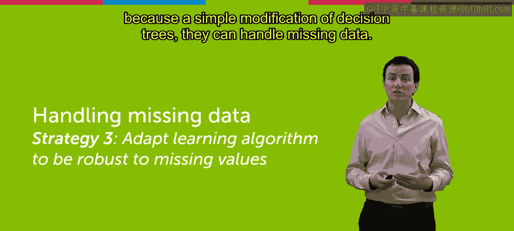
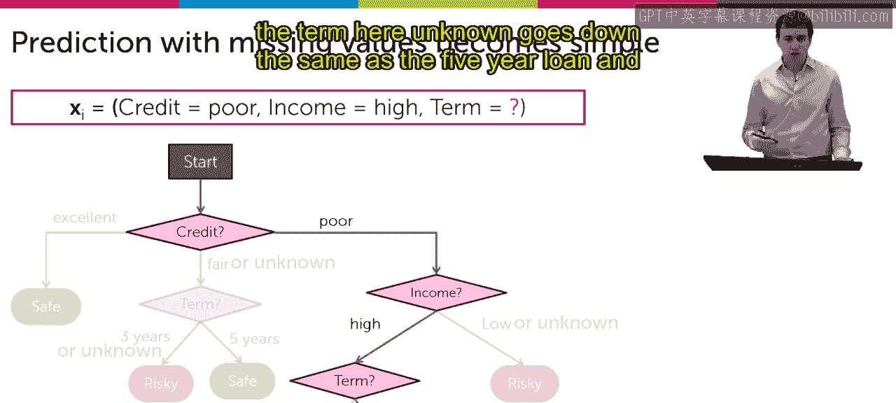
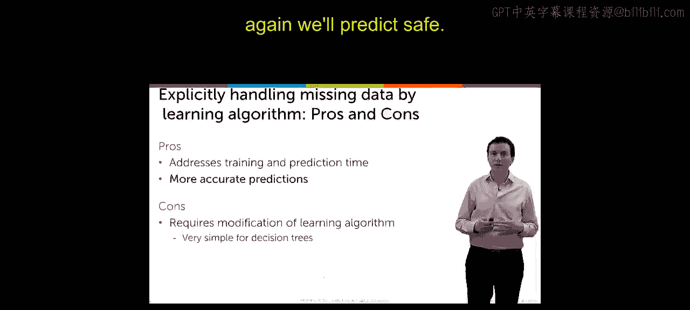
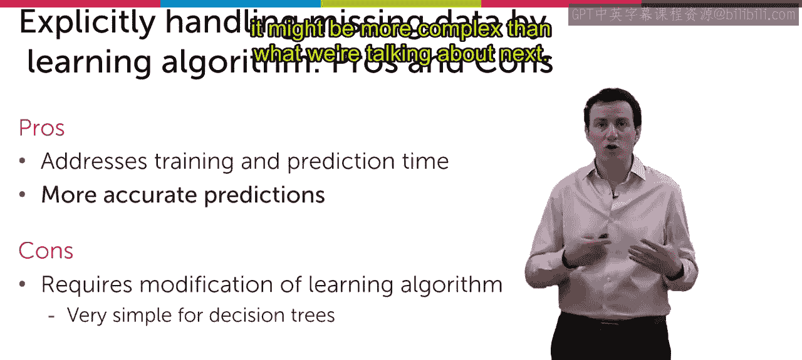
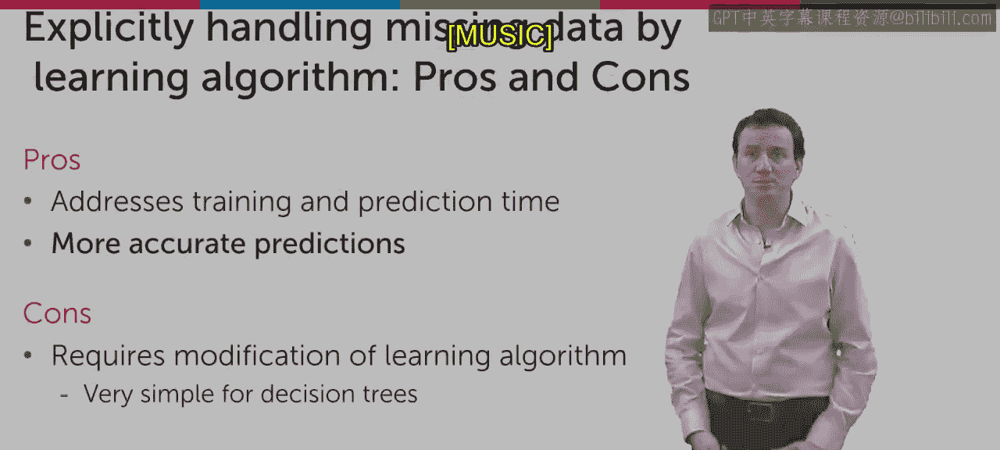

# 华盛顿大学《机器学习（分类，聚类和检索，第3-4课⧸共4课）｜Machine Learning》中英字幕 p82 81_修改决策树以处理缺失数据.zh_en -BV1Sr421F7N7_p82-

。

In my opinion， the best thing you can do to deal old missing data is to create， make your algorithm。

 machine learning algorithm robust to missing data。😊，In other words。

 making machine algorithm adapt to missing data and that's exactly what we're going to do in this particular module and we're going to do it in the context of decision trees because there's a simple modification to decision trees that can handle missing data。

😊。

So。How we're going to deal with missing data let's try to understand a little better what happened in the context of decision trees。

 so I had a simple XI where the credit was poor and income was unknown。

 I go down the decision tree I hit credit poor so I take the branch here。Poor， and then I hit income。

 but income was unknown。 incomee was question mark。 So what do I do then？

So we're going to do is assign a branch to follow when the data is unknown。

 when the value is unknown， and in this case I'm going to associate all unknown data， for example。

 with the branch where income was low， so if your income was unknown， take the branch low。

And from then， I'm just going to predict that this loan was risky so in other words。😊。

In now decision three， we're going to make explicit decisions as to where question marks or missing values。

 unknown values will go。We've introduced a decision to what happens when we hit an unknown value at this point of the decision tree。

 but we might hit unknown values any point of the decision tree。

 so we' to make decisions everywhere as to what should happen when we see unknown values So for every decision node we to choose one of its branch to observe。

The unknown values and notice that those going to be specific decisions we're going to make associated with every diamond node or every decision node in decision tree。

 so for credit， we're going to have the unknowns or question marks go into the fair branch for。

Income for organic credit equal poor and。We look at income。

 we're going to go down the low branch when credit equals poor and income is high， we look at term。

 and in this case when terms is equal to five years。

 we're going to put unknowns or the question marks in that five year branch， however。

take a note of this。 We might choose to say that when credit costs fair and we look at term。

 the unknowns in this case will go to the term cost three years。 so the decision that we make。

About where unknowns go does not need to be the same in different parts of the decision tree。

So we take different decisions here。About the question mark。Or unknowns。

And that's the beauty of the approach we're describing because we're going to optimize。

 just like we optimize the structure decision trees。

 we're going to optimize where the unknowns will go in order to minimize the classification error。😊。

Now， if we learn a tree like this and we're given an input， for example， where the credit is unknown。

 the income was high in the terms five years， we can go down the tree and traverse， well。

 the credit was unknown， the term was five years， so I'm going to predict it's a safe loan。😊。

while if I have another input where the credit is poor， the income is high in the term。

Was question mark， we're in a different branch of branch of the decision tree will go down credit poor income high and。

The term here， unknown goes down the same as the five year loan and again will predict safe。

In general， approaches that explicitly handle missing data in the algorithm itself can be quite helpful。

 they can help address。Missing data a training time and a prediction time and can make more accurate predictions in general。

 And we just talked about an example in decision trees。 The downside though。

 is that requires you to modify the actual learning algorithm to deal with missing data in the case of decision trees。

 I'm going to describe kind of a very simple modification that can make this happen。

 but this can be very complex for other algorithms。

 and even for decision trees you to make it really really good。

 it might be more complex than what we're talking about next。

 but the idea here is fundamentally important though。😊。

