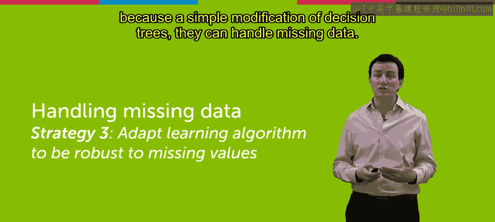
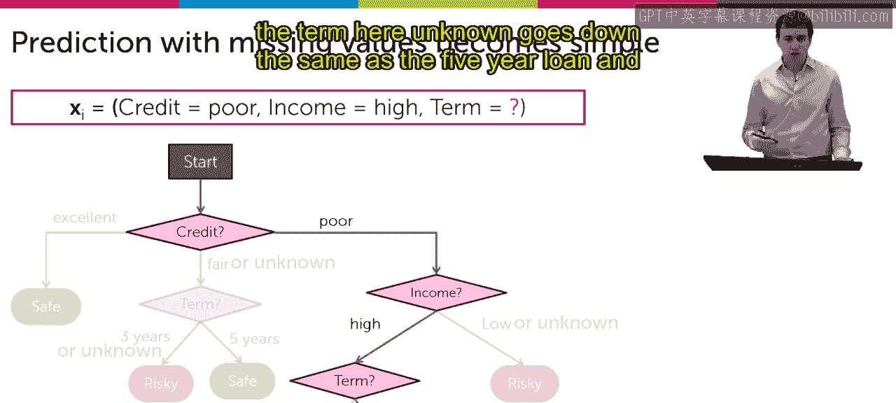
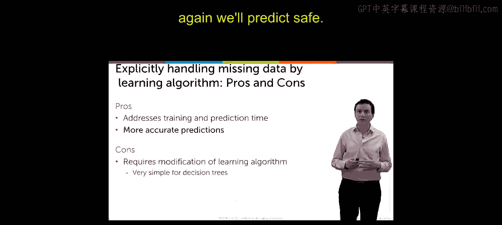
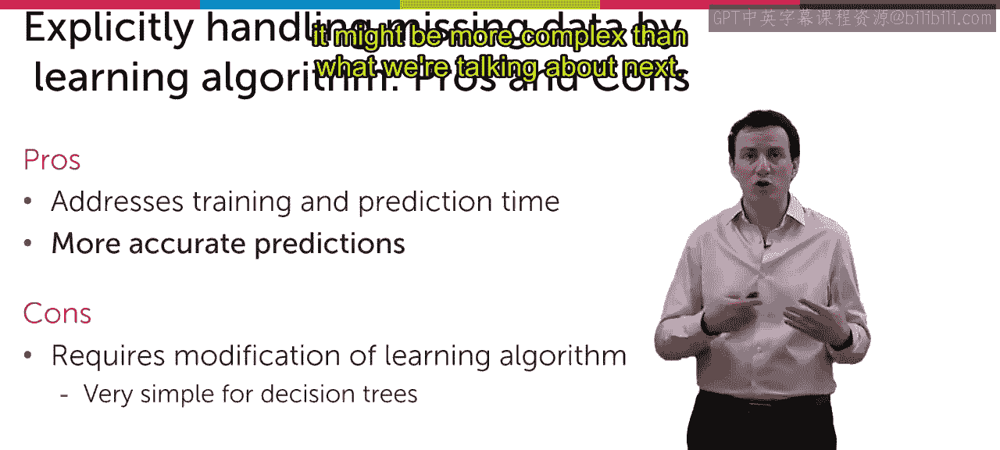
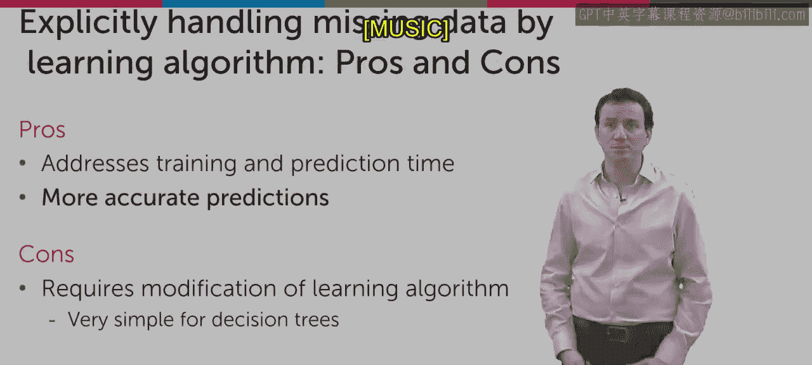

# 机器学习（分类，聚类和检索）：第3-4课：修改决策树以处理缺失数据 📊

在本节课中，我们将学习如何处理机器学习中一个常见且棘手的问题——缺失数据。我们将重点探讨如何通过修改决策树算法本身，使其能够直接适应并处理数据缺失的情况，从而构建出对缺失数据具有鲁棒性的模型。

上一节我们介绍了缺失数据带来的挑战，本节中我们来看看如何让算法本身学会处理缺失值。

## 处理缺失数据的最佳方法 💡

处理缺失数据的最佳方法是使你的机器学习算法对缺失数据具有鲁棒性。换句话说，就是让机器学习算法能够适应缺失数据。这正是我们在这个特定模块中要做的事情。我们将在决策树的背景下进行，因为对决策树进行一个简单的修改，就能处理缺失数据。

## 决策树如何处理缺失值？ 🌳

为了更好地理解如何在决策树中处理缺失数据，让我们看一个简单的例子。假设有一个输入样本，其“信用”为“差”，而“收入”未知。在决策树中，我们首先根据“信用=差”选择分支，然后到达“收入”判断节点，但“收入”值是未知的。此时我们该怎么办？

我们将采取的方法是：**为未知数据指定一个要遵循的分支**。当值未知时，我们明确决定它应该走哪条路。在这个例子中，我们可以将所有未知的“收入”数据都关联到“收入=低”这个分支。因此，如果你的收入未知，就走“低”分支，然后预测这笔贷款是“有风险”的。

## 在决策树中明确处理未知值 🔍

在修改后的决策树中，我们将明确决定问号或缺失值、未知值应该去向何处。我们引入了在决策树的这一点遇到未知值时的处理规则。但我们可能在决策树的任何一点遇到未知值，因此我们需要在所有地方都做出决定，规定当看到未知值时应该发生什么。

以下是具体的实施思路：

对于每一个决策节点，我们都需要选择它的一个分支来“接收”未知值。请注意，这些将是我们需要做出的、与决策树中每一个菱形决策节点相关联的具体决定。

例如：
*   对于“信用”节点，我们可以让未知值进入“一般”分支。
*   对于“收入”节点（在“信用=差”的前提下），我们可以让未知值进入“低”分支。
*   对于“期限”节点（在“信用=差”且“收入=高”的前提下），我们可以让未知值进入“5年”分支。

然而，关键点在于：**我们在决策树不同部分为未知值所做的决定不必相同**。例如，在“信用=一般”时查看“期限”，我们可能决定让未知值进入“3年”分支。这就是我们所描述方法的美妙之处——就像我们优化决策树的结构一样，我们也将**优化未知值的去向，以最小化分类错误**。

## 修改后决策树的预测过程 🚀

现在，如果我们学习了这样一棵树，并收到一个输入（例如，信用未知、收入高、期限5年），我们可以遍历这棵树进行预测：信用未知，根据规则走指定分支；期限是5年，最终预测为“安全”贷款。

同样，对于另一个输入（信用差、收入高、期限未知），我们会进入决策树的不同分支：信用差 -> 收入高 -> 期限未知（根据规则，等同于5年期贷款），再次预测为“安全”。

## 方法的优势与局限 ⚖️

总的来说，在算法本身中明确处理缺失数据的方法非常有用。它可以帮助解决训练时和预测时的缺失数据问题，通常能做出更准确的预测。我们刚刚讨论的就是决策树中的一个例子。

然而，这种方法的缺点是**需要你修改实际的学习算法**来处理缺失数据。对于决策树，我将描述一种可以实现这一点的简单修改。但对于其他算法，这可能非常复杂。即使对于决策树，要使其效果非常好，也可能比我们接下来要讨论的更复杂。但这里的基本思想至关重要。

## 总结 📝

本节课中，我们一起学习了如何通过修改决策树算法来处理缺失数据。核心思想是：在构建决策树的每个决策节点时，不仅优化基于已知特征的分支规则，同时**优化一个额外的规则**，即当该特征值缺失（未知）时，样本应该被分配到哪个分支。这种方法通过让算法主动适应数据的不完整性，增强了模型的鲁棒性，是处理缺失数据的一种有效策略。