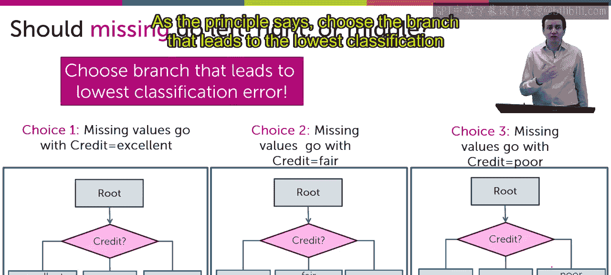
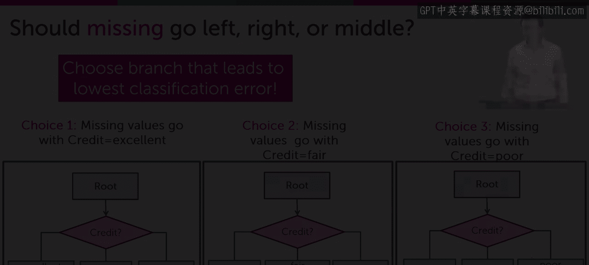
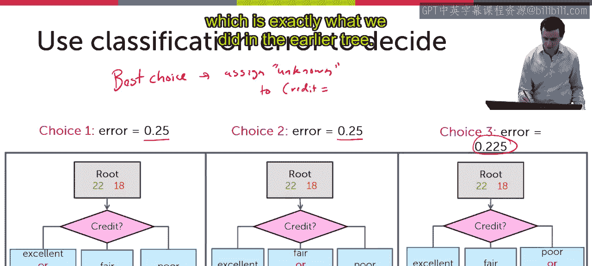
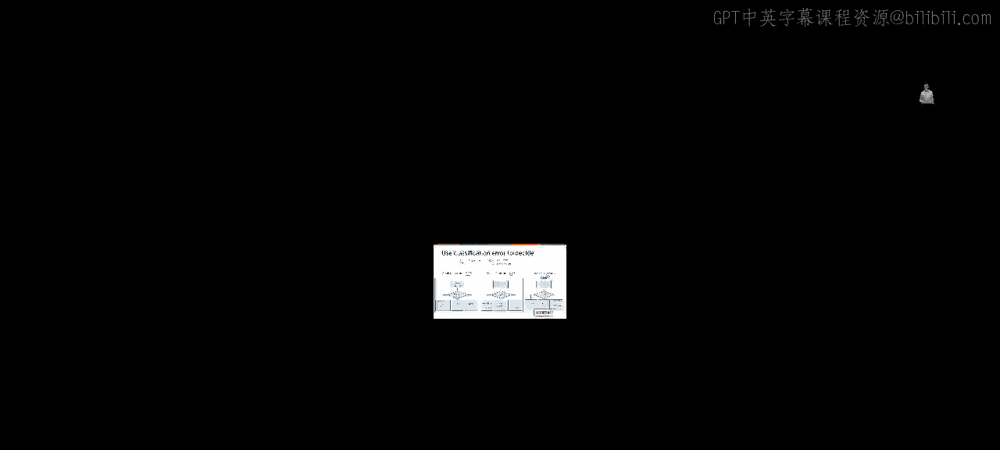
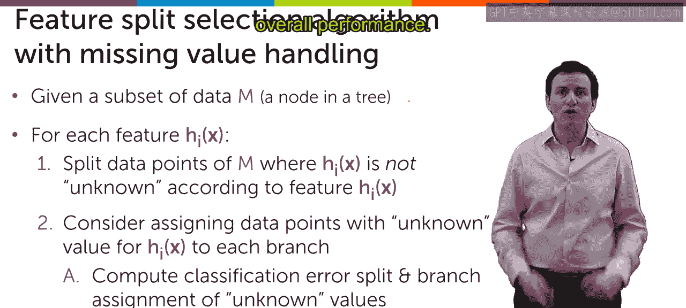

# 华盛顿大学《机器学习（分类，聚类和检索，第3-4课⧸共4课）｜Machine Learning》中英字幕 p83 82_有缺失数据时的特征分割选择.zh_en -BV1Sr421F7N7_p83-

。

The core decision tree algorithm is choosing the feature to split on。

 and that's the place we're going to modify to also choose what to do with that missing data。

Re the most important question in decision tree learning is figuring out what feature to split on。

And so now when we look at what features to split on。

 we're not just going to decide what feature to split on。

 but we're also going to decide which branch to take when we see a missing value。And so。Conceptally。

 it's just a very， very simple modificationification the algorithm we described in the previous module。

 but now we's going not this extra search to figure out where to put that missing data。😊。

Just like with greedity learning decisionion trees。

 we can just focus on learning a decisionion St to understand what's going on here。

 so we chose to split on credit， credit can be excellent fair or poor and the branch here on the right is the one where all the data points have credit costs poor。

And now we might decide that the missing data is going to go into that branch。

 so now we're going to take all the data that was missing and the data was for and feed it into that particular node。

That's also's going to happen with categorical data。😊，Now when we have numeric data。

 we're going to use those threshold splits that we discussed in the previous module。

 and in this case we my threshold income as less than $50，000 or greater than $50，000。

 and if we might decide that missing data or data where the income is unknown we're going to feed it to the same node where of those that the income was less than 50。

000。😊，That's the decisions that we're going to try to make inside of our learning algorithm。

Now we have to decide where missing date is going to go。

 so let's say that we choose to split on credit， we're considering splitting on credit。

If we consider splitting on credit， what should we do with the missing data。

 should we put it with people with X credit？😊，For people with fair credit or two people with poor credit。

I don't know what's best， but we have a principle for doling with this。As the principal says。

 choose the branch that leads to the lowest classification error just like we did before。

Let's say that were considering splitting on credit and we' consider assigning the missing data to the branch where the credit was excellent。

 let's see what happens so in this example we have three。Data points with missing data。

 this three here。And we're considering assigning those data points to the branch where the credit was excellent。

So we had two kinds of data， we had the observed data and in there we have in the Exxon branch we have nine safe loans and zero risky in the fair branch we have eight safe loans and four risky and in the poor branch we have four safe loans and 12 risky。

Now we have this three extra data points and in this three extra data points as you can see there's two risky and one save so we're thinking about adding the two risky and one save into the excellent branch so where the grand totals here the grand totals are。

10 saves and two risky inside the exxon branch and then the same for the other two branches because of not the Nxer data so what's the overall total error of the resulting decision tree well for the X branch we're going to predict save so we're going to make two mistakes。

For the fair branch。We're going to predict safe， so we're going to make four mistakes。

And for the poor branch we're going to predict risky and we're going to make four mistakes so overall we're going to make 10 mistakes and our total was 40 data points。

 so the total error here is 0 point。2，5，1 quarter。Now we do the same for every single option。

 every single branch， so we tried putting the unknown data with the accent and got error 0。

25 if we tried to put it with the fair branch， we get 0。25 error as well。

 but if we tried to put it with the。Last branch here with the poor branch we get an error of 0。

225 and so that's a lower error， so this is the winner， so the best thing to do。Would be。To。

Assign unknowns。To the poor branch。To。Credit。

Equals4。Which is exactly what we did in the earlier tree。

This is the modification of the tree splitting algorithm to take into account missing data。

It's a little you know complicated， but it's generally kind of simple idea we just described。

 you'll leave me here for a reference if you choose to implement it。

 but overall the fundamental concept is you can use this idea of embedding handling of missing data inside of the learning algorithm to get better overall performance。

😊。

。