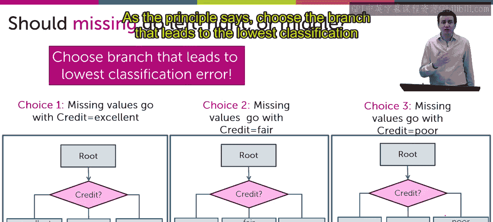
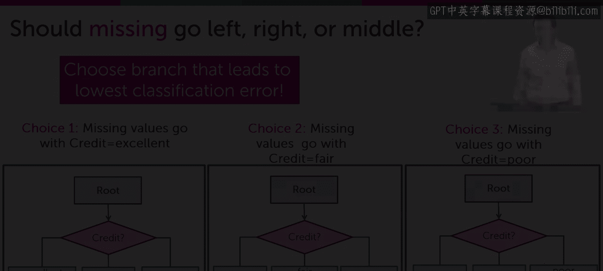
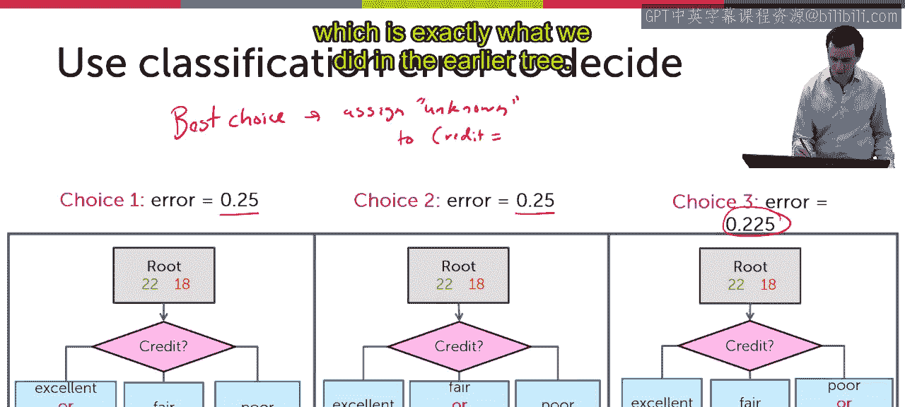
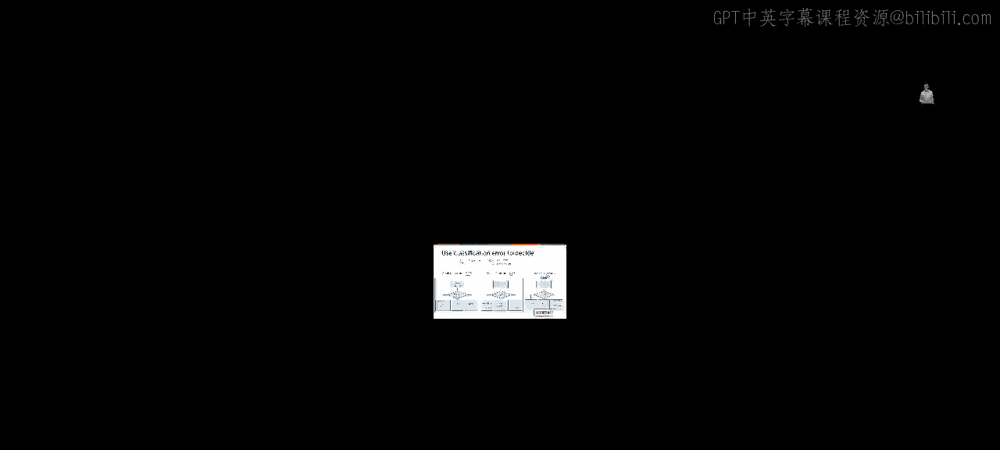
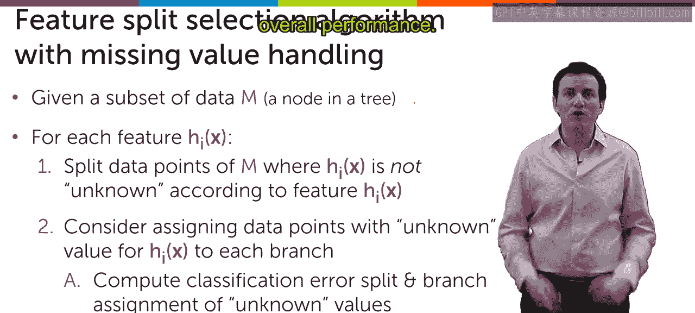

# 机器学习（分类，聚类和检索）：第3-4课：有缺失数据时的特征分割选择

在本节课中，我们将学习决策树算法如何处理数据集中存在缺失值的情况。核心在于修改特征选择过程，使其同时决定如何处理缺失数据。

## 🎯 核心算法修改

决策树算法的核心是选择用于分割的特征。我们将修改此处，使其也能决定遇到缺失数据时如何处理。

决策树学习中最重要的问题是确定使用哪个特征进行分割。现在，当我们考虑选择哪个特征时，不仅要决定分割特征，还要决定当遇到缺失值时，数据应流向哪个分支。

从概念上讲，这只是对上一模块描述的算法进行一个非常简单的修改。但现在，我们需要进行额外的搜索，以确定缺失数据的去向。

## 🌳 决策树中的缺失数据处理

与贪婪学习决策树一样，我们可以专注于学习一个决策树来理解这里的情况。

例如，我们选择按“信用”特征进行分割。信用等级可以是“优秀”、“一般”或“差”。右侧的分支是所有信用等级为“差”的数据点。

现在，我们可能决定将缺失数据放入该分支。因此，我们将把所有缺失数据（以及“一般”信用等级的数据）送入该特定节点。

对于分类数据，处理方式类似。

对于数值数据，我们将使用上一模块讨论的阈值分割法。例如，我们可能以5万美元为阈值分割“收入”特征。我们可能决定将缺失或收入未知的数据，送入收入低于5万美元的那个节点。

这就是我们将在学习算法内部尝试做出的决策。

## 🔍 如何决定缺失数据的去向

我们必须决定缺失数据的去向。假设我们考虑按“信用”特征分割。如果考虑按“信用”分割，我们应该如何处理缺失数据？应该将其放入信用“优秀”的分支，还是“一般”的分支，或是“差”的分支？

我们不知道哪个最好，但我们有一个处理原则。该原则是：**选择能导致最低分类错误率的分支**，就像我们之前所做的那样。

让我们通过一个例子来说明。假设我们考虑按“信用”分割，并考虑将缺失数据分配给信用“优秀”的分支。

在这个例子中，我们有3个数据点缺失数据。我们考虑将这3个数据点分配到信用“优秀”的分支。

我们有两种数据：已观测数据和缺失数据。
*   在“优秀”分支中，已观测数据有9个安全贷款和0个风险贷款。
*   在“一般”分支中，有8个安全贷款和4个风险贷款。
*   在“差”分支中，有4个安全贷款和12个风险贷款。

现在，我们有这3个额外的缺失数据点，其中包含2个风险贷款和1个安全贷款。我们正考虑将这2个风险和1个安全贷款加入“优秀”分支。

因此，“优秀”分支的总计变为：10个安全贷款和2个风险贷款。其他两个分支的总计保持不变，因为没有新数据加入。

那么，结果决策树的总体错误率是多少？
*   对于“优秀”分支，我们将预测为“安全”，因此会犯2个错误。
*   对于“一般”分支，我们将预测为“安全”，因此会犯4个错误。
*   对于“差”分支，我们将预测为“风险”，因此会犯4个错误。

总体我们将犯10个错误，总数据点是40个。因此，总错误率是 `10 / 40 = 0.25`。

我们对每个选项、每个分支都进行同样的计算。
*   如果尝试将未知数据放入“优秀”分支，得到错误率0.25。
*   如果尝试放入“一般”分支，同样得到错误率0.25。
*   如果尝试放入“差”分支，我们得到错误率0.225。

0.225是更低的错误率，因此这是最优选择。所以，最好的做法是**将未知数据分配给信用“差”的分支**。这恰好与我们之前展示的树中所做的完全一致。

## 📝 算法总结

这是为考虑缺失数据而对树分割算法进行的修改。虽然描述起来有点复杂，但其核心思想很简单。

总结一下，本节课我们一起学习了如何在决策树学习中处理缺失数据。关键在于将缺失数据的处理嵌入到学习算法本身中。具体做法是，在选择最佳分割特征时，同时评估将缺失数据分配到每个可能分支所带来的分类错误率，并选择能使总体错误率最低的分配方式。这种方法可以提升模型的整体性能。