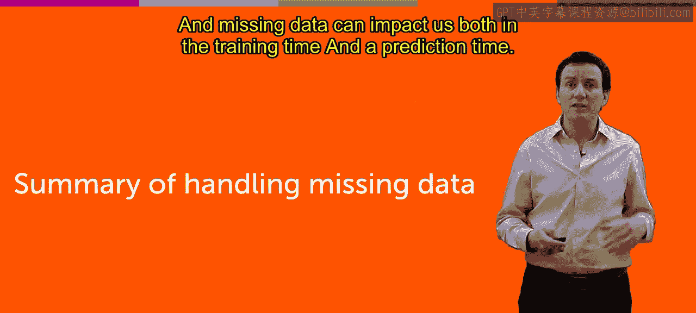

# 华盛顿大学《机器学习（分类，聚类和检索，第3-4课⧸共4课）｜Machine Learning》中英字幕 p84 83_处理缺失数据的回顾.zh_en -BV1Sr421F7N7_p84-

。

In this module we address a very fundamental concept。

 concept of having missing data that missing data can impact us both in the training time and a prediction time for both cases。

 we explored fundamental ideas that are useful for a wide range of algorithms。

 not just decision trees， we explore the idea of just skipping data points which has its benefits and pitfalls。

 the idea of trying to impute or guess what those missing values are and the idea of modifying the actual learning algorithm in particular with decision trees in order to better deal with missing data。

😊。

Now in practice you will often see missing data and you should be always in the lookout for missing data and sometimes that data comes in as you know weird values not just explicitly missing so for example。

 sometimes people put in zero when it's unknown and you might think it's zero but it's really unknown so you should always be in the lookout for missing data and you should always take it very carefully because it really impact the answers of your algorithm today we've seen some basic approach dealing with it。

 of course there are more advanced ones that you can get into but this is a fundamental area it should always be in the lookout for。

And let me close again by thanking my colleague， Krishna Sriar。

 who's really been instrumental in the creation of the slides and helping with the overall vision of this module。

。