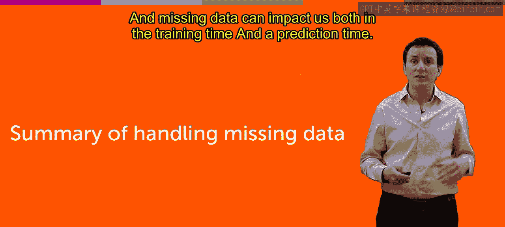

# 机器学习（分类，聚类和检索）：第3-4课：处理缺失数据的回顾

在本节课中，我们将要学习一个非常基础且重要的概念：如何处理数据集中的缺失值。缺失数据不仅会影响模型的训练过程，也会影响最终的预测结果。我们将探讨几种适用于多种算法的通用处理思路，而不仅仅是决策树。

## 缺失数据的影响

缺失数据是一个普遍存在的问题，它可能在模型训练时和后续进行预测时都对我们造成影响。对于这两种情况，我们都需要有相应的处理策略。

上一节我们介绍了缺失数据带来的挑战，本节中我们来看看几种基础的应对方法。这些核心思路具有广泛的适用性。

## 处理缺失数据的基本方法

以下是三种处理缺失数据的基础方法：

1.  **直接忽略**
    这种方法直接跳过包含缺失值的数据点。其优点是实现简单，但缺点是可能会丢失大量信息，特别是当缺失情况不是随机发生时，会导致模型产生偏差。

2.  **数据填补**
    这种方法试图估算或猜测缺失值是什么。常见的填补方式包括使用特征的平均值、中位数或众数，或者使用更复杂的模型进行预测。填补可以保留数据量，但填补的值可能不准确，从而引入噪声。

3.  **修改学习算法**
    这种方法通过调整算法本身来适应缺失数据。以决策树为例，我们可以修改其分裂规则，使其能够处理缺失值。例如，在计算信息增益时，可以按比例将缺失值样本分配到不同的子节点中。

## 实践中的注意事项

在实践中，你会经常遇到缺失数据，因此必须始终保持警惕。有时，缺失值会以“奇怪”的数值形式出现，而不仅仅是明确的空值。

例如，有时人们会用零（`0`）来表示未知，你可能会误以为它就是零，但实际上它代表的是缺失。因此，你必须仔细检查数据，并谨慎处理缺失值，因为它会严重影响算法结果的准确性。

今天我们学习了一些处理缺失数据的基础方法。当然，还有更高级的技术可以深入探索，但掌握这些基础是至关重要的，你应该在每次分析中都留意数据缺失的问题。

## 总结

本节课中我们一起学习了处理缺失数据的重要性与基本方法。我们回顾了忽略、填补和修改算法这三种核心策略，并强调了在实践中识别与谨慎处理缺失值的必要性。这是构建可靠机器学习模型的基础一步。

最后，再次感谢我的同事Krishna Sriar，他在本模块幻灯片的制作和整体构思中提供了至关重要的帮助。