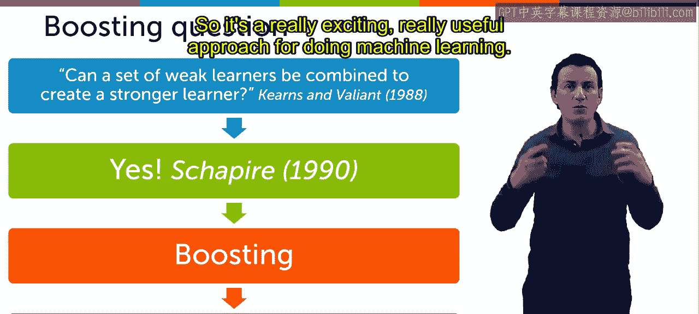

# 华盛顿大学《机器学习（分类，聚类和检索，第3-4课⧸共4课）｜Machine Learning》中英字幕 p85 84_提升问题.zh_en -BV1Sr421F7N7_p85-

。

We've now seen linear classifiers like logistic regression and we've also seen decision trees。

 which are great ways to build classifiers that fit data Now in this module we're going to talk about something called boosting which is an amazing kind of trick that you can do machine learning and applies to any classifier but it takes its quality or how well it fits data or its error and boost it make it better and better by combining multiple classifiers the approach we're going to discuss today has had amazing impact in the machine learning world it's pretty simple there's a little bit of math but not too bad。

 easy to implement and it's going to make a huge difference when you go into the real world data。😊。

The way we can think intuitively about boosting is that we start to work called weak classifiers。

 so these are things like a simple logistic reor shallow decision tree or maybe even decision stump and the question is what can we say about the simple classifiers or weak classifiers in general they have some good properties they have low variance so they tend not to overfi which is awesome however they tend to have high bias so they don't fit their data really well so decision stamp is not likely to give you really great accuracy and so if you look at the learning curves associated with such models let's say a logistic regression model。

😊，If you start with a very simple weak classifier you don't have very good fit to the data so high training error。

 but the training error decreases more and more and more features。

 however as we know the true error decreases and then increases as you start to overfit and our goal here is to find kind of this optimal tradeoff between bias and variance。

Now we know that weak classifiers are great because they have low bias。

 but we need something that's a little stronger in order to get good quality， low test error。

 and the fundamental question is how do we do that。

 how do we go from weak classifier to something that has lower error？

One approach is to add more features so for example。

 if we're using polynomial features in logistic regression we can add second order polynomials。

 third order polynoms， four four polynoms and so on。

 trying to avoid overfitting in decisionion tree we can go deeper and deeper in the decision tree。😊。

But the fundamental question here in Bu is is there something else that we can do that helps us improve our classifiers that takes this weak classifier and makes it a stronger classifier。

😊，This idea of boosting start of a beautiful mathematical conjecture。

 a question that currents a valiant pose in 1988， and the question was can we take weak classifiers。

 let's say decision stamps and boost them， combine them together multiple of them in some kind of voting schema in order to get a stronger classifier out of that。

😊，And amazingly， Rob Shapirri and others just a year or two later came up with an algorithm called boostting that really showed that this was possible。

 And this algorithm really changed all of machine learning。 In fact。

 it's had an amazing impact on the whole field。 It's a default approach for many computer vision tasks for many systems are deployed in industry today。

 for example， things that figure out what search results you do when you search for something on the search engine or what ads to show you when you you know visit a page or search something。

 So boostting has had tremendous impact has it's the technique that wins a lot of those machine learning competitions you might see out there。

 So there's a company called cargo that does a bunch of these competitions boosting wins more than half of those competitions。

 So it's a really exciting， really useful approach for doing machine learning。😊。

