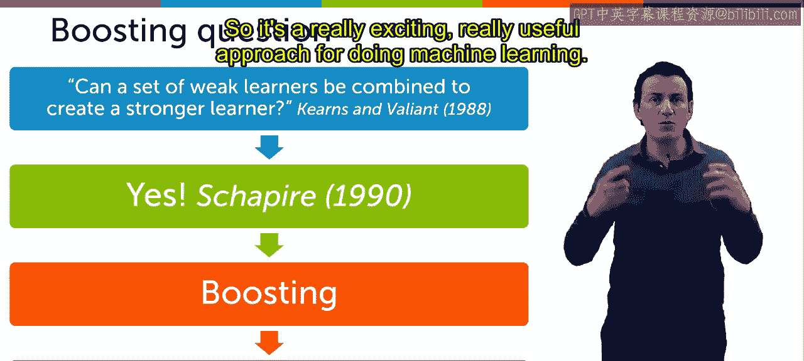

# 机器学习（分类，聚类和检索）：第3-4课：提升问题

## 概述
在本节课中，我们将要学习一种名为“提升”的机器学习技巧。提升方法能够将多个性能一般的“弱”分类器组合起来，形成一个性能更强的分类器。我们将探讨其背后的直观思想、核心算法及其在现实世界中的巨大影响力。

我们已经学习了像逻辑回归这样的线性分类器，也学习了决策树这种构建分类器以拟合数据的好方法。现在，在这个模块中，我们将讨论一种名为“提升”的方法。这是一种在机器学习中非常神奇的技巧，它可以应用于任何分类器。提升方法通过组合多个分类器，来提高其质量、数据拟合度或降低其错误率，使其变得越来越好。我们今天要讨论的方法对机器学习领域产生了惊人的影响。它相当简单，虽然涉及一点数学，但并不复杂，易于实现，并且当您处理现实世界数据时，它将带来巨大的改变。

## 从弱分类器到强分类器

我们可以直观地理解提升：我们从所谓的“弱分类器”开始工作。这些可以是简单的逻辑回归模型、浅层决策树，甚至可能是决策树桩。问题是，对于这些简单的或弱分类器，我们能说些什么？它们有一些好的特性：方差低，因此它们往往不会过拟合，这很棒。然而，它们往往有较高的偏差，所以它们不能很好地拟合数据。因此，决策树桩不太可能给你非常高的准确度。

如果你查看与此类模型相关的学习曲线，比如说逻辑回归模型，如果你从一个非常简单的弱分类器开始，你对数据的拟合度不会很好，所以训练误差很高。然而，随着你添加越来越多的特征，训练误差会越来越低。但正如我们所知，真实误差会先下降，然后在你开始过拟合时上升。我们的目标是在偏差和方差之间找到这种最优的权衡。

我们知道弱分类器很好，因为它们方差低。但为了获得高质量、低测试误差的结果，我们需要一些更强的东西。根本问题是：我们如何做到这一点？我们如何从弱分类器过渡到具有更低错误率的东西？

一种方法是添加更多特征。例如，如果我们在逻辑回归中使用多项式特征，我们可以添加二阶多项式、三阶多项式、四阶多项式等等，同时试图避免过拟合。在决策树中，我们可以让决策树越来越深。

但提升方法中的根本问题是：我们是否可以做些别的事情来帮助改进我们的分类器？是否有什么方法可以接受这个弱分类器并将其变成一个更强的分类器？

## 提升思想的起源与影响

这个提升的想法始于一个美妙的数学猜想。这是莱斯利·瓦利安特在1988年提出的一个问题。问题是：我们能否获取弱分类器，比如说决策树桩，并以某种投票方案将它们组合起来，从而从中得到一个更强的分类器？

令人惊讶的是，罗伯特·沙皮尔等人在仅仅一两年后就提出了一种名为“提升”的算法，真正证明了这是可能的。这个算法彻底改变了整个机器学习领域。事实上，它对整个领域产生了惊人的影响。它是许多计算机视觉任务的默认方法，也是当今工业界部署的许多系统的基础。例如，当你在搜索引擎上搜索某些内容时，决定显示什么搜索结果或显示什么广告的系统。因此，提升方法产生了巨大的影响，它是在许多机器学习竞赛中获胜的技术。有一家名为Kaggle的公司举办了许多这类竞赛，提升方法赢得了其中超过一半的比赛。所以，这是一种非常令人兴奋且非常有用的机器学习方法。

## 总结
本节课中，我们一起学习了提升方法的基本概念。我们了解到，提升是一种通过组合多个简单的“弱”分类器来构建一个强大分类器的技术。它巧妙地平衡了偏差与方差，从而显著提高了模型的性能。这种方法不仅在理论上优美，而且在实际应用和竞赛中都被证明极其有效，是机器学习工具箱中一个不可或缺的强大工具。