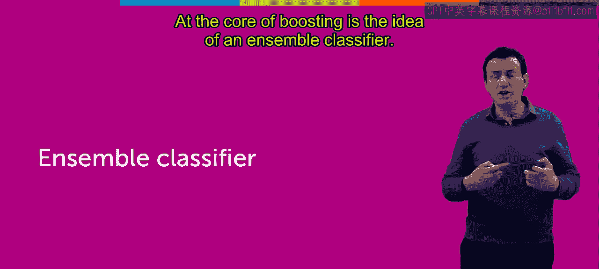
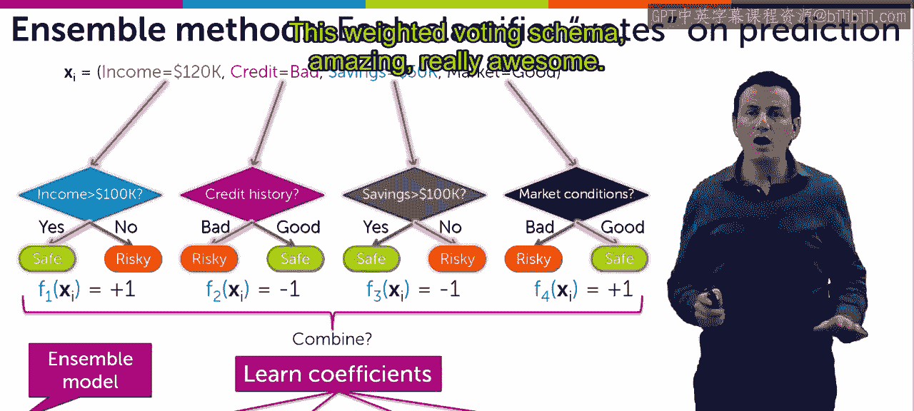
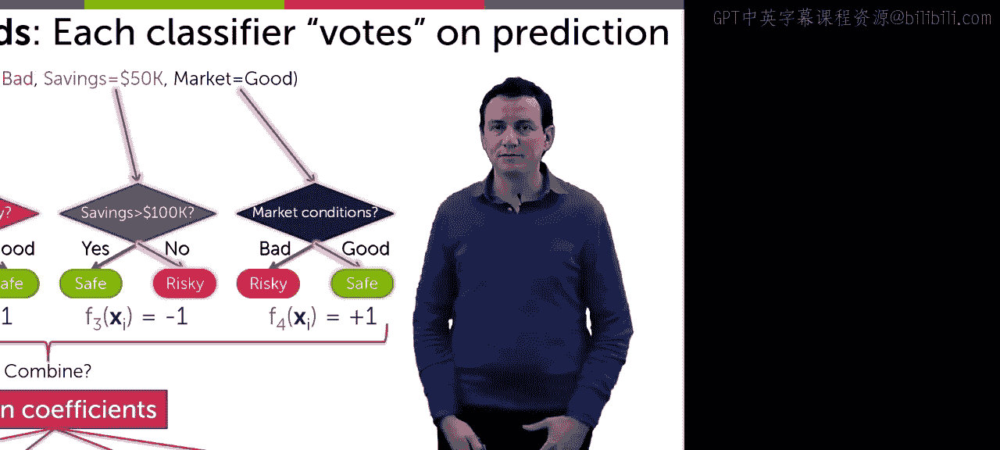
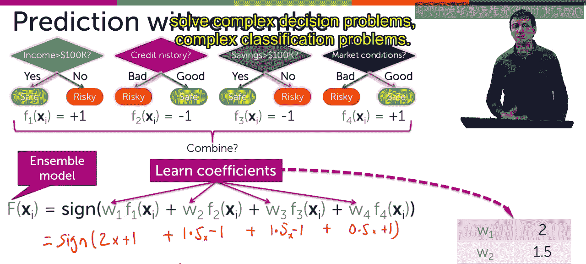
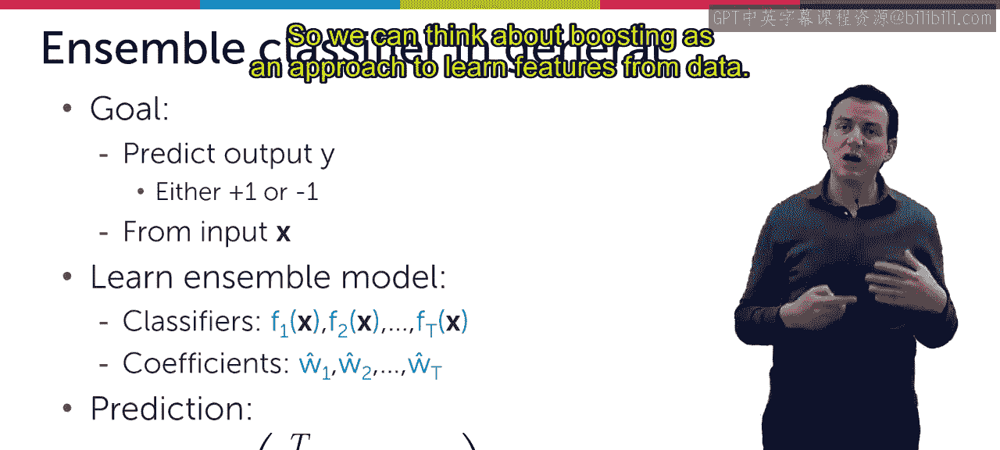
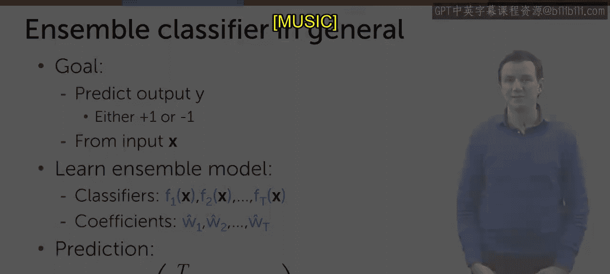

# 华盛顿大学《机器学习（分类，聚类和检索，第3-4课⧸共4课）｜Machine Learning》中英字幕 p86 85_集成分类器.zh_en -BV1Sr421F7N7_p86-

。

The core of boosting is the idea of an ensemble classifier so let's revisit the idea of say a decision stump。

 a decision st might take our data as input and might look at some particular feature。

 let's say income and ask is income greater than 100k if yes we say a loan is safe and if not we might say the loan is risky and so the output here y hat is plus1 or minus1 depending on whether we think the loan is safe or risky。

We're going to use the following notation just to be clear in today's module。

 we're going to use f of x to denote one of these weak simple classifiers or classifier in general。

 so that's the F。😊，And so what boosting does starts not just from a single decision stump。

But it combines many of them together in order to improve the prediction。So for example。

 we might have decision stamp splits on income， another one that splits on credit history。

 another one on how much savings you have on the market conditions and so。

 So if you're giving a particular input， for example。

 your income is 120 So the first decision boost here is going vote with F1 that the loan is safe。

 so it's going to vote plus1 but your credit history is bad。

 So the second decision stamp here is going to vote -1 F2 and say the third one because your savings are low is going vote risky minus-1 and the third one market conditions turn now to be good So you're gonna vote plus1 and the question here。

 the boosting asks is how do you combine in an ensemble way。

 this minus-1 plus1 votes from different classifiers F1 through F4 in this case。

 And so the way that we combine is by having some sort of weights。

The build work is called anassesemble models， so the weights here are W1， W2， W3， W4。

 and we multiply the outputs from each of the classifiers。

 add them up together and then take the signine of the activeive， the sign is positive。

 we output plus1， the sign is negative， we output minus1 so it's kind of a weighted  voltage schema。

This weighted voting schema。😊，Amazing， really awesome。

 and let's see a little bit more what that looks like。

So let's suppose that we have a particular set of weights and we have multiple decision stamps so classifiers that have provided theirvol。

 Let's see more explicitly what that output value would be。 So， for example。

 if the weights of each classifier are shown on the right here。

 then we're going to say that the output that we're going to predict is going to be the sign of w1。

 which is2。😊，They multiply the vote of F1， which is plus 1。Plus w2， which is 1。5。

 so we believe that the second decision Stump is not as important as the first one and the vote there was minus1。

So that multiplies minus-1。 then for the third one again， we say that the weight is 1。

5 and again we say it's not as important as the first one。

 but as important as the second one and the way the。

Prediction there was minus1 and finally for the last one we might say that the weight is 0。5。

 so this is the least important of all of these classifiers and the function here that the output of F4 here was plus1 was a safe log。

😊，So we have this vote， this weights， we multiply them together。

 and we see that the output of this capital F classifier for the input to X is the sine of minus 0。5。

 which is equal to。😊，Or implies that y hat I is minus1。

So even though there was two positive volts and two negative volts and the most important classifier。

 the first one was a positive volt。When you add it up and you average the results。

 you get a risky loan as an output。Now this is a simple example of what's called an ensemble classifier or the combination of multiple classifiers。

 as we'll see this kind of ensemble model， this kind of combination is what everybody uses in industry to be able to solve complex decision problems。

😊，Complex classification problems。

Just to make sure we're all on the same page， I'm going to just formally define the exampleem a learning problem。

 So we're giving some data where why is either plus1 or minus-1。

 there's also multiclass version of this。 we're just going talk about plus one or minus-1 in today's module and we have some input X。

 we have some data。That allows us to learn F1， F2 all the way to F capital T。

 which are the T we classifiers or just classifiers that we learn from data and there have some coefficients that we learn from data W hat 1。

 W hat2。On the way to W hat T and once we learn them making a prediction is very similar to what you do with logistic regression or linear classifier is just a sign of the weighted sum of the votets from each classifier and so if you look at this it looks a lot like a linear classification model logistic regression and all of those exactly the same however not only are we learning the Ws from data we're actually learning the features in those models we had ages to represent our features here the features these Fs which are the weak classifiers that we're going to learn from data so we can think about boosting as approach to learn features from data and it's really super exciting。

😊。

