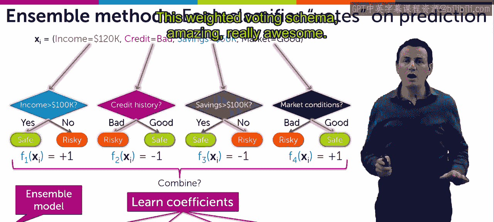
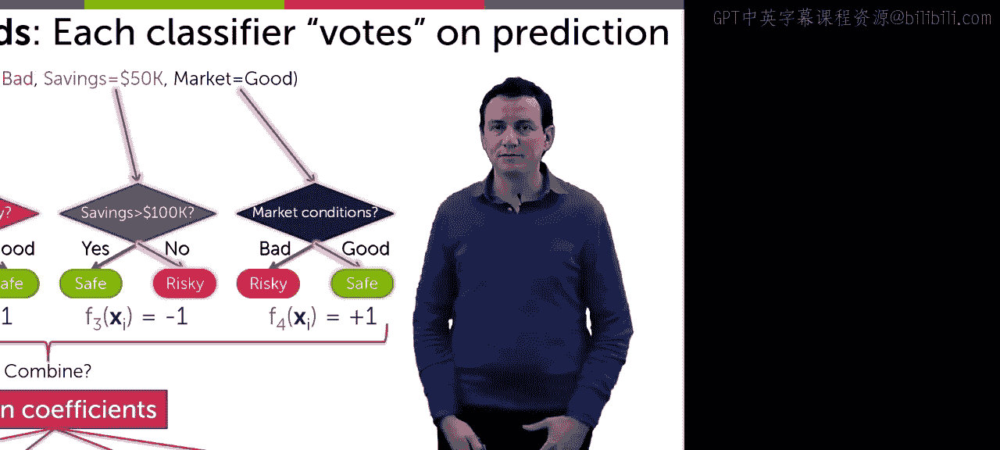
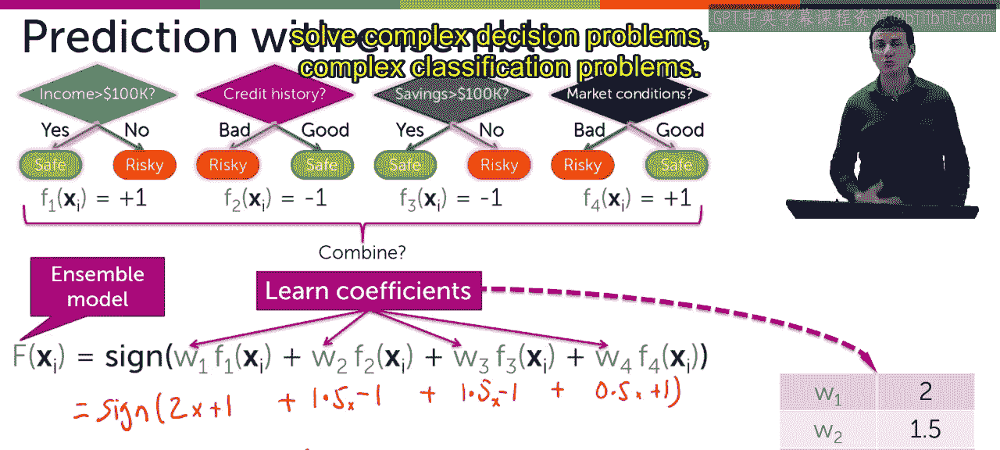
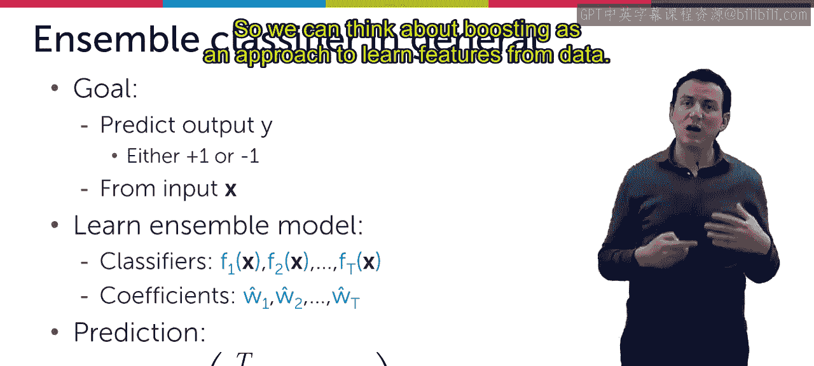
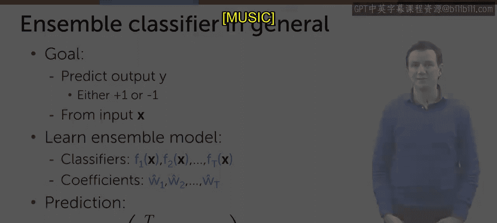

# 机器学习：第3-4课：集成分类器与提升法

在本节课中，我们将要学习集成分类器的核心概念，特别是提升法的基本思想。我们将了解如何组合多个简单的“弱”分类器来构建一个更强大的预测模型。

---

## 集成分类器的核心思想

上一节我们介绍了决策树桩等简单分类器。本节中我们来看看如何将它们组合起来。

提升法的核心是集成分类器的思想。让我们回顾一下决策树桩的概念。一个决策树桩将数据作为输入，并可能查看某个特定特征，例如收入。它会判断收入是否大于10万。如果是，则预测贷款安全；如果不是，则预测贷款有风险。因此，这里的输出 `y_hat` 是 `+1` 或 `-1`，取决于我们认为贷款是安全还是有风险。

为了在本模块中表述清晰，我们将使用以下符号：用 `f(x)` 表示一个简单的弱分类器或泛指的分类器。

提升法并非从一个单一的决策树桩开始，而是将许多这样的分类器组合在一起，以提高预测能力。例如，我们可能有基于收入进行分割的决策树桩，另一个基于信用历史，还有一个基于储蓄金额，再一个基于市场状况。

## 组合分类器的投票机制

上一节我们提到了多个分类器，本节中我们来看看如何整合它们的“投票”结果。

假设对于一个特定的输入（例如，你的收入是12万），第一个决策树桩 `F1` 将投票认为贷款安全（`+1`）。但你的信用记录不良，因此第二个决策树桩 `F2` 将投票认为有风险（`-1`）。第三个树桩因为你的储蓄较低，也投票有风险（`-1`）。第四个树桩由于市场状况良好，投票安全（`+1`）。提升法提出的问题是：如何以集成的方式组合来自不同分类器 `F1` 到 `F4` 的这些 `+1` 和 `-1` 投票？

组合的方式是为每个分类器分配权重。这种构建的模型称为集成模型。这里的权重是 `W1, W2, W3, W4`。我们将每个分类器的输出乘以其权重，然后将它们相加，最后取结果的符号。如果符号为正，则输出 `+1`；如果符号为负，则输出 `-1`。这是一种加权投票方案。

## 加权投票示例

为了更好地理解加权投票，让我们看一个具体的计算例子。

假设每个分类器的权重如右图所示。那么，我们预测的输出将是以下加权和的符号：
`sign(W1 * F1(x) + W2 * F2(x) + W3 * F3(x) + W4 * F4(x))`

代入具体数值：
*   `W1 = 2.0`，`F1` 投票为 `+1`。
*   `W2 = 1.5`，`F2` 投票为 `-1`。
*   `W3 = 1.5`，`F3` 投票为 `-1`。
*   `W4 = 0.5`，`F4` 投票为 `+1`。

计算加权和：
`2.0*(+1) + 1.5*(-1) + 1.5*(-1) + 0.5*(+1) = 2.0 - 1.5 - 1.5 + 0.5 = -0.5`

取符号：
`sign(-0.5) = -1`

因此，即使有两个正票和两个负票，并且最重要的分类器（第一个）投了正票，但加权平均后的最终输出 `y_hat` 是 `-1`，即预测为有风险的贷款。这是一个集成分类器的简单示例，这种组合方式是工业界用于解决复杂分类问题的常用方法。

## 形式化定义与类比

为了确保概念清晰，我们形式化地定义这个集成学习问题。

我们有一些数据，其中标签 `y` 是 `+1` 或 `-1`（本模块仅讨论二分类）。我们有输入 `x` 和数据，这使我们能够学习 `T` 个弱分类器 `F1, F2, ..., FT`，以及从数据中学到的系数 `Ŵ1, Ŵ2, ..., ŴT`。

一旦学会了这些，进行预测就类似于逻辑回归或线性分类器：它只是每个分类器投票的加权和的符号。

**公式表示：**
`F(x) = sign( Ŵ1 * F1(x) + Ŵ2 * F2(x) + ... + ŴT * FT(x) )`

如果你观察这个公式，它看起来很像线性分类模型或逻辑回归。然而，关键区别在于：我们不仅从数据中学习权重 `Ŵ`，实际上我们还学习这些“特征”——即这里的 `F`，它们是我们将从数据中学习的弱分类器。因此，我们可以将提升法视为一种从数据中学习特征的方法。

---

本节课中我们一起学习了集成分类器的基本概念，了解了提升法如何通过加权组合多个弱分类器来构建强分类器。我们看到了加权投票的具体计算过程，并将集成模型的形式与线性模型进行了类比，指出了其同时学习特征（弱分类器）和权重的特点。这是解决复杂机器学习问题的强大范式。