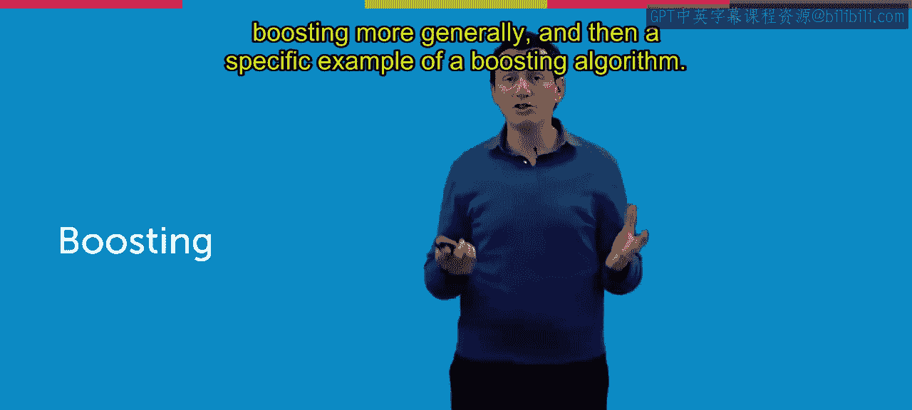
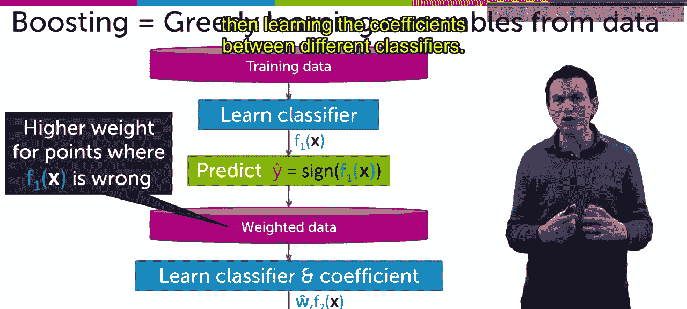

# 华盛顿大学《机器学习（分类，聚类和检索，第3-4课⧸共4课）｜Machine Learning》中英字幕 p87 86_提升.zh_en -BV1Sr421F7N7_p87-

。

So now let's dive in， now that we talked about unable models。

 let's dive in into boosting more generally and then a specific example of a boosting algorithm。

 so think about a learning problem where we take some data。

 we learn a classifier which gives us some output F of x and we use it to predict on some data so we say the Y heart is a sign of f of x。

😊。

So if we take some data and we try to make a prediction， we might learn。

 say a decision stop and so let's say you decide to split on income。

 we look at folks with income greater than 100000 folks with income less than 100000 and how do we learn the actual predictions that we make Well we look at the rows of our data the roseword income was greater than 100000 and we see that for those three were safe loans and one was a risky loan so we're gonna predict why hat cost safe and if look at incomes less than 100000 we'll see that we have four safe and three risky so again we predict save so both sides we're gonna to predict safe and so it turns out that we do this first decision stamp seems okay but it doesn't seem great on the data and so the decision stop wasn't enough to capture the information we needed on the data so what boosting on do take that decision stamp evaluated look at how well it's doing on our data and learn a next decision stamp and next we classifier and that next we could class。

I's going to focus on the data points where the first one was bad。So in other words。

 this is a very important point， in other words we're going to look at where we're making mistakes so far and we're going to increase。

 see the proportion of the impact or how much we care about the points。

 where we've made mistakes and we learn another classifier that takes care of the points where have made mistakes and then we learn another one。

 another one and eventually as we will see we'll actually converse to a great classifier。😊。

What does it mean to learn data points where we made mistakes？

What it means is that we're going to assign a weight alpha I to the positive number to every data point in our data set。

And that weight when it's higher， it means that data point is more important。

 so you can imagine a learning problem where we have data not just like we've done so far in this course。

 but we have data with weights associated with it and now we're going to learn from weight to data What does it mean to learn from weight to data the way to think about it is that those alpha I' correspond to。

😊，Kin of the data points counting more than one time if it's greater than one。 So， for example。

 if alpha is 2， you can think about it that data point is counting twice。

 that alpha was half you can think about a data point counting half of a data point。

 But everything you learning algorithm stays exactly the same。

 It's just that you instead of counting data points to count kind the weights of data points。😊。

Let's see what happens in our decision stampump approach。So we had that first decision on stamp。

 it was not great， especially for folks with lower income， and so we learned these weights。

 which are higher for the places we've made mistakes。And now we learn a new decision stamp。

 let's say again on split on comes again greater 10000 less than 100。

000 when we look at the classifications decisions that we make for greater 100000 what we do is we sum the weight of the data points to risky and the income was greater 10000 so in this case where sum 0。

5 1。2 sorry 0。50。8 and 0。7 which adds up to2 and then for the risky ones it's 1。

2 and so we're going to make a prediction the Y hat is safe so it's the weighted sum of the data points。

😊，For income， less than 100000。Same kind of idea。 We go through a data point we look at the ones that were risky the ones that saved and sum up the weight of those and we see the total weight of risky loans 6。

5。 the total weight of safe loans was  three。 so we're gonna predict why hat is risky So this decision stopping is now gonna be a bit better。

 So we're gonna combine this one with the previous one and others and others until。😊。

We create this ensemble classifier。Now this idea of learning from weighted data is not just about decision Stumps。

 it turns out that most machine learning algorithms accept weighted data。

 so I'm going to show you very briefly what happens if you're doing logistic regression and you have weighted data so if you look at the equation on the bottom here that's exactly the equation of logistic regression derivative or the update function that we do this is the thing that you would implement if you learning a logistic regression model。

😊，Now you say oh， I have this weight of data， I have to reimplement everything from scratch。

 Oh my god oh my God oh my God。 And it turns out that it's very simple。

 If you look at the middle of the equation， we have the sum over data points over here and now so just sum over data points were just gonna weigh the contribution of each data point So we just add that weight alpha I to each term in the sum and we're done。

😊，We now have logistic regression that learn from way to data。

So we showed you two examples decision stampumps so logistic regression。

 but in general it's quite easy to learn from way to data。😊。

So boosting can be viewed as a greedy algorithm for learning and assemble from data。

 we train the first classifier， let's say f1 of x from data and if you just have a1 of x you just predict the signine of F1 to be your output of Y hat。

Now， then you reweight your data by weighting more data points where you make mistakes or F1 makes mistakes。

And now we run another classifier F2， and we learn the coefficients which each one these classifiers。

 and now our prediction if we just do two steps of this is W hatt 1 F1 plus w hat 2 F2。

 and the sign of that is Y hat。So that is kind of the idea of roing， keep adding new classifiers。

 learning the weights， sorry optimizing the weights to focus on。

More difficult data points and then learning the coefficients between different classifiers。

