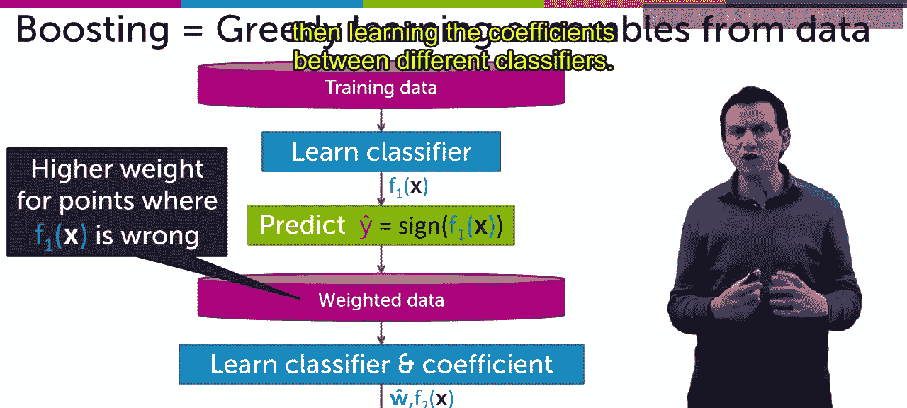
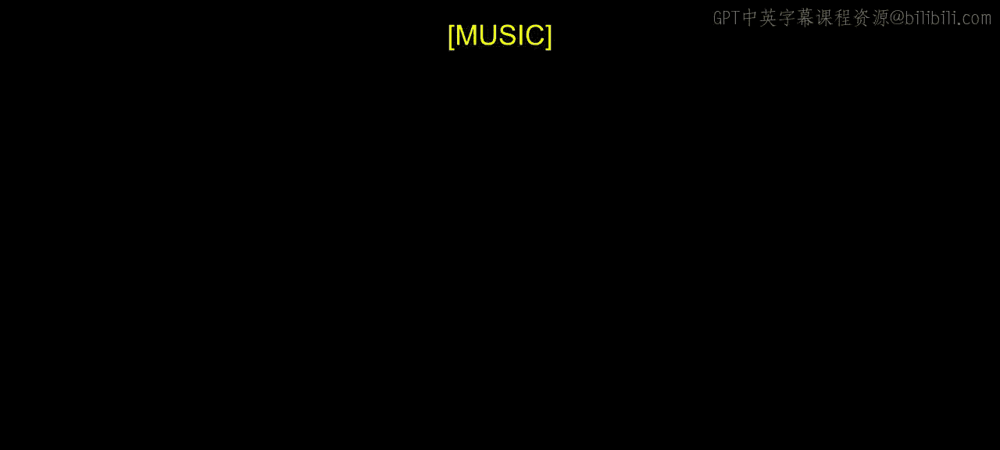

# 机器学习（分类，聚类和检索）：第3-4课：提升方法

## 概述
在本节课中，我们将要学习提升方法。这是一种通过组合多个弱学习器来构建一个强学习器的技术。我们将从提升的基本概念开始，然后深入探讨一个具体的提升算法示例，并解释如何通过加权数据来迭代改进模型。

---

## 提升的基本思想

上一节我们介绍了集成模型，本节中我们来看看提升方法。

考虑一个学习问题：我们获取一些数据，学习一个分类器，该分类器给出输出 **F(x)**，我们用它来预测数据，即 **Y_hat = sign(F(x))**。

如果我们获取一些数据并尝试进行预测，可能会学习一个决策树桩。例如，我们决定按收入进行划分：收入大于100,000和收入小于100,000。我们如何学习实际的预测呢？我们查看数据行：对于收入大于100,000的行，有三笔安全贷款和一笔风险贷款，因此我们预测 **Y_hat = 安全**。对于收入小于100,000的行，有四笔安全贷款和三笔风险贷款，我们再次预测 **安全**。两边的预测都是安全。这个决策树桩看起来还行，但在数据上似乎不够好，未能捕捉到我们所需的信息。

提升方法会如何处理呢？它会评估这个决策树桩，查看它在数据上的表现，然后学习下一个决策树桩或分类器。下一个分类器将专注于第一个分类器表现不佳的数据点。

换句话说，这是一个非常重要的点：我们将查看目前犯错误的地方，并增加这些点的影响力或关注度。然后，我们学习另一个分类器来处理犯错误的数据点，接着再学习一个，如此反复。最终，正如我们将看到的，我们会收敛到一个强大的分类器。

---

## 加权数据学习

学习我们犯错误的数据点意味着什么？

这意味着我们将为数据集中的每个数据点分配一个权重 **α_i**。当权重较高时，意味着该数据点更重要。你可以想象一个学习问题，其中数据不仅像本课程迄今为止所做的那样，而且数据还带有与之相关的权重。现在，我们将从加权数据中学习。

从加权数据中学习意味着什么？可以这样理解：**α_i** 对应于数据点被计数的次数（如果大于1）。例如，如果 **α=2**，你可以认为该数据点被计数了两次；如果 **α=0.5**，你可以认为该数据点被计数了半个数据点。但你的学习算法完全保持不变，只是你不再计数数据点，而是计数数据点的权重。

让我们看看在决策树桩方法中会发生什么。我们有了第一个决策树桩，它并不理想，特别是对于收入较低的人群。因此，我们学习了这些权重，在我们犯错误的地方权重更高。现在，我们学习一个新的决策树桩，假设再次按收入划分：大于100,000和小于100,000。

当我们查看对大于100,000的数据所做的分类决策时，我们做的是：对收入大于100,000的风险数据点的权重求和。在这种情况下，我们求和0.5、0.8和0.7，加起来是2.0；对于安全的数据点，权重是1.2。因此，我们将预测 **Y_hat = 安全**。这是数据点的加权和。

对于收入小于100,000的数据，采用相同的思路。我们遍历数据点，查看风险和安全的数据点，并求和它们的权重。我们看到风险贷款的总权重是6.5，安全贷款的总权重是3.0。因此，我们将预测 **Y_hat = 风险**。这个决策树桩现在会稍微好一些。然后，我们将这个分类器与之前的分类器以及其他分类器结合起来，直到我们创建出这个集成分类器。

---

## 扩展到其他算法

这种从加权数据中学习的想法不仅限于决策树桩。事实上，大多数机器学习算法都接受加权数据。

我将简要地向你展示，如果你在进行逻辑回归并且有加权数据会发生什么。如果你看下面的方程，这正是逻辑回归导数或更新函数的方程，这是你在学习逻辑回归模型时会实现的东西。

现在你可能会说：“哦，我有这些数据权重，我必须从头开始重新实现一切。天啊天啊天啊。”但事实证明这非常简单。如果你看方程的中间部分，我们在这里对数据点求和。现在，我们只需要对数据点求和，并且对每个数据点的贡献进行加权。因此，我们只需在每个求和项中添加权重 **α_i**，就完成了。

我们现在有了可以从加权数据中学习的逻辑回归。

我们向你展示了两个例子：决策树桩和逻辑回归。但总的来说，从加权数据中学习是相当容易的。

---

## 提升作为贪婪算法

提升可以被视为从数据中学习集成模型的一种贪婪算法。

以下是其工作原理的步骤：

1.  我们训练第一个分类器，例如 **f1(x)**，来自数据。如果只有 **f1(x)**，你只需预测 **sign(f1)** 作为你的输出 **Y_hat**。
2.  然后，你通过给犯错误（或 **f1** 犯错误）的数据点分配更高权重来重新加权你的数据。
3.  现在我们运行另一个分类器 **f2**，并学习每个分类器的系数。
4.  如果我们只做两步，我们的预测是 **ŵ1 * f1 + ŵ2 * f2**，其符号是 **Y_hat**。

这就是提升的基本思想：不断添加新的分类器，学习权重（抱歉，是优化权重）以专注于更困难的数据点，然后学习不同分类器之间的系数。

---

## 总结
本节课中我们一起学习了提升方法。我们了解到提升是一种迭代的集成技术，它通过给先前模型分类错误的数据点增加权重，并训练新的模型来专注于这些困难样本，从而组合多个弱学习器形成一个强学习器。我们探讨了加权数据学习的概念，并看到了如何将其应用于决策树桩和逻辑回归等算法。最后，我们理解了提升可以被视为一种贪婪算法，它逐步构建一个强大的集成分类器。