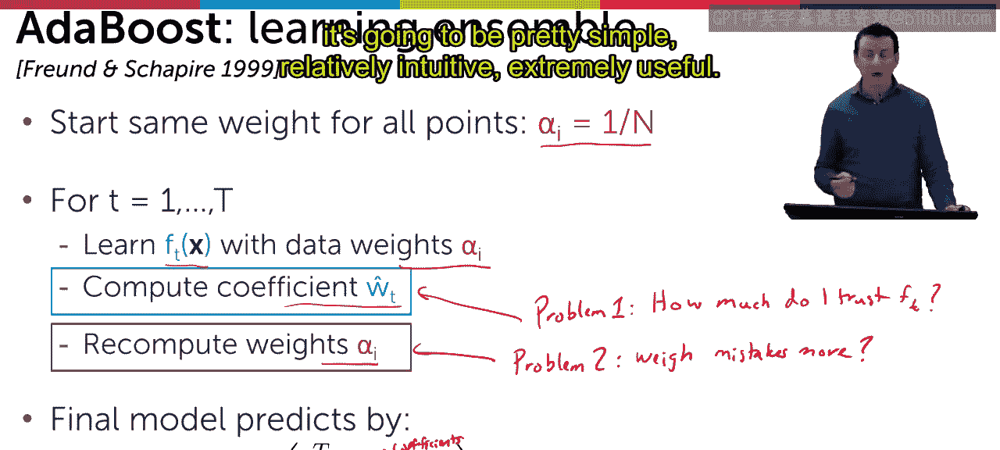

# 华盛顿大学《机器学习（分类，聚类和检索，第3-4课⧸共4课）｜Machine Learning》中英字幕 p88 87_AdaBoost概述.zh_en -BV1Sr421F7N7_p88-

。

In this module， we're going to talk about a specific boosting algorithm called ada boost。

 Addda boost is one of the early machine learning algorithms for boosting。 It's extremely useful。

 It's very simple to implement。 and it's quite effective。

 There there is a mission another interesting one towards the end of the module。

 But let's start with other boost。😊。

This is the famous adabu algorithm， which was created by Fre and Shapirri in 1999。

Amazingly useful algorithm。 So you start by saying every data point has same weights。

 You don't know which ones are high or which ones are easy， they all have the same weight。

 And so you could start with them all weight1。 we start with them with weight1 over n。😊。

Because it makes everything kind of work out a little better and we talk about why in a few slides。

 but we start with all data points having the same what's called uniform weight。

 so in this case of is 1 over n。And then for each iteration of adabu。

 as you go to learn the first decision stamp or the first simple classifier。

 the first week classifier， the second one is tell1， all the way to capital T。

 what we do is we learn FT on weighted datas alpha I。

So as the data is the weight start with one over end， but they get different over time。

 then we compute the coefficient。W hat T for this new classifier FT that we learn。

 and then we recompute the weights alpha I。And we keep going finally。Once we are done。

 we say that the prediction Y hat is the sign of the weighted combination of F1， F2， F3。

 F4 weighted by the coefficients。That we learn from data。

So there are two fundamental problems I need to address when we're thinking about other boost。

One is how do we compute the coefficient W hat T， let's call that problem one。In our。

Module for today。 So problem one is。How much do I trust？F T， F， in this case。So if I trust FT a lot。

 I should give it a very high weight if I trust FT。Very bad， very little， actually。

 they're very low weight。Are very low coefficient， I should say。

And then problem two is how do you recompute this weight？On the data points。

Let's call that problem two and so problem two here is。How do we weigh？Mistakes。More。

🎼So we want to increase the weight of mistakes so in the main part of this module we're going to talk about how do compute W hatT and how you can update alpha I's and it's going to be pretty simple relatively intuitive extremely useful。

