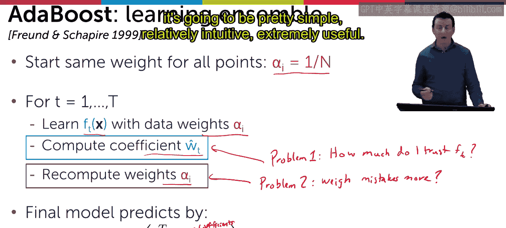

# 机器学习：3-4：AdaBoost概述 🚀

在本节课中，我们将要学习一种特定的提升算法——AdaBoost。AdaBoost是早期机器学习中用于提升的算法之一，它极其有用，实现简单，并且效果显著。课程末尾还有一个有趣的拓展任务，但让我们先从AdaBoost开始。

---

## AdaBoost算法流程 📊

上一节我们介绍了提升算法的基本概念，本节中我们来看看AdaBoost的具体步骤。以下是AdaBoost算法的核心流程：

1.  **初始化权重**：为每个数据点分配相同的初始权重。通常设置为 `α_i = 1/n`，其中 `n` 是数据点的总数。这被称为均匀权重初始化，我们稍后会解释为何这样设置更优。
2.  **迭代训练弱分类器**：对于每一轮迭代 `t`（从1到 `T`）：
    *   在**加权数据**上学习一个弱分类器 `f_t`。
    *   计算该分类器的系数 `ŵ_t`。
    *   根据分类器的表现，**重新计算**每个数据点的权重 `α_i`。
3.  **组合最终分类器**：完成所有迭代后，最终的预测 `ŷ` 是所有弱分类器 `f_1, f_2, ..., f_T` 的加权组合的符号。公式表示为：`ŷ = sign( Σ_{t=1}^{T} ŵ_t * f_t(x) )`。

---

## 核心问题与解决方案 ⚙️

在实现AdaBoost时，我们需要解决两个基本问题。

### 问题一：如何计算分类器系数 `ŵ_t`？

这个问题关乎我们**信任**每个弱分类器 `f_t` 的程度。如果 `f_t` 表现很好，我们应给予它较高的权重（系数）；如果表现很差，则应给予较低的权重。

### 问题二：如何更新数据点权重 `α_i`？

这个问题关乎我们如何**强调**被错误分类的数据点。我们希望增加那些被当前分类器 `f_t` 错误分类的数据点的权重，以便在下一轮迭代中，后续的分类器能更关注这些“困难”的样本。

在本模块的主要部分，我们将详细讨论如何计算 `ŵ_t` 以及如何更新 `α_i`。这些方法相对简单、直观且极其有效。

---

## 总结 ✨

本节课中，我们一起学习了AdaBoost算法的基本框架。我们了解了其从初始化均匀权重开始，迭代训练弱分类器、计算系数并更新数据点权重的流程。同时，我们明确了实现AdaBoost需要解决的两个核心问题：**分类器系数的计算**和**数据点权重的更新**。在接下来的课程中，我们将深入探讨这些具体问题的解决方案。