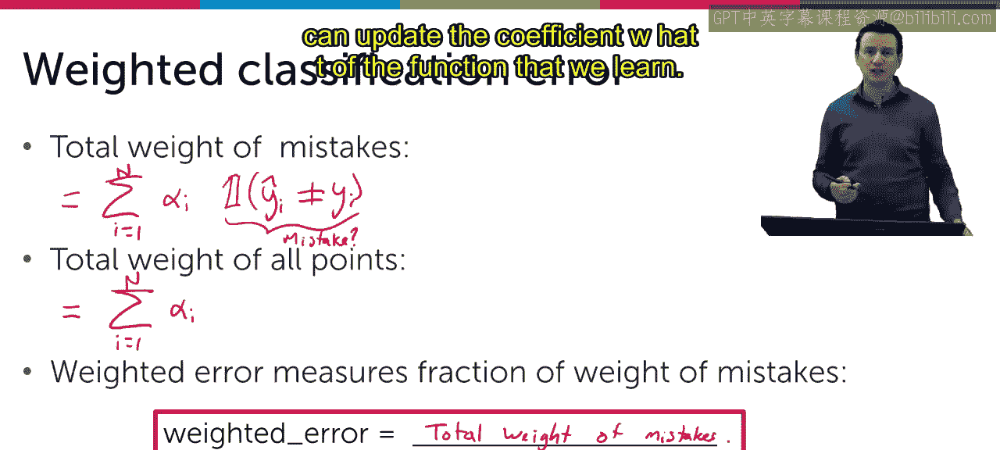

# 华盛顿大学《机器学习（分类，聚类和检索，第3-4课⧸共4课）｜Machine Learning》中英字幕 p89 88_加权误差.zh_en -BV1Sr421F7N7_p89-

。

Let's start talking about how do you compute W hatT？

And this quantity is intuitive and it has to know how good or how much we trust FT。

 the classifier that we learn at teeth iteration。😊，So specifically if FT is good， we like it。

 it's doing well in our data， we want WhaT to be large， in fact， if FT has really。

 really great accuracy or very low error， we want WT to be really big。😊，However， if FT is rebound。

 if it really is terrible at making predictions， we should down weight it。

 we should not trust that particular vote。So in other words。

 how do we measure whether class fire is good or not， as we said。

 we say FT is good if it has low training error。😊，However。

 you have to remember that we have weighted data， so we really care about is how well it's doing weighted data。

 for example。😊，If we way more certain data points because they're really hard。

 we' make lots of mistakes。 sometimes when I make sure that。

The classifier has low error on those really hard mistakes。

And so let's look at measuring error on weighted data。

Measuring area of weighted data is very similar to measuring error regular data。

 We have a data point。 for example， the sushi was great and is label thats positive but now we have a weight in this case alpha which maybe be 1。

2 so this is a data point which is say above average port and so we want to measure the weighted total of the correct examples and the weighted total of the mistakes so we take our learning classifier。

😊，F and we feed the review in this case the sushi was great。

 but we had the label which this case was positive and I will compare the prediction， for example。

 let's say that Y hat was plus one for this input。😊，It's the same as the two label is correct。

 so we add the weight 1。2 to the weight of all the correct examples we've seen。그 that awesome。

But let's say we have another data point， the food is okay。

Wwhichch is labeled truly as negative and we talked about this example before we feed food was okay to a classifier。

 we hide the label minus-1 where a classifier gets confused。

 it doesn't know that culture reference the food was okay and thinks it is a positive example why hat is plus one and it's a mistake so we take the weight of this data。

0。5 and added it to the total weight of the mistakes so we keep adding the weight of the mistakes versus the weight of the query classifications and use that to measure the error。

😊，Now that we have seen an intuitive notion of what the weighted error is。

 let's write down the equations for the weighted error so we can be sure if we need to implement it。

 so the first thing you have to measure is the total weight of all the mistakes so the sum of the mistakes of the weight of those data points so this is the sum。

😊，Over the data point， so I equals 1 through n。off。An indicator that says， was this a mistake。

 so is why had I different than why I？So this just measure whether there's a mistake。

And if it was a mistake。We don't just count it as a mistake。

 we count it whatever weight that data point has， so we're going to weigh that contribution by alpha I。

And now to compute the error， were going to normalize it， so it's somewhere between 0 and1。

 so we have to divide it by the total weight of all the data points。

 so it's the sum over I equals1 through n of the weight of all the data points of I。

And these are the two quantities that we care about and the weighted error can be denoted by。😊。

Total weight of the mistakes。Divided by the total weight。Offf of。Data。Point。Excusmely simple。

 the best possible error you can hope for is 0。0。Now， the worst error。Is 1。0。

 which means that we're making mistakes everywhere。

 but notice that if we're making mistakes everywhere， if we inver a classifier。

 we're going to get everything right。 So the way to think about is kind the worst possible case in some ways is。

How random does。 So a random classifier。Who get error of 0。5 and we discussed this。

In the first course of how a random classifier gets error 0。

5 on a binary classification problem like this， so now that we've seen the weighted error。

 let's look at how we can update the coefficient W hat T of the function F that we learned。

