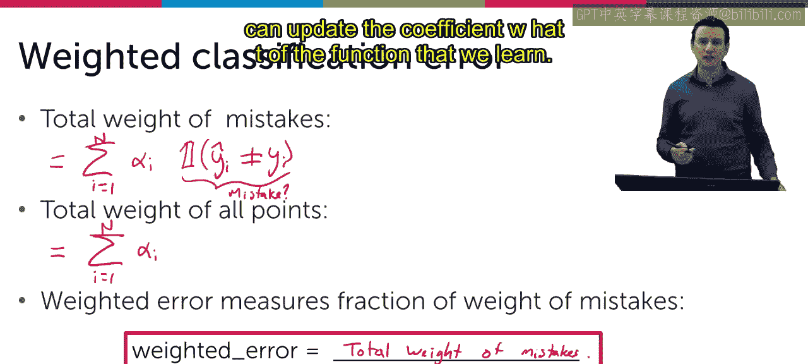

# 机器学习（分类，聚类和检索）：第3-4课：加权误差计算与系数更新

在本节课中，我们将学习如何计算加权误差，并理解如何根据分类器在加权数据上的表现来更新其投票权重。这是AdaBoost等集成学习算法的核心步骤。

上一节我们介绍了加权数据的概念，本节中我们来看看如何具体衡量一个分类器在加权数据上的表现，即计算加权误差。

## 计算加权误差

加权误差的衡量方式与常规误差类似，但每个数据点的贡献由其权重决定。以下是计算加权误差的步骤：

1.  **计算错误的总权重**：遍历所有数据点，如果分类器预测错误，则累加该数据点的权重。
2.  **计算数据点的总权重**：累加所有数据点的权重。
3.  **计算加权误差**：将错误的总权重除以数据点的总权重。

用公式表示如下：

**加权误差 (ε) = (Σ (错误的数据点 i 的权重 α_i)) / (Σ (所有数据点 i 的权重 α_i))**

其中，Σ 表示求和，范围是 i=1 到 n（n 为数据点总数）。判断是否为错误的指示函数为：`1(预测值 y_hat_i ≠ 真实标签 y_i)`。

加权误差 ε 的值在 0 到 1 之间。ε = 0 表示完美分类；ε = 1 表示全部预测错误（但此时反转分类器的预测即可得到完美结果）；ε = 0.5 类似于随机猜测的表现。

## 根据加权误差更新分类器权重

现在我们已经了解了加权误差，接下来看看如何利用它来更新第 T 轮学习到的分类器 F_T 的投票权重 W_hat_T。

这个权重的设定非常直观，它反映了我们对分类器 F_T 的信任程度：
*   如果 F_T 表现好（加权误差低），我们希望赋予它较大的权重。
*   如果 F_T 表现差（加权误差高），我们应该降低它的权重，不信任它的投票。

具体更新公式基于加权误差 ε_T 计算：

**W_hat_T = 0.5 * ln( (1 - ε_T) / ε_T )**

对这个公式的解读如下：
*   **ε_T 很小（接近0）**：`(1 - ε_T) / ε_T` 的值会很大，`ln` 函数的结果为正且较大，因此 W_hat_T 是一个较大的正数。这表示我们非常信任这个准确的分类器。
*   **ε_T 很大（接近1）**：`(1 - ε_T) / ε_T` 的值会很小（接近0），`ln` 函数的结果为负且绝对值较大，因此 W_hat_T 是一个较大的负数。这表示我们不仅不信任它，反而更相信它的**反面**预测（即反转它的输出）。
*   **ε_T = 0.5**：`(1 - ε_T) / ε_T = 1`，`ln(1) = 0`，因此 W_hat_T = 0。这表示这个分类器如同随机猜测，我们不给予任何权重。

通过这种方式，AdaBoost算法能够自动地为每一轮产生的弱分类器分配合适的权重，最终将所有弱分类器的加权投票组合成一个强大的集成模型。

本节课中我们一起学习了加权误差的计算方法及其在更新分类器投票权重中的应用。理解加权误差是掌握AdaBoost等提升（Boosting）算法如何聚焦于困难样本、并组合弱分类器的关键。下一节，我们将看到如何利用更新后的权重来调整训练数据本身的分布，为下一轮训练做准备。