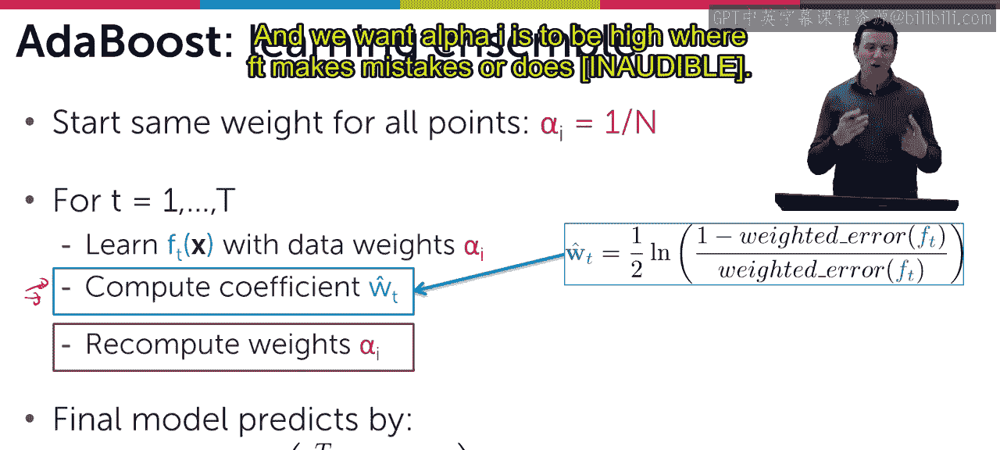
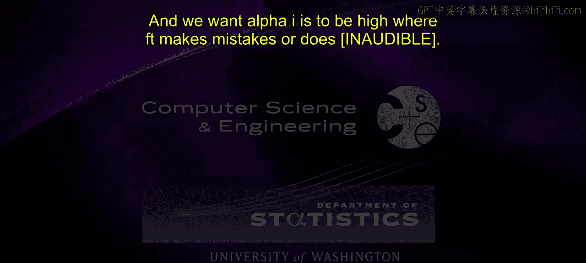

# 华盛顿大学《机器学习（分类，聚类和检索，第3-4课⧸共4课）｜Machine Learning》中英字幕 p90 89_计算每个集成组件的系数.zh_en -BV1Sr421F7N7_p90-

。

AWBst uses this slightly intimidating formula to figure out what W hatT should be。

 but it turns out to be pretty intuitive if you look at more detail。

 this formula is derived from a famous theorem at the boost theorem which want I mention very briefly towards the end of the module。

 but it's the formula that lets you find classifiers that keep getting better and better and helps boosting gets to the optimal solution。

😊，So let's look at it this form in a little bit more detail by exploring a few possible cases。

 so the question is is FT good， if FT is really good， it has really low error。😊。

When the train data and say weighted error。 So for example， if that weighted error is 0。01， then。

It's a really good classifier the question is first let's see what happens to this famous middle term here when the weighted area is 0。

01， so the middle term is 1 minus 0。01 divided by 0。01 which is equal to 99。😊。

And next to compute W hatT， we're going to take。A half。Times the log。Of of this number 99。

 And so if you do one half。Times the log of 99， you're going to get 2。3。

So this was an excellent classifier and we gave a weight of 2。3 just high。😊，Now。

 let's see what happens if we output a random classifier So as we said， the random classifier has。😊。

Weighted error of 0。5 is not something to be trusted， so if you plug this in1 minus 0。5 divided by 0。

5， yields the magic number。1。And if you look at half of log of 1， what log of 1 is0。

So W Hati is zero， so what have we learned if a classifier is just random it's not been anything meaningful。

 we counted by zero， we say you know you're terrible。

 we're going to ignore you and you might have friends who are kind of like this you know they say random stuff。

 you ever trust what they say you put zero weight on their opinions so that's what other boost do。😊。

Now we're going to get to a really， really， really interesting case。

 let's suppose that your classifier is terrible， it gets 0。99 weighted error。😊。

So it's getting almost everything wrong。It's worse than random。

 let's see what happens to the term in the middle here of our equation， you get 1 minus 0。

99 divided by 0。99。Which is equal to 0。01。And guess what happens when you take a half log of 0。01？😊。

You get minus 2。3。And when I first saw this， I thought， wow， this alabu theorem， it's beautiful。😊。

But take a moment to kind of internalize what just happened， we had this terrible classifier。

But yet we gave it pretty high weight 2。3， but with a negative sign。

 and why is that because a terrible， terrible classifier might be terrible。

 but if we take1 minus f of T。So if you do exactly the opposite is what it says。

Is an awesome classifier？In other words， if we invert a signs a classifier。

 we're going to do awesomely and add a boost automatically looks that for you and so this is again kind of using a friend analogy。

 you might have a friend who you know has really good opinions but they always like wrong and so you do exactly the opposite of what that person says maybe this is what how you hear your parents or something or some friends is say okay you say I should do it。

 I'm going do the opposite of that and by doing that I might do great things in the world and so other boost automatically figures that out for you which is awesome。

😊，Now let's revisit the Alibu algorithm that we've been talking about and in this part of the module we've been exploring how do we compute the coefficients W hat T and we saw they can be computed by this really simple formula。

 we compute the weighted error of F of T and we just say that the W hatT is one half of the log of woman minus is the weighted error divided by the weighted error and with that we have our W hatTs and we can focus on figuring out how to come up with alpha I's and we want alpha I is to be high where FT makes mistakes or does badly。

😊。

