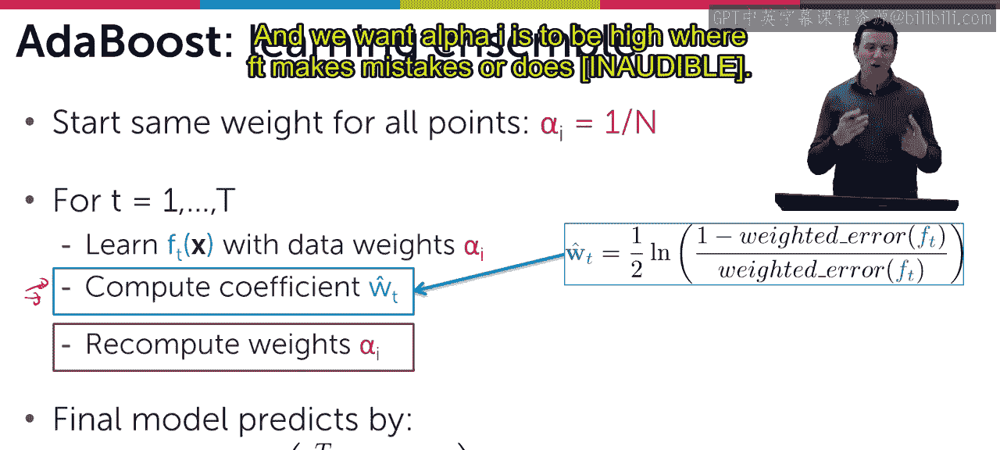

# 机器学习（分类，聚类和检索）：第3-4课：计算集成学习系数

在本节课中，我们将学习AdaBoost算法中一个核心步骤：如何为每个集成组件（即每个弱分类器）计算其系数。这个系数决定了该分类器在最终集成模型中的“话语权”。

上一节我们介绍了AdaBoost如何迭代地训练弱分类器并更新数据点的权重。本节中我们来看看，在得到一个弱分类器后，如何计算它的重要性系数。

AdaBoost使用一个公式来计算系数 **ŵ_t**。这个公式虽然初看有些复杂，但其背后的直觉非常清晰。该公式源于一个著名的Boosting定理，它确保了分类器能够持续改进，并帮助AdaBoost收敛到最优解。

让我们通过分析几种可能的情况来更详细地理解这个公式。

## 公式解析

计算系数 **ŵ_t** 的核心公式是：

**ŵ_t = ½ * log( (1 - ε_t) / ε_t )**

其中，**ε_t** 是当前弱分类器 **f_t** 在**加权训练数据**上的错误率。

以下是几种典型情况的分析：

### 情况一：优秀分类器

假设分类器 **f_t** 非常优秀，其加权错误率 **ε_t = 0.01**。

首先计算中间项：**(1 - 0.01) / 0.01 = 99**。

然后代入公式：**ŵ_t = ½ * log(99) ≈ 2.3**。

结论：对于一个优秀的分类器，AdaBoost会赋予它一个较高的正系数（如2.3），使其在最终决策中拥有较大的权重。

### 情况二：随机分类器

假设分类器 **f_t** 表现如同随机猜测，其加权错误率 **ε_t = 0.5**。

计算中间项：**(1 - 0.5) / 0.5 = 1**。

代入公式：**ŵ_t = ½ * log(1) = 0**。

结论：对于一个随机分类器（不提供任何有效信息），AdaBoost会通过赋予其系数0来完全忽略它。这好比不信任一个总是说随机话的朋友的意见。

### 情况三：极差但“有用”的分类器

这是一个非常有趣的情况。假设分类器 **f_t** 极其糟糕，其加权错误率 **ε_t = 0.99**，即它几乎把所有样本都分错了。

计算中间项：**(1 - 0.99) / 0.99 ≈ 0.01**。

代入公式：**ŵ_t = ½ * log(0.01) ≈ -2.3**。

结论：虽然这个分类器本身很糟糕，但它获得了一个绝对值较大（2.3）但为**负**的系数。这是因为，如果我们把这个分类器的预测结果**取反**（即总是做与它预测相反的决定），那么它就会变成一个非常优秀的分类器（错误率从0.99变为0.01）。AdaBoost自动为我们发现了这一点，并通过赋予负系数来实现预测取反的效果。这就像有一个朋友总是给出错误建议，你反其道而行之，反而能做出正确决定。

## 算法回顾与总结

在本模块的这一部分，我们探讨了如何计算AdaBoost中每个弱分类器的系数 **ŵ_t**。我们看到，它可以通过一个简洁的公式计算得出：

1.  计算当前弱分类器 **f_t** 在加权数据上的错误率 **ε_t**。
2.  应用公式：**ŵ_t = ½ * log( (1 - ε_t) / ε_t )**。

这个公式优雅地处理了三种情况：
*   **优秀分类器**：获得高的正系数。
*   **随机分类器**：获得零系数，被忽略。
*   **极差分类器**：获得高的负系数，其预测被取反后利用。

计算出 **ŵ_t** 后，我们就完成了对集成组件权重的分配。接下来，算法的重点将回到如何根据当前分类器的表现，更新每个训练样本的权重 **α_i**，使得后续的分类器能更关注之前被错误分类的样本。

本节课中我们一起学习了AdaBoost系数计算的原理与直觉。理解这个公式是掌握AdaBoost如何将弱分类器组合成强分类器的关键一步。