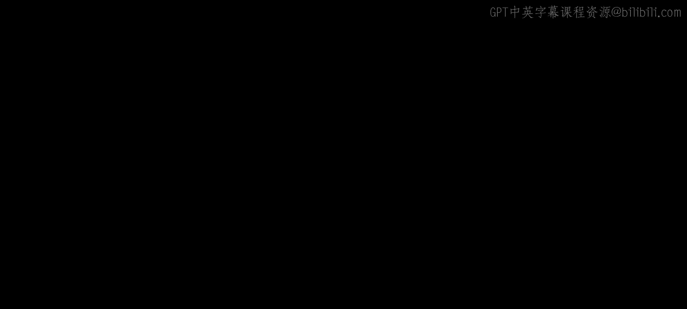
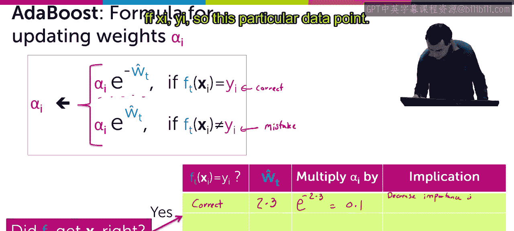
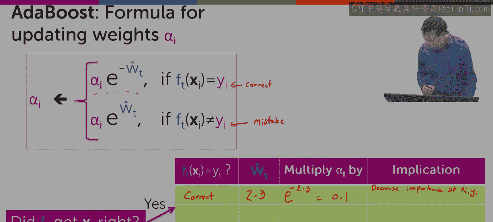
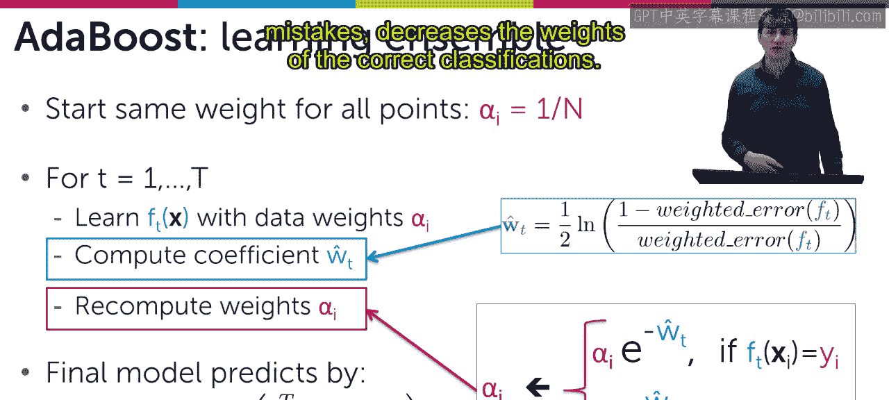

# 华盛顿大学《机器学习（分类，聚类和检索，第3-4课⧸共4课）｜Machine Learning》中英字幕 p91 90_重新加权数据以关注错误.zh_en -BV1Sr421F7N7_p91-

。

We started with alpha is being uniform， the same for all data points1 over n。

 and now we want to change them to focus more on those difficult data points where we're making mistakes。

 So the question is where did FT make mistakes or what data points FT got right if FT got a particular data point X right we want to decrease alpha I because we got it right But if we got X wrong then we want to increase alpha so that the next decision stamp or we classify homes in and does better in this particular input。

Again， the abu theorem provides us with a slightly intimidating formula for how to update the weights alpha I。

 but if we take a moment to interpret it， we'll see that this formula is extremely intuitive and theres something quite nice so let's take a quick look at it so it says that alpha I gets an update depending on whether FT gets the red data point right so this is correct。

😊，Or whether FD makes a mistake。And as well see， we're going to increase the weight of data points we made mistakes and we're going to decrease the weight of data points we got right。

 So let's take a look at this。😊，So let's take onexii and let's suppose that we got it correct。

So we're in the top line here and notice that this equation depends on whatever the coefficients do assign to this classifier。

 so if the classifier was good， we want to change the weights more。

 but if the classifier was terrible， we're going to change the weights less so let's say that the classifier was good and we gave it weight 2。

3 so what we're doing here we're looking at formula we're multiplying alpha I by e to the minus。

W hat T， which is 2。3。And if you take a calculator out， you see that this is 0。1。

So we're taking the data points we got right and we multiply the weight of those data points by 0。

1 so dividediding by1， so what effect does that do？😊。

We're going to decrease the importance of this data point。

off。X I， Y I， so this particular data point。

Now let's look at the case where we got the data point correct。

 but the classifier we learned was as good as random。

 so we had weight 0 just like we discussed a few slides ago， so it's kind of overall weight of0 of 0。

5 leads to weight 0 in this case we're multiplying the coefficient alpha I by e to the minus0 which is equal to 1 what does that mean that means that when I keep。

😊，The importance of this data point the same。And that also makes a ton of sense。

 so this was a classifier that was terrible， we gave it weight of0 were going to ignore it and so since we're ignoring we're not changing anything about how we weight all of data points。

 we're just going to keep going as if nothing's happened because nothing's changed on their overall ensemble。

😊，Now， let's look at the opposite case when we actually made mistakes， so let's say that。😊。

We got XI incorrect， so we made a mistake。In this case， we're in the second line here。

 so if it was a good classifier， they had a W hat T of 2。3。

 then we're going to multiply the weight by each of the power 2。3 so this is each to the 2。

3 which if you do the math is 9。98 so approximately 10 so its 10 times bigger and so what we're doing is increasing the importance of this mistake significantly。

So the next classifier is going to pay much more attention to this particular data point because it was a mistaken one。

😊，Now， finally， just very quickly， what happens if we make a mistake？😊。

But we had that random classifier， they had weight 0， we didn't care about it。

 so the multiplication here is e to the0， which is again equal to 1。

 which means we keep the importance of this data point the same。😊，So very good。

 we've now seen this cool update rule from Alilibut， which makes a ton of sense。

 includes the weights of the data points where we made the mistakes and decrease the ones。

 we then make a mistakes extremely intuitive， and we're going to use it in our Alilibut algorithm。

So if we update our algorithm。We we started with uniform weight， we learned class via F of T。

 we updated we compute its coefficient W hat T， now we can update the weights of the data points alpha I。

😊，Using the simple formula from the previous slide， which increases the weight of mistakes。

 decreases the weight of the correct classifications。😊。

