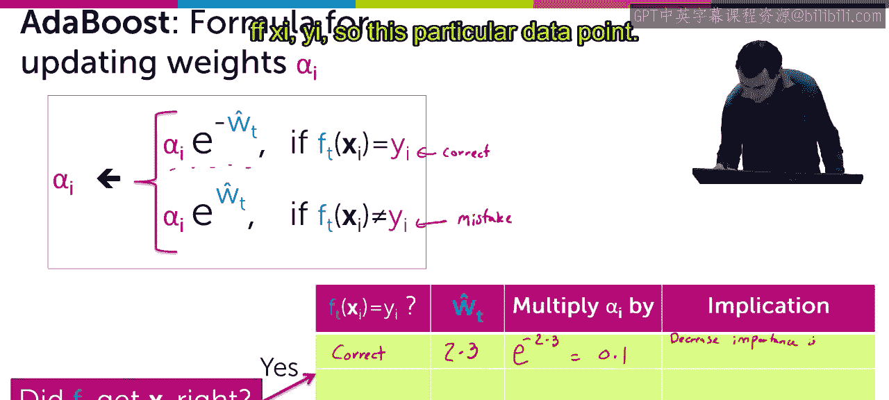
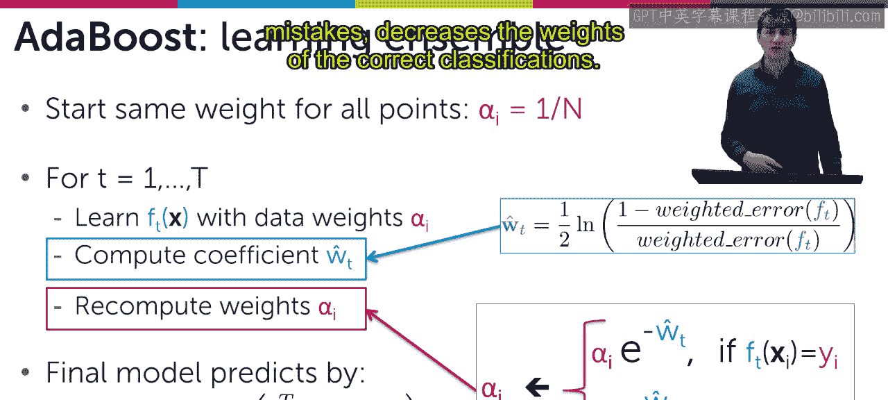

# 机器学习（分类，聚类和检索）：第3-4课：通过重新加权数据关注错误分类点

在本节课中，我们将学习AdaBoost算法中的一个核心步骤：如何根据当前分类器的表现，动态调整训练数据集中每个样本的权重。这一过程旨在让后续的分类器更加关注之前被错误分类的“困难”样本。

上一节我们介绍了如何为每个弱分类器计算一个权重系数（`W_hat_T`），本节中我们来看看如何利用这个系数来更新每个数据点自身的权重（`alpha_i`）。

## 权重更新规则概述

AdaBoost算法提供了一个公式来更新每个数据点的权重 `alpha_i`。这个公式的直观思想是：**增加被错误分类数据点的权重，减少被正确分类数据点的权重**。这样，下一个弱分类器在训练时就会更专注于纠正之前的错误。

以下是权重更新的具体规则，它取决于当前分类器 `F_T` 对数据点 `(X_i, Y_i)` 的预测是否正确，以及分类器自身的权重 `W_hat_T`：

*   如果 `F_T` 正确分类了 `(X_i, Y_i)`，则新权重为：
    `alpha_i_new = alpha_i_old * exp(-W_hat_T)`
*   如果 `F_T` 错误分类了 `(X_i, Y_i)`，则新权重为：
    `alpha_i_new = alpha_i_old * exp(W_hat_T)`

## 规则解读与示例

让我们通过几个具体例子来理解这个更新规则是如何工作的。

### 情况一：分类正确，且分类器表现良好

假设当前弱分类器 `F_T` 表现良好，我们为其分配的系数 `W_hat_T = 2.3`。对于某个被它正确分类的数据点，我们更新其权重：
`alpha_i_new = alpha_i_old * exp(-2.3) ≈ alpha_i_old * 0.1`

**效果**：该数据点的权重被大幅减小（乘以0.1），意味着在后续训练中，它的重要性降低，因为当前模型已经能正确处理它。

### 情况二：分类正确，但分类器表现随机

假设 `F_T` 是一个随机分类器，其系数 `W_hat_T = 0`。对于被它正确分类的数据点：
`alpha_i_new = alpha_i_old * exp(0) = alpha_i_old * 1`

**效果**：该数据点的权重保持不变。这很合理，因为一个随机分类器的判断没有提供有效信息，所以我们不基于它的结果来调整数据的重要性。

### 情况三：分类错误，且分类器表现良好

同样假设 `W_hat_T = 2.3`，但对于一个被错误分类的数据点：
`alpha_i_new = alpha_i_old * exp(2.3) ≈ alpha_i_old * 10`

**效果**：该数据点的权重被显著增加（乘以10）。这迫使下一个分类器必须更加关注这个被当前“好”分类器误判的困难样本。

### 情况四：分类错误，但分类器表现随机

假设 `W_hat_T = 0`，对于一个被错误分类的数据点：
`alpha_i_new = alpha_i_old * exp(0) = alpha_i_old * 1`

**效果**：权重同样保持不变。因为随机分类器的错误判断不具备参考价值，我们不据此调整权重。

## 算法流程更新

现在，我们可以将权重更新步骤整合到AdaBoost算法流程中：

1.  **初始化权重**：所有数据点的权重 `alpha_i` 设置为均匀分布，即 `1/n`。
2.  **循环训练弱分类器**：
    a. 使用当前的权重分布 `alpha_i` 训练一个弱分类器 `F_T`。
    b. 计算 `F_T` 的系数 `W_hat_T`。
    c. **使用上述规则更新所有数据点的权重 `alpha_i`**。
3.  组合所有弱分类器，形成最终强分类器。

## 总结

本节课中我们一起学习了AdaBoost算法中数据权重更新的关键机制。我们看到了一个直观且有效的规则：根据当前分类器的表现（`W_hat_T`）和其对每个样本的判断对错，来增加错误分类样本的权重，并减少正确分类样本的权重。这个过程确保了算法能够持续聚焦于整个数据集中最难分类的样本，从而逐步提升整体模型的性能。