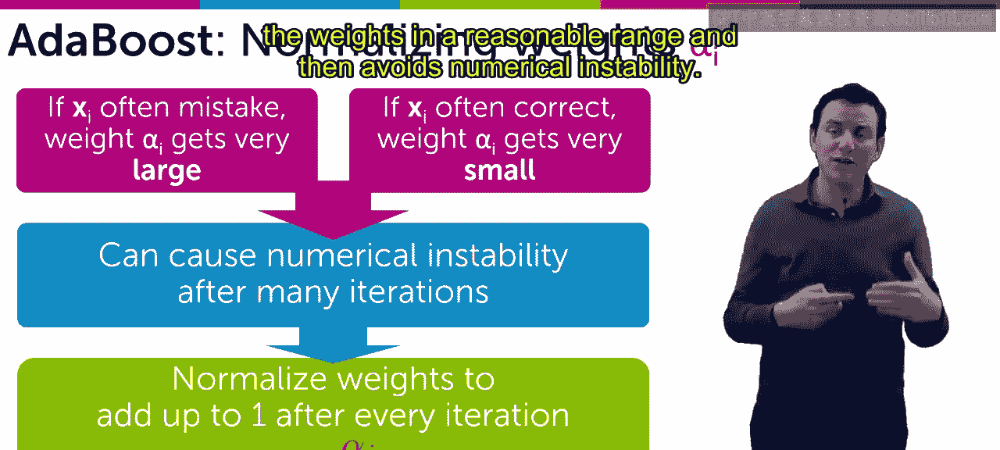
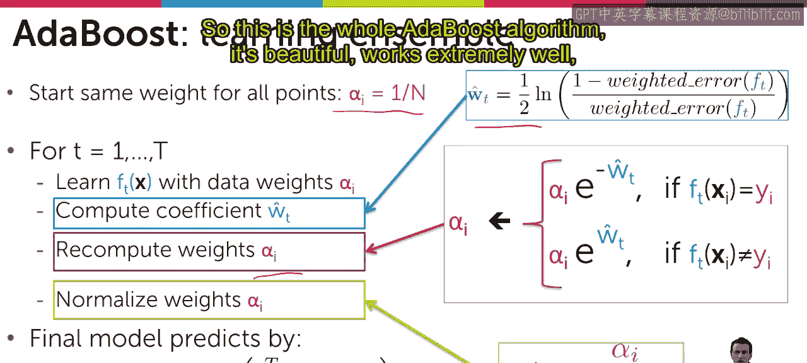

# 华盛顿大学《机器学习（分类，聚类和检索，第3-4课⧸共4课）｜Machine Learning》中英字幕 p92 91_归一化权重.zh_en -BV1Sr421F7N7_p92-

。

Finally， we need to address a technical issue that we hinted at when we normalize the weights of data points to start to1 over n when we had uniform weights。

Wwhichch is the issue of renormalizing the weights of the data points throughout the iterations。 So。

 for example， if we take a data point Xi， suppose it's often a mistake we're multiplying its weight by a positive number again and again and again。

 let's say two times two times two times2。 and that weight of I can get extremely large on the other hand。

 if you take a data point Xi that's often correct。 you multiply by some number less than one。

 So say a half6 keep point by a half a half a half and that weight can get really really small。

 And so this problem can lead to numerical instaabbilities in the approach。

 and so you know a computer might not behave very well with all this crazy weight of data And so what we do is after each iteration。

 we go ahead and normalize the weight。😊，Of all data points to add up to one。

 so basically we divide alpha each alphahi by the sum over the data points of alpha。

So this approach keeps the weights in a reasonable range and avoids numerical stability。

So let's summarize the other boost algorithm we start with。

Even weights inform weights equal weights for all data points。 We learn a classifier F of T。

 We find its coefficient depending on how good it is on weighted in terms of weighted error。

 And then we update the weight to weigh mistakes more than things we got correct。 And finally。

 we normalize the weights by dividing each value by this total sum of the weights。

 And this normalization is of practical importance。 So this is the whole aW algorithm。

 It's beautiful， works extremely well really easy to to use。😊。

