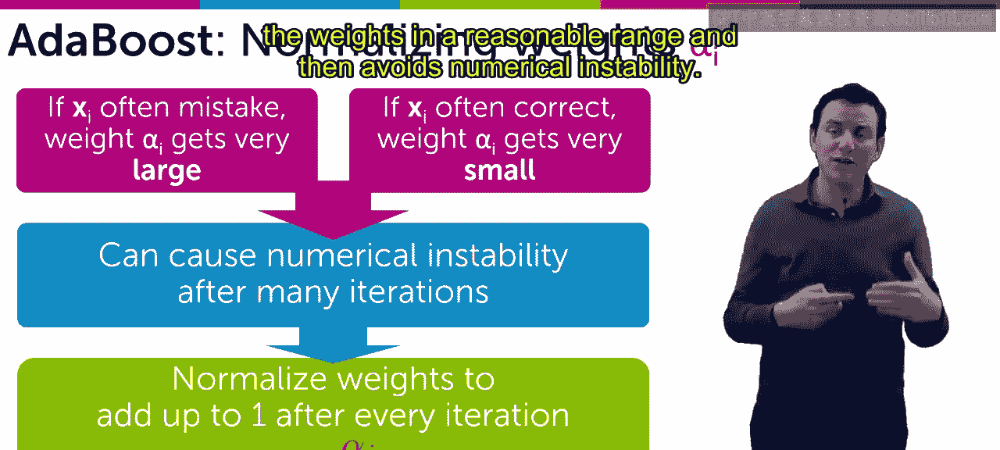
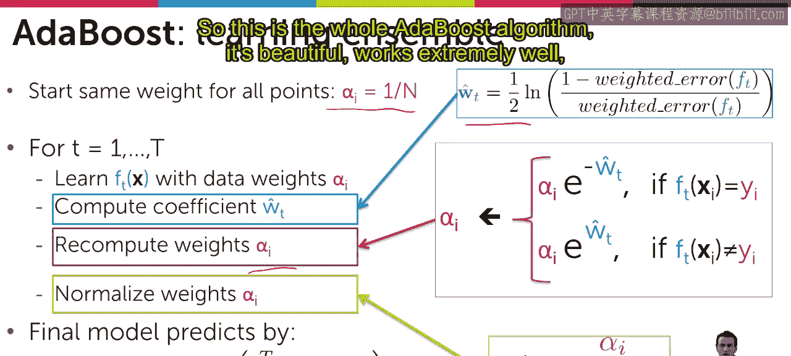

# 机器学习：3-4：AdaBoost算法中的权重归一化

在本节课中，我们将学习AdaBoost算法中的一个关键技术细节：权重归一化。我们将了解为什么需要在每次迭代后对数据点的权重进行归一化处理，以及如何具体操作。

## 概述

上一节我们介绍了AdaBoost算法如何通过加权错误率来更新数据点的权重。本节中，我们来看看一个随之而来的技术问题：权重的数值稳定性。如果不加处理，某些数据点的权重可能会变得极大或极小，导致计算上的困难。

## 权重变化的潜在问题

在AdaBoost的迭代过程中，我们反复根据分类器的表现来调整每个数据点的权重。这可能导致权重的数值范围失控。

以下是具体原因：
*   如果一个数据点 `Xi` 经常被分类错误，其权重会反复乘以一个大于1的数（例如，2 × 2 × 2...）。这个权重 `α_i` 会变得**极大**。
*   反之，如果一个数据点 `Xi` 经常被正确分类，其权重会反复乘以一个小于1的数（例如，0.5 × 0.5 × 0.5...）。这个权重 `α_i` 会变得**极小**。

这种极端情况会导致算法出现**数值不稳定性**，计算机在处理这些差异巨大的权重时可能无法正常运行。

## 解决方案：权重归一化

为了解决上述问题，我们在**每次迭代后**，对所有数据点的权重进行归一化，使它们的总和为1。

具体操作是，将每个权重 `α_i` 除以所有权重的总和。

**公式表示如下：**
`α_i (新) = α_i (旧) / Σ(α_j)`，其中求和 `Σ` 针对所有数据点 `j`。

这种方法能将权重保持在一个合理的范围内，有效避免数值不稳定性的发生。

## 算法总结

现在，让我们总结完整的AdaBoost算法流程：

1.  **初始化权重**：从均匀权重开始，即所有数据点的权重均为 `1/n`。
2.  **训练弱分类器**：基于当前权重，学习一个分类器 `F_t`。
3.  **计算系数**：根据该分类器在加权数据上的错误率，计算其系数（重要性）。
4.  **更新权重**：增加被错误分类数据点的权重，减少被正确分类数据点的权重。
5.  **归一化权重**：将更新后的所有权重进行归一化，使其总和为1。这一步具有重要的实际意义。

## 总结

本节课中，我们一起学习了AdaBoost算法中权重归一化的必要性和具体方法。通过每次迭代后对权重进行归一化，我们可以确保算法数值稳定，从而可靠地运行。整个AdaBoost算法结构优美，效果卓越，并且非常易于使用。