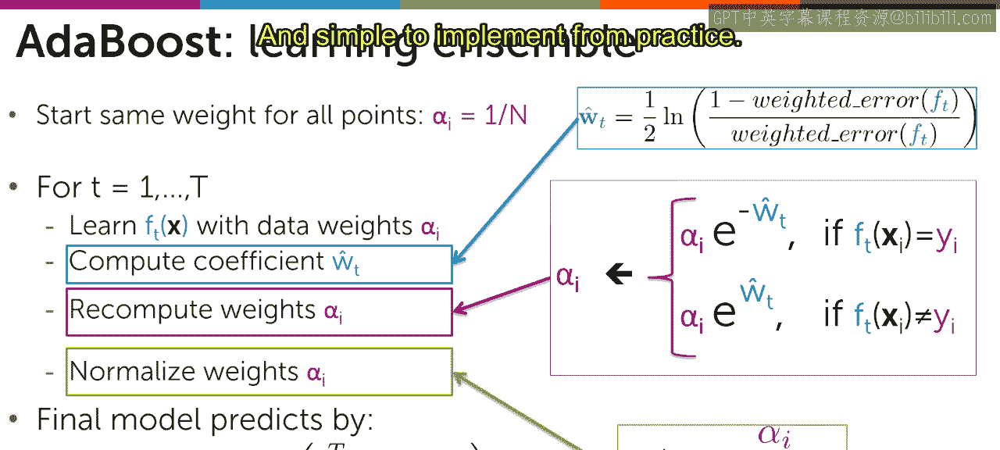

# 华盛顿大学《机器学习（分类，聚类和检索，第3-4课⧸共4课）｜Machine Learning》中英字幕 p93 92_AdaBoost运行的例子.zh_en -BV1Sr421F7N7_p93-

。

Now let's take that toy example that we've used to illustrate different machine learning algorithms in this module and explore it in the context of other boost。

 and it's going to give us a lot of insight as to how boosting works in practice。😊。

So for the first classifier F1， we work directly with the original data。

 all points have the same weight。最 wait。And so。The learning process we have is going to be standard learning。

So nothing changes in your learning algorithm since every data point has the same way and in this case we are learning a decision stamp and so here is a decision boundary that does its best to try to separate positive examples from negative examples。

 it splits right around zero。😊，It's actually minus0。

07 if you remember from the decisionion 3 classifier， so this is the first decisionion St F1。😊。

Now to learn a second decision stamp F2， we have to re our data based on how much F1 did so how well F1 did so we're gonna look at our decision boundary and we're going to weigh data points that were mistakes higher and here in the picture I'm denoting them by bigger minus signs and plus signs so if you look at the data points here on the left there were mistakes so the minus on this side and this pluses over here there were places where we made mistakes so we increased their weight and we decrease the weight of everybody else and we see that the pluses here became here bigger and the minuses in this region became larger。

So that's how we update our weight。And now let's look at the next step。

 learning the classifier F2 in the second iteration based on this way to data。

Using the weighted data， we'll learn the following decision stop and you see that now instead of having a vertical split。

 we have a horizontal split and it's a better split for weighted data。😊，Split。For these。

Wais on the left。And it's kind of cool， so in the first iteration we decide to split on x1 in the second one we split on x2 this is x2 greater than or less than about 1。

3 or so， and you'll see that it gets all the minuses correct on top but it makes some mistakes on the minuses in the bottom。

 but it gets the pluses correct in the bottom。😊，So as opposed to the vertical split here。

 we now have a horizontal split。So now we've learned their decision stamps F1 and F2 and the question here is how do we combine them So if you go through the abu formula。

 you'll see that the W hat1， the weight of the first decision stamp is going to be 0。

61 and then W hat2 is going to be 0。53 So we trust the first decision stamp a little bit more that we trust the second one which makes sense the second one doesn't seem as good。

 but when you add them together， you start a very interesting decision boundary So you get the points on the top left here are ones where we definitely think。

😊，That Y hat is minus-1， so definite negatives on the bottom right here， its some definite positives。

We had equals plus 1。And then for the other two regions。

 you can think about these as being regions of higher uncertainty。So， these are uncertain。

Which right now makes sense， but as you add more decision stamps。

 we're going to be more sure that some of the points on the left here bottom are negative and right top are negative Now if you keep Ali's going for 30 iterations。

The first thing that we notice is that we get all the data points right。

 so our training error is zero the third thing you notice and here I'm going to use a technical term for this is that our decision boundary。

😊，I。Crazy。This is our technical term and then if you combine these two insights， we figure out， okay。

 we don't really trust this classifier， we're probably overfitting the data。😊。

So if it's perfectly on the training data， maybe it doesn't do as well on the winter of through error。

Openfi something that will happen in boosting and we'll talk about it a little bit next。

So let's take a deep breath and summarize what we've done so far。

 We described ensemble classifiers and we said that we're going learn the simple classifiers and take the voting in between them to make predictions。

 and then we describe this a boost algorithm， which is a pretty simple approach to learning ensemble classifier using this technique of boosting where're boosting up the weight of data points we're making mistakes and simple to implement simulations for in practice。

😊。

🎼。