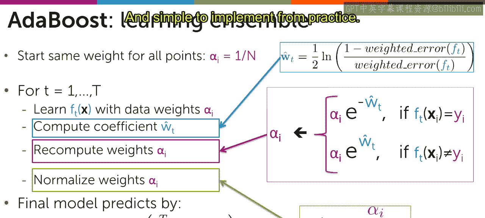

# 机器学习（分类，聚类和检索）：第3-4课：AdaBoost运行示例


在本节课中，我们将通过一个具体的玩具示例，来探索AdaBoost算法在实际中是如何工作的。这个示例将帮助我们直观理解Boosting机制，包括如何迭代地调整数据权重、组合弱分类器，以及最终可能面临的过拟合问题。

---

## 初始分类器 F₁

首先，我们直接使用原始数据来训练第一个分类器。此时，所有数据点具有相同的权重。学习过程是标准的，因为每个数据点的权重相同。在本例中，我们学习的是一个决策桩。

以下是第一个决策桩 F₁ 的决策边界：
```python
# 决策边界近似为 x₁ ≈ -0.07
if x₁ < -0.07:
    prediction = -1
else:
    prediction = +1
```
这个边界试图在零点附近将正例与负例分开。它做出了一个垂直分割。

---

## 第二个分类器 F₂

为了学习第二个决策桩 F₂，我们需要根据 F₁ 的表现来重新加权数据。具体来说，我们会增加被 F₁ 分类错误的点的权重，并降低分类正确的点的权重。在图中，更大的加号和减号表示更高的权重。

观察更新权重后的数据分布，被错误分类的点（左侧的负号和右侧的正号）权重增加了。

基于这个加权后的数据，我们学习得到第二个决策桩 F₂。与第一次的垂直分割不同，这次我们得到了一个水平分割。

以下是第二个决策桩 F₂ 的决策边界：
```python
# 决策边界近似为 x₂ ≈ 1.3
if x₂ < 1.3:
    prediction = -1
else:
    prediction = +1
```
这个边界对于加权后的数据是一个更好的分割。它正确分类了顶部的所有负例，但在底部的负例上犯了一些错误，同时正确分类了底部的正例。

---

## 组合分类器

现在我们已经学习了决策桩 F₁ 和 F₂，问题是如何组合它们。根据AdaBoost的公式计算，我们得到第一个决策桩的权重 **ŵ₁ = 0.61**，第二个决策桩的权重 **ŵ₂ = 0.53**。这意味着我们比第二个分类器更信任第一个分类器，这很合理，因为第二个看起来效果稍差。

当我们把它们组合起来时，会得到一个非常有趣的决策边界：
*   左上角的点被明确预测为负类（Ŷ = -1）。
*   右下角的点被明确预测为正类（Ŷ = +1）。
*   其他两个区域则存在较高的不确定性。

---

## 迭代与过拟合

如果我们继续运行AdaBoost算法，比如进行30次迭代，会观察到两个现象：
1.  训练误差变为零，即所有训练数据点都被正确分类。
2.  决策边界变得非常复杂和不规则（用技术术语形容，就是变得“疯狂”）。

结合这两个洞察，我们得出结论：这个分类器很可能**过拟合**了数据。它在训练集上表现完美，但在未见过的测试数据上可能表现不佳。这是Boosting中可能发生的情况，我们将在后续课程中进一步讨论。

---

## 总结



本节课中，我们一起学习了集成分类器的概念，即通过组合多个简单分类器并进行投票来做出预测。我们详细描述了AdaBoost算法，这是一种通过“提升”错误分类数据点权重的技术来学习集成分类器的简单而有效的方法。最后，我们通过一个运行示例，看到了AdaBoost如何迭代改进，以及最终可能面临的过拟合挑战。