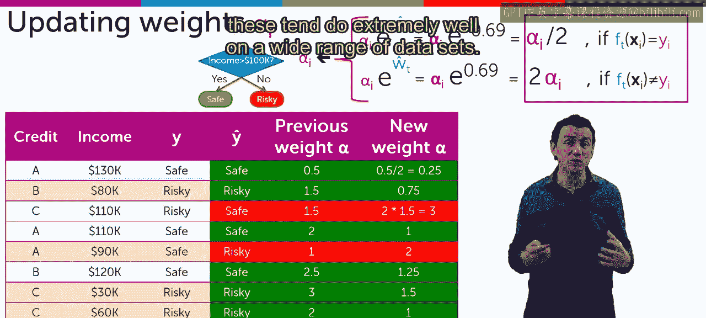

# 华盛顿大学《机器学习（分类，聚类和检索，第3-4课⧸共4课）｜Machine Learning》中英字幕 p94 93_使用AdaBoost学习提升决策树桩.zh_en -BV1Sr421F7N7_p94-

。

We will now take a few minutes to instantiate this abstract algorithm to describe and see what it looks like in the context of learning decision Stumps turns out the books of decisionion Stumps is a really nice simple default way of training on your data and so。

😊，It's one that will just go through a little further and help us ground some of the concepts that we looked at so far。

So here I've outlined the abu algorithm that we discussed before in the previous slides。

 but just to be clear， we're going to talk about learning a decision stamp for F of T and figuring out how to update it figure out coefficient W hat T。

😊，Our first step is figuring out how to learn the next decision stamp。 that's gonna be F of T。

 And this is just gonna be like standard decision stamp learning。

 We're gonna try splitting on each feature income credit history savings。

 market conditions and furing out how good each of the resulting decision stampumps are weighted data and notice that in our process。

 we might split。😊，One income multiple times so in multiple boost interactionss we might revisit the same features so we're going try each one of those features and for each one of them measure the weighted error on the training data so for say spliting on income。

 the weighted error might be 0。2 for splitting on credit it might be 0。

35 for splitting on savings it might be 0。3 it finally if you split of market conditions。

 it might be the worst of this four decision terms on this weighted data it might have weighted error 0。

4。So we're picking the best feature， the one that has lowest weighted error。

 and so we're going to pick that first one split on， we're going to split on income greater than 100。

000 and so F of T is going to be the decisional stamp that says income is greater to 10。

000 if you are safe， if not as a risky law。Now the final question is what coefficient we give to this particular classifier。

 so we have to do is plug 0。2 into that abu formula and if we plug it in and do the little math it's 0。

69 is the result so the coefficient of this first decision stamp is just going to be 0。69。😊。

Going back to the Abu algorithm， we discussed how we are going to learn the samet from data and how we figure out it's coefficient。

 let's next talk about how to update the weight alpha of each data point。😊。

So here's the intuitive process。 what happens。 We have our data points and I'm highlighting them here。

 depending on their income， just like we did before。

 But I'm going to make a prediction using this decision stamp。 The question is。

 how good is this decision stamp income greater than 100000。 And if you look at it。

 it makes mistakes in some of the data points and gets other right。

 So I marked the correct ones in bright green and mistakes in right red。😊。

And if we take the previous weights off of each one of these data points。

 I'm highlighting when those weights were right there。

We need to compute the new weight based on the formula above， which is the standard abu formula。😊。

So we're gonna plug in the W hat that we computed 0。

69 into the as formula to figure out what to multiply each one of these weight by。 So if plug it in。

 you'll see that each of the minus 0。69 is a half。 So for every correct data point we're gonna half its weight。

 and each of the 069 is 2。 So for every incorrect data point。 we're gonna double its weight。

 So I'm gonna go row by row for the ones in green I got correct。 I'm gonna half the weight。

 So for the first row there， the weight before with 0。5 and now becomes 0。25。😊，The next one was 1。

5 it becomes 0。75 because I got it correct for the third row I got it I mean the mistake it's way before was 1。

5 now I'm going to double it I'm going to make it three so we can go data point by data point and either multiply by two or divided by two the weight depending on whether we got that data point right or not。

😊，Extremely simple to build a booster decision to classifier and these tend to do extremely well on a wide range of data sets。

