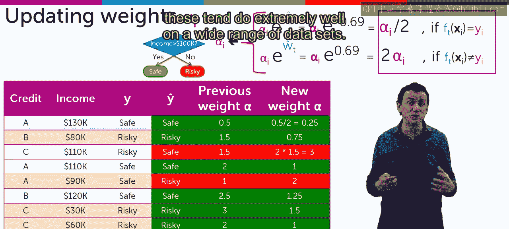

# 机器学习（分类，聚类和检索）：第3-4课：使用AdaBoost学习提升决策树桩

在本节课中，我们将学习如何将AdaBoost算法具体应用于决策树桩的学习。我们将详细介绍如何选择最佳决策树桩、计算其系数，以及如何更新每个数据点的权重。

---

## 概述：AdaBoost与决策树桩

上一节我们介绍了AdaBoost算法的抽象框架。本节中，我们来看看如何将这个框架实例化，用于学习决策树桩。决策树桩是一种非常简洁的默认学习方式，能帮助我们巩固目前所学的概念。

## 学习最佳决策树桩

以下是AdaBoost算法的核心步骤，我们将据此学习决策树桩 `F(t)` 并计算其系数 `W_hat_t`。

第一步是学习下一个决策树桩 `F(t)`。这类似于标准的决策树桩学习过程。

我们将尝试在每个特征上进行分割，例如收入、信用历史、储蓄和市场状况，并评估每个决策树桩在加权数据上的表现。在多次提升迭代中，我们可能会重复使用同一特征。

以下是评估过程：
*   对于“收入”特征进行分割，加权误差可能是 **0.2**。
*   对于“信用”特征进行分割，加权误差可能是 **0.35**。
*   对于“储蓄”特征进行分割，加权误差可能是 **0.3**。
*   对于“市场状况”特征进行分割，加权误差可能是 **0.4**。

我们选择具有最低加权误差的最佳特征。因此，我们将选择第一个特征，即“收入 > 100,000”进行分割。

所以，`F(t)` 将是这样一个决策树桩：如果收入大于100,000，则预测为“安全”；否则预测为“高风险”。

现在，最后一个问题是给这个分类器分配什么系数。我们需要将加权误差 **0.2** 代入AdaBoost公式进行计算。

**公式**：
`W_hat_t = 0.5 * ln((1 - error_t) / error_t)`

代入 `error_t = 0.2` 进行计算，结果是 **0.69**。因此，这第一个决策树桩的系数就是 **0.69**。

## 更新数据点权重

回到AdaBoost算法，我们已经讨论了如何从数据中学习树桩并计算其系数。接下来，我们谈谈如何更新每个数据点的权重 `alpha`。

这是一个直观的过程。我们使用刚学到的决策树桩（收入 > 100,000）对数据点进行预测。问题是，这个决策树桩的效果如何？

观察预测结果，它对一些数据点分类正确，对另一些则分类错误。我们将正确的标记为亮绿色，错误的标记为红色。

基于之前每个数据点的权重（图中已标出），我们需要使用上面的标准AdaBoost公式计算新权重。

我们将把计算出的系数 `W_hat = 0.69` 代入公式，以确定每个权重的乘数。代入计算后，你会发现：
*   对于每个正确的数据点，其权重将乘以 `exp(-0.69) ≈ 0.5`，即减半。
*   对于每个错误的数据点，其权重将乘以 `exp(0.69) ≈ 2`，即翻倍。

以下是逐行更新权重的示例：
*   对于第一行（绿色，正确），权重从 **0.5** 变为 **0.25**。
*   对于第二行（绿色，正确），权重从 **1.5** 变为 **0.75**。
*   对于第三行（红色，错误），权重从 **1.5** 变为 **3.0**。

我们可以逐个数据点地根据分类对错，将其权重乘以2或除以2。

## 总结

本节课中，我们一起学习了如何使用AdaBoost算法来提升决策树桩。我们具体实践了如何选择最佳分割特征以构建决策树桩、如何根据加权误差计算分类器的系数，以及如何根据分类结果更新每个训练样本的权重。构建一个提升的决策树桩分类器极其简单，并且这类模型通常在广泛的数据集上表现非常出色。