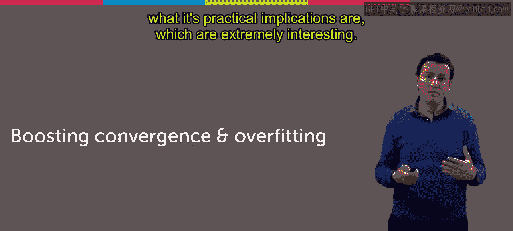
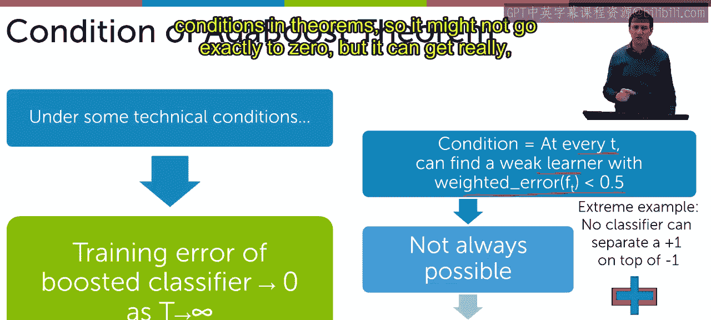

# 华盛顿大学《机器学习（分类，聚类和检索，第3-4课⧸共4课）｜Machine Learning》中英字幕 p95 94_提升定理.zh_en -BV1Sr421F7N7_p95-

。

Next， I want to take a few minutes to talk about the famous Ardebu theorem and what its practical implications are。

 which are extremely interesting。

So if you remember， the way that boosting came about is that currency of Viol had this famous question。

 can you combine weak classifiers to make a stronger one。

 actually violentolent is a touring award winnerner。

 so a really famous professor from Harvard and Shapirri a couple years later came up with the idea of boosting。

 which really changed the machine learning field。And so。

If we look at the iterations of boosting in the X axis here and the training error for a toilet data set。

 we observe a very practical effect that we've see a lot of boosting data。

We're going to start with a really bad training error。

 so our first decision stamp has training error of 22。5%， so not good at all。After 30 iterations。

 as we saw a little earlier， we're going to get。All the data points right in our training date and I showed you kind of that crazy decision boundary for this。

 So we see a smooth transition intion after ittion where the classification error tends to go down not as exactly。

 but tends to go down and the edge goes to  zero and actually stays at zero。😊。

And that's a key insight of the boosting theorem。So here is the famous Adabu theorem。嗯。

W underlines all the choices we made in the algorithm and it really has had a lot of impact in machine learning。

Basically， the serum says under some technical conditions and all theorems are like this。

 now if you are on say some restrictions apply starts for details。😊。

So you say send theres some technical conditions。😊，The training error of the classifier goes to zero。

As the number of iterations of the number of ensembles that we consider capital T goes to infinity。

 so in other words pictorially， we'll see that we expect the training error。

 which is this thing here on the Y axis to go eventually to0。Now， that's eventually。

It might oscillate a little bit in the middle， however。

 what the theorem says is that it tends to generally decrease， eventually become zero。

 usually and then stick at zero。So you're going to see this high in the beginning， wiggle， wiggle。

 wiggle， but tend to go down and then hit a certain value， usually zero and sticks at zero。😊。

Now let me just take a minute to talk about those technical conditions it starts with details。

 it turns out the technical condition is something quite important， it says that at every duration T。

😊，We can find that weak clear or a decision stamp that has weighted error at least。

A little bit lower than 0。5。 So there's a list better than random。 That's what the theorem says。

 It seems like intuitively shall justify the classifier that does better than random。

 even on weight data， But it turns out that this is not always possible。

 So here's like a counter example， which is really extreme counter example。

 but this other example where it's not possible。😊，So for example。

 if you have a negative point here and you have a positive point on top of it。

 there's never going to be decision stampump that can separate a positive point on top of negative point。

 so the conditions of a boosting algorithm might not be satisfied of the boosting abu theorem。

 however， nevertheless。😊，Boosting usually takes your train error to zero or somewhere quite low if the number of iterations go to infinity。

So we do observe that decreasing practice， although there are some technical conditions in theorem。

 so it might not go exactly to zero， but it can get really， really low。😊。

。