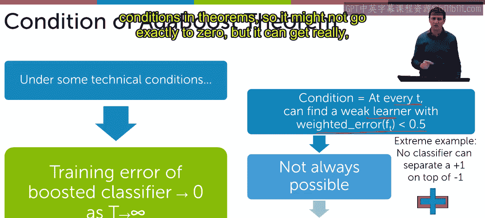

# 机器学习（分类，聚类和检索）：第3-4课：提升定理

在本节课中，我们将要学习著名的AdaBoost提升定理，探讨其核心含义及其在实际应用中的影响。提升定理是理解Boosting算法为何有效以及其性能极限的关键。

## 概述

提升定理由Yoav Freund和Robert Schapire提出，它从理论上解释了为何能够将一系列“弱”分类器组合成一个强大的分类器。我们将首先回顾Boosting算法的起源，然后深入定理的表述、技术条件及其实际意义。

上一节我们介绍了Boosting算法的基本迭代过程，本节中我们来看看支撑其有效性的理论基石——提升定理。

## 提升定理的起源与现象

Boosting算法的诞生源于一个核心问题：能否组合多个弱分类器来构建一个强分类器？Freund和Schapire提出的Boosting思想彻底改变了机器学习领域。

在实践中，我们观察到Boosting算法一个非常显著的现象。以下是其在训练集上的典型表现：

*   **X轴**：Boosting的迭代次数。
*   **Y轴**：在特定数据集上的训练误差。

我们通常看到，初始的弱分类器（如第一个决策树桩）训练误差可能很高（例如22.5%）。但随着迭代次数增加，训练误差会平滑下降，并最终趋向于零。这意味着算法最终能在训练集上完美分类所有样本。

## 提升定理的表述

以下是著名的AdaBoost定理的核心内容。定理中的权重 `W` 概括了算法中的所有选择，该定理对机器学习领域产生了深远影响。

**定理**：在满足某些技术条件的前提下，当集成分类器中弱分类器的数量 `T` 趋向于无穷大时，最终组合分类器的训练误差将趋向于零。

用公式可以表示为：
`当 T → ∞ 时，训练误差 → 0`

图像化理解就是，我们预期Y轴上的训练误差曲线最终会下降到0。虽然过程中可能会有波动，但总体趋势是下降的，并最终稳定在零附近。

## 定理的技术条件

现在，让我们花点时间讨论定理中提到的“技术条件”。所有定理都有其适用范围，提升定理也不例外。

该技术条件至关重要，它要求：在**每一轮迭代 `T`** 中，我们都能找到一个弱分类器（例如决策树桩），其**加权分类错误率**必须略低于0.5。

换句话说，这个弱分类器在加权后的数据上，其性能必须比随机猜测（错误率50%）**好一点点**。这看起来是一个很直观的要求。

然而，这个条件并非总能满足。以下是一个极端的反例：

假设一个负类样本点与一个正类样本点在空间位置上完全重合。那么，没有任何一个决策树桩（基于单一特征阈值的分类器）能够将这两个点分开。在这种情况下，提升定理的条件就无法被满足。

尽管如此，在实际应用中，只要数据不是完全不可分的，Boosting算法通常都能将训练误差降至极低水平，即使不一定精确到零。

## 总结

本节课中我们一起学习了AdaBoost提升定理。我们了解到，该定理从理论上保证了：只要每一轮迭代都能找到比随机猜测稍好的弱分类器，那么随着集成规模的扩大，组合分类器的训练误差可以趋近于零。

我们讨论了定理的技术条件及其重要性，也通过反例明白了该条件的边界。尽管存在严格的理论前提，但提升定理成功地解释了Boosting算法在实践中表现出的强大拟合能力，使其成为机器学习中不可或缺的工具之一。