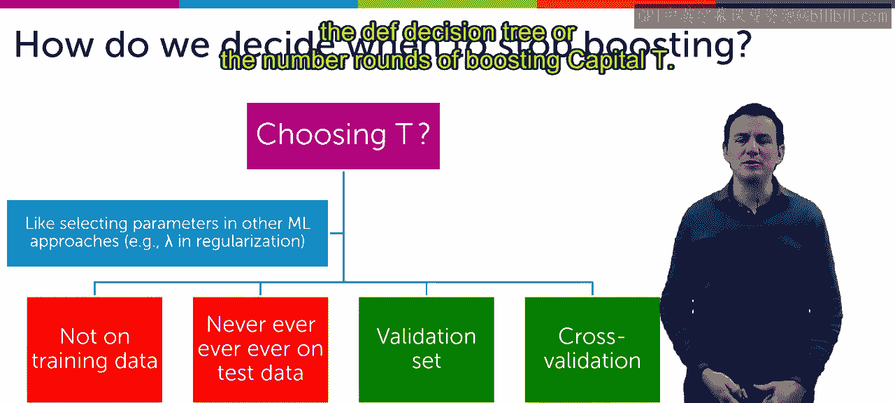

# 华盛顿大学《机器学习（分类，聚类和检索，第3-4课⧸共4课）｜Machine Learning》中英字幕 p96 95_提升中的过拟合.zh_en -BV1Sr421F7N7_p96-

。

So let's compare a boosted decision stamp to a decision tree。

 So this is the decision tree plot that we saw in the decision tree module。

 so this is on real a real dataset is based on loan applications and we see the training error as we make the decision tree deeper tends to go down down and down and we saw that but the test error which is kind of relate to the true error。

 goes down for a while and you have here the best depth which is maybe7。

But eventually it goes back up。So let's say after depth 18 over here。

 the training error is down to 8%， so it's really low training error。

 but the tester has gone up to 39% and we observe overfitting and in fact we observe a huge gap here。

The other thing to note， by the way， is that the best decision three has classification error in the test set of about 34% or so。

No。Let's see what happens with decision stampumps ba boosted on the same data set。

 you get a plot that looks kind of like this， you see that the training error keeps decreasing per iteration so this is the train error。

So as the theorem predicts， it decreases。As。And the。Test error in this case is actually going down。

With with iterations so we're not observing over3 and li yet and after 18 rounds of boosting so 18 decision stampumps。

 we have 32% test error， which is。Better than a decision tree gets， in fact。

 better than the best decision tree。 And the overfitting is much lower。

 So this gap here is much smaller。So the gap between the train area the test error is kind of related to that overfitting quantity that we have。

Now we said we're not observing over 15 yet， so let's run boost systems for more iterations and see what happens。

So let's see what happens when we keep on boosting and adding more decision stamps and the X axis is adding more and more decision stamps and more trees but just the level1 trees and see what happens to the classification error we see here that the training error keeps decreasing。

😊，Just like we expected by the theorem。But the test error has stabilized。

 so the test performance tends to stay constant。 and in fact， it stays constant for many iterations。

 So if I pick T anywhere in this range。We will do about the same。So， any of。These。Values。

For capital T would be fine。So， now we've seen。How boosting the Tesra goes down seems to be stabilizing。

 but the question is， do we observe overfitting with boosting？And in fact。

 we do observe overfitting with boosting， but boosting tends to be quite robust overfitting so if you use too many trees or too field trees。

 there's a huge range when it does okay so here I'm going up to 5，000 decision stampumps。

 which is this type of boosting that we're doing here。The best test error was about 31%。

 but if I kept going too far ago to 5，000 I'm overfitting， that test error is going up。

 but isn't up that much。Goes up to 33%， so there's some overfiing here。

Very importantly in these examples I've been showing you the test error and talking about what happens overfi when boosting。

 but as we know， we need to be very careful of how we picked the parameters of our algorithm so how do we pick T capital T which is when we stop boosting we add five decision stamps 5000 decision stops and this is just like select magic parameters of all sorts of machine learningning algorithms and it turns out that almost every algorithm out there model has a parameter traced of complexity therefore decision tree number of features or magnitude of the weights in logistic regression and here is the number rounds of boosting with the quality of the fit So just like lambda in regulargization。

😊，We can't use the training data because the training error tends to go down with iterations of boosting so you say that T should be infinite。

 should be really big and it should never， never， never， never ever。

 ever ever ever ever ever use the test data so that's bad I was just showing illustrative examples but you should never do that so what should we do well。

😊，You should either use a validation set if you have a lot of data。

 if you have a big data set you select the subpart of that to just pick the magic parameters and if your data set is not at large。

 you should use cross validation and we talked in integration course。

 we talked about how to use validation sets and how to use cross validation to pick magic parameters like Lambda。

 the depth of decision tree or the number rounds of boosting capitalto T。😊。

