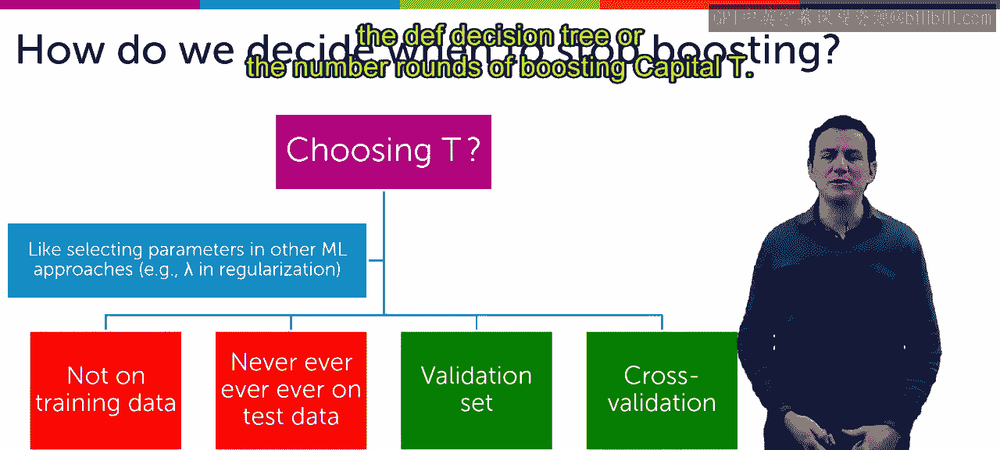

# 机器学习（分类，聚类和检索）：第3-4课：提升中的过拟合 📈

在本节课中，我们将要学习提升方法（Boosting）中的一个重要现象——过拟合。我们将通过对比决策树与提升决策桩（Boosted Decision Stump）的表现，来理解提升方法对过拟合的鲁棒性，并探讨如何正确选择提升的迭代轮数。

---

## 决策树中的过拟合

上一节我们介绍了提升方法的基本原理，本节中我们来看看过拟合问题。首先，回顾一下在决策树模块中观察到的现象。

下图展示了在一个真实的贷款申请数据集上，决策树深度与分类错误率的关系。

以下是关键观察结果：
*   **训练错误率**：随着决策树深度增加，训练错误率持续下降。
*   **测试错误率**：测试错误率（可反映真实错误率）先下降，在深度约为7时达到最佳，之后开始回升。
*   **过拟合现象**：当深度达到18时，训练错误率低至8%，但测试错误率却高达39%。这表明出现了严重的过拟合，且训练与测试错误率之间存在巨大差距。
*   **最佳表现**：最佳决策树在测试集上的分类错误率约为34%。

---

## 提升决策桩的表现

现在，让我们看看在相同数据集上应用提升决策桩（Boosting）的效果。

其表现曲线呈现以下特征：
*   **训练错误率**：随着提升迭代轮数的增加，训练错误率持续下降，这与理论预测一致。
*   **测试错误率**：测试错误率同样随着迭代而下降，**并未立即观察到过拟合**。
*   **性能对比**：经过18轮提升（即18个决策桩）后，测试错误率为32%。这优于单个最佳决策树的表现（34%）。
*   **过拟合程度**：训练与测试错误率之间的差距更小，意味着过拟合程度显著降低。

---

## 持续提升会怎样？

我们提到提升初期未观察到过拟合，那么如果持续增加迭代轮数，会发生什么呢？

以下是随着决策桩数量（即提升轮数 T）增加的趋势：
*   **训练错误率**：如定理所预期，持续下降。
*   **测试错误率**：在经历一段下降后趋于稳定。在相当宽的迭代轮数范围内（例如上图中T的某个区间），测试性能保持恒定。
*   **过拟合的显现**：如果迭代轮数过多（例如达到5000），最终仍会观察到过拟合，测试错误率开始缓慢上升（例如从最佳的31%升至33%）。但提升方法对过拟合表现得相当鲁棒，错误率上升幅度相对较小。

---

## 如何选择提升轮数 T？

在以上示例中，我们使用了测试错误率来讨论过拟合，但在实际建模中，**绝不能使用测试集来调整参数**。那么，应该如何正确选择提升的迭代轮数 T 呢？

T 是控制模型复杂度的关键参数，类似于正则化中的 λ 或决策树的深度。选择它的原则与选择其他机器学习算法的“魔法参数”相同。

以下是两种标准方法：
1.  **验证集法**：如果拥有大量数据，可以划出一部分作为验证集，专门用于选择最佳 T 值。
2.  **交叉验证法**：如果数据集不是特别大，则应使用交叉验证技术来选择 T 值。

这两种方法能确保我们基于未参与训练的数据来评估模型复杂度，从而得到泛化能力更好的模型。

---

## 总结

本节课中我们一起学习了提升方法中的过拟合问题。通过对比发现，提升方法（如提升决策桩）相比单个复杂模型（如深度决策树）对过拟合具有更强的鲁棒性，其测试错误率能在更宽的迭代轮数范围内保持稳定。然而，过度提升最终仍会导致过拟合。关键在于，我们必须使用验证集或交叉验证等正确方法来选择提升的迭代轮数 T，而不能依赖于训练错误率或测试集。

