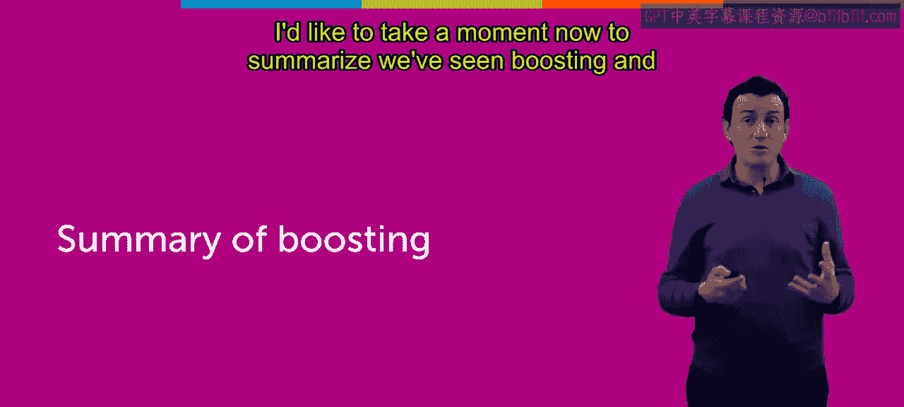
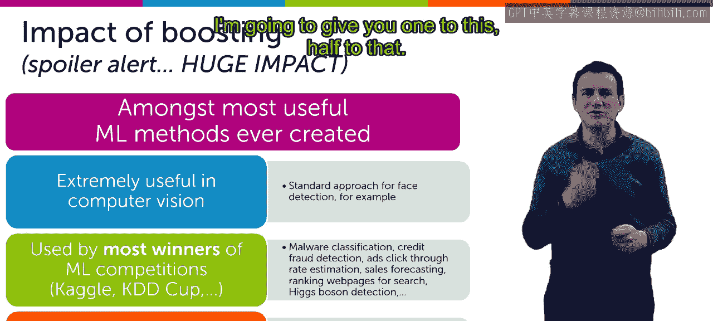
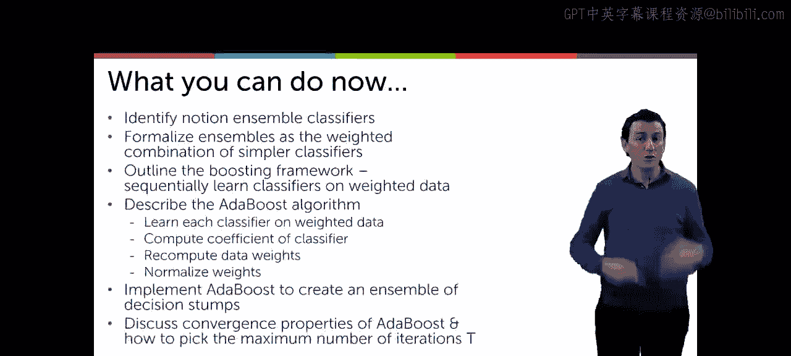
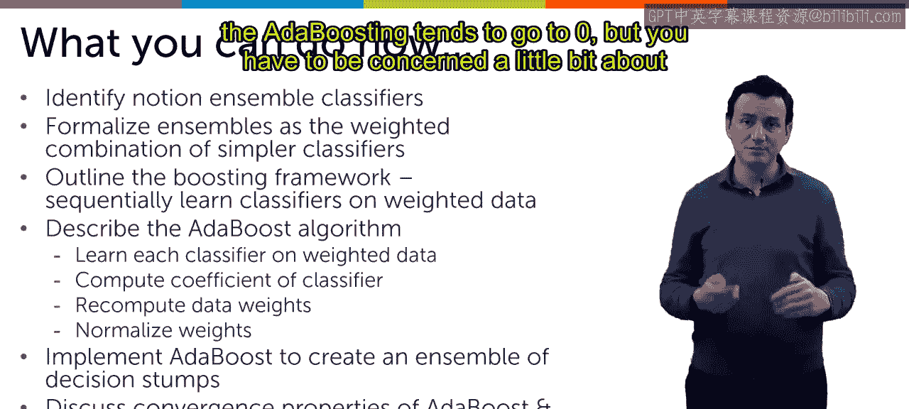
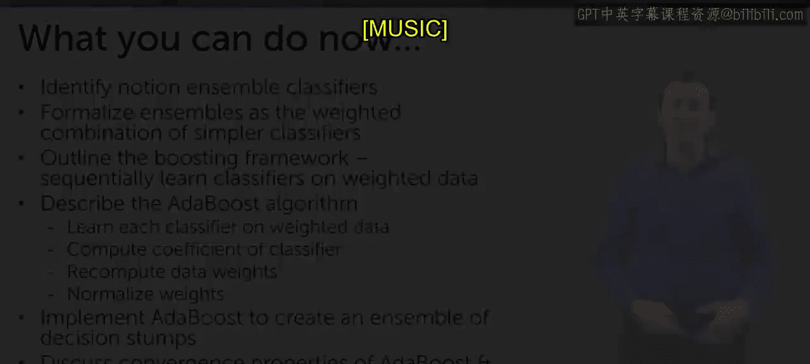

# 华盛顿大学《机器学习（分类，聚类和检索，第3-4课⧸共4课）｜Machine Learning》中英字幕 p97 96_集成方法：提升的影响快速回顾.zh_en -BV1Sr421F7N7_p97-

。

I'd like to take a moment now to summarize what we've seen with boosting and what impact it's had in the real world。

Let's talk about other boosts。 So otherbu is one of the early types of boosting algorithms。

 extremely useful， but there are other algorithms out there。

 in particular this one called gradient boosting， which is slightly more complicated but extremely similar and it's like other boost。

 but it can be useful not just for base classification but for other types of loss functions for other types of problems and it's what most people use So gradient boosting it's kind of generalization of other boost。

 you can think about it that way。 then there's other related ways to learn and ensembles。

 the most popular one is called random forests So random forests is a lot like boost in a sense they tries to learn an ensemble of classifiers in this case decision trees but it could be other types of classifiers and instead of using boosting uses an approach called bagging and it's very briefly in what you do buggings you take your data and you sample different subset of data。

 which kind of like learning on different sub data sets and we learn the decision tree on each one of them and just average outputs so you're not optimize。

in the coefficients W hat and we're learning from different subsets data。

 it's easier to parallellyze， but it tends to not perform as well as boosting for a fixed number of trees。

 so for 100 trees or 100 stampumps， boosting tends to perform better than random forest us。😊。

Now let's take a moment to discuss the impact Gusing has had in the machine learning world。

 and hint hand has been huge。😊，It's amongst the most useful machine learning approaches out there。

 It's useful in a wide range of fields。 So， for example， in computer vision。

 a lot of the default algorithms in computer vision use boosting like face detection algorithms or you take your camera you pointed at something and tries to detect your face of who is there that uses boosting it's extremely useful。

 if you look at machine learning competitions have become very popular the last two or three years from places like cargo or KDD Cup。

 most winners， so this is more than half think it's about 70% of winners actually use boosting to win a competition。

 In fact， they use boosted trees and this looks at wide range of tasks like malware detection or fraud detection or ranking web searches and even like。

😊，Interesting physics tasks like detecting the Higgs boson。

 all those problems and all those challenges have been won by booster decision trees。

And this is perhaps one of the most deployed advanced machine learning methods out there。

 particularly the notion of ensembles。 So， for example， if you know about Netflix， which is the。

An online movie place we can watch movies online company。

 they recommend what movie you might want to watch next。

 That system uses boosting actually uses an ensemble of classifiers。

 but more interestingly they had a competition a few years ago where people tried to provide better recommendations and the winner was one that create an ensemble of many。

 many， many classifiers in order to create better recommendations。 So ensembles。

 you'll see them everywhere。 Sometimes they optimized with boosting。

 sometimes they optimized with different techniques like bugging。

 and sometimes people just by hand tune in the way to say， okay。

 I gonna give one to this half to that。 they recommend the last approach。

 I recommend boosting as they wanted to use。😊。

Great， so in this module， we've explored the notion of an ensemble classifier and we formalized ensembles as the weight combination of the votes of different classifiers。

 and we discuss generally the boosting algorithm where the next classifier focuses on the mistakes that were made so far。

 as well as other boost， which is a special case for classification where we showed you how to come up with the coefficients of each classifier and the weights on the data。

 weve we discussed how to implement。😊。

Decision stamps both boost the decision stampumps extremely easy to do and then talk a little bit about the conversions property of how the training erroring tends to go to zero。

 but you have to be concerned a little bit about overfitting。

 although it tends to be a very robust overfitting practice。

