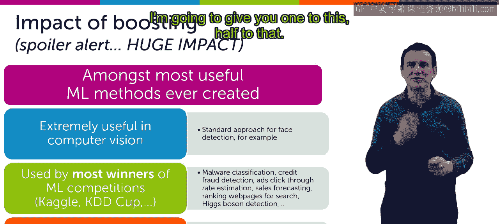
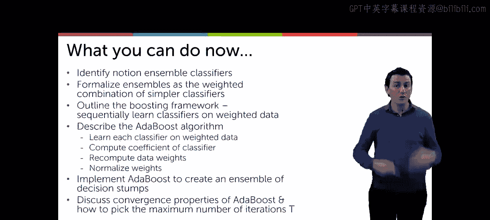
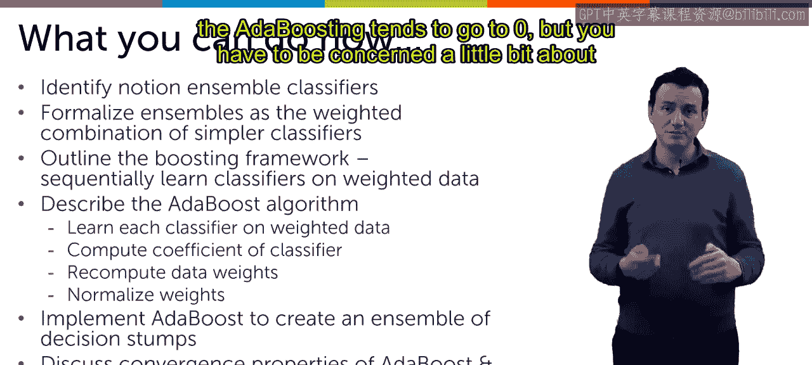
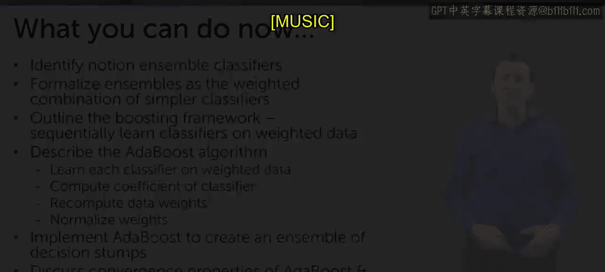

# 机器学习（分类，聚类和检索）：第3-4课：集成方法：提升的影响快速回顾 🚀

在本节课中，我们将对提升（Boosting）方法进行总结，回顾其核心思想、其他相关算法，并探讨它在现实世界中的巨大影响。

## 提升方法总结 📊

上一节我们介绍了集成分类器的概念，并将其形式化为不同分类器投票的加权组合。我们重点讨论了提升算法，其核心思想是让后续的分类器专注于纠正之前分类器所犯的错误。

具体来说，我们学习了AdaBoost算法，这是用于分类问题的一种特殊提升方法。我们展示了如何计算每个分类器的系数 `α_t` 以及数据点的权重 `D_t(i)`。其核心更新公式如下：

*   对于误分类的点，增加其权重：`D_{t+1}(i) = D_t(i) * exp(α_t)`
*   对于正确分类的点，减少其权重：`D_{t+1}(i) = D_t(i) * exp(-α_t)`
*   分类器系数 `α_t` 基于其加权错误率 `ε_t` 计算：`α_t = 0.5 * ln((1 - ε_t) / ε_t)`

最终，集成模型的预测是所有弱分类器预测的加权投票：`H(x) = sign( Σ α_t * h_t(x) )`。

## 其他集成算法 🔄

除了AdaBoost，还有其他强大的集成学习方法值得了解。

以下是两种重要的相关算法：

1.  **梯度提升（Gradient Boosting）**：可以看作是AdaBoost的泛化。它不仅能用于分类问题，还能通过优化其他类型的损失函数来处理更广泛的问题（如回归），是目前最常用的提升算法之一。
2.  **随机森林（Random Forests）**：这是一种与提升不同的集成策略，称为“装袋法”（Bagging）。其过程简要概括为：从原始数据中有放回地抽取多个不同的子数据集，在每个子集上独立训练一棵决策树，最后对所有树的输出进行平均（如投票或取均值）。与提升相比，随机森林更容易并行化，但在固定树的数量下（例如100棵树），其性能通常略逊于提升方法。

## 提升的现实世界影响 🌍

现在，让我们来看看提升方法在机器学习领域产生的巨大影响。它已成为最实用、应用最广泛的机器学习方法之一。

提升方法在众多领域发挥着关键作用：

*   **计算机视觉**：许多默认算法，如人脸检测，都基于提升方法。
*   **机器学习竞赛**：在Kaggle或KDD Cup等平台上，大约70%的冠军解决方案使用了提升方法，特别是提升决策树（如XGBoost， LightGBM）。
*   **多样化任务**：提升方法成功应用于恶意软件检测、欺诈检测、网页搜索排名，甚至像希格斯玻色子探测这样的物理任务。
*   **工业部署**：集成方法是部署最广泛的先进机器学习技术之一。例如，Netflix的电影推荐系统就使用了集成分类器。在其著名的推荐算法竞赛中，获胜方案正是通过组合大量分类器构建的集成模型。

人们通过不同方式构建集成模型：有时使用提升进行优化，有时使用装袋法等技术，有时甚至手动调整组合权重。其中，我们推荐使用提升方法来自动化这一过程。

## 课程总结 ✅

在本模块中，我们一起深入探索了集成分类器的世界。

我们首先将集成模型形式化为多个分类器的加权组合。然后，重点学习了提升算法，其核心是让后续分类器专注于纠正前序模型的错误。我们详细探讨了用于分类的AdaBoost算法，包括如何计算分类器系数和数据权重。我们还讨论了如何用决策树桩（Decision Stump）这种极简单的模型作为弱学习器来实现提升。

最后，我们提到了提升的训练误差会收敛到零的理论性质，虽然也需要警惕过拟合，但提升方法在实践中通常表现出很强的鲁棒性。

总而言之，集成方法，尤其是提升，是机器学习工具箱中不可或缺的强大工具，并在解决现实世界复杂问题中持续证明其价值。