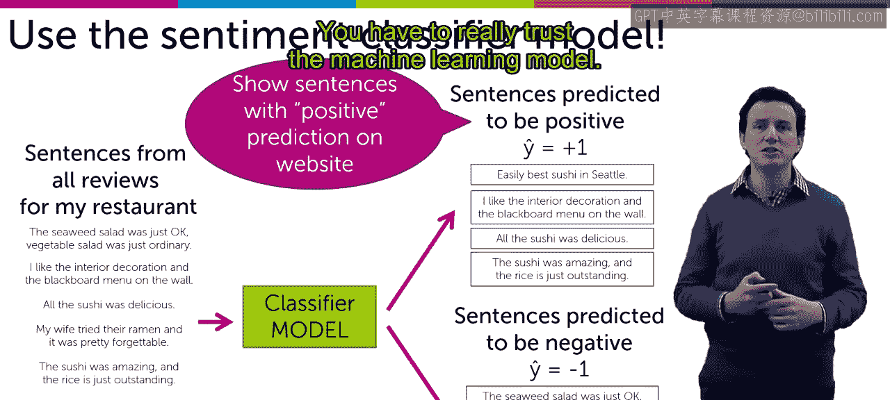

# 华盛顿大学《机器学习（分类，聚类和检索，第3-4课⧸共4课）｜Machine Learning》中英字幕 p98 97_案例研究：准确率不是分类的最佳指标.zh_en -BV1Sr421F7N7_p98-

。

Throughout this course we've evaluated classifiers in one key way。

 we measure the error or the accuracy of that classifier。

 but it turns out that for many real world applications。

 error or accuracy is not a great measure to try to understand whether classifier is doing the right thing for you。

😊，And in this module， we're going to talk about precision recall， which is a very cool。

 very simple way to evaluate classifiers that captures something that's needed for a wide range of applications。

 and we'll use a cool fun application as a kind of running example throughout the module。😊。

So here's the idea。Let's say I have a restaurant and I have a goal。

 I want to increase the number of guests， the number of people coming to it in my restaurant by 30%。

 And I say I'm going to do a cool advertising campaign to do that。

 but nobody wants to just get those ads in the Mayo or spammy Mayo as their advertising campaign。

 So I want to be innovative。 I want to be authentic about my advertising campaign。

 And the way I want to be authentic is that when I use the voice of my customers。😊。

To talk about how great the restaurant is。 So I'm going to look at the customer reviews。

 I I'm going to find great things in there， great nuggets to be able to tell everyone about how great my restaurant is。

 So I going to find great quotes。😊，Key positive sentences that describe amazing things about my restaurant and may even find some spokespeople that。

😊，I'm really eloquent。 They explain really well what they love about my restaurant。

 So that's my goal。😊，And so I might do that automatically by taking the restaurant reviews and posting key sentences or key things that people are saying on my website so that anybody who lands there can see the latest greatest of what's being said。

So I want to do a lot of these restaurant reviews， and I want to automate a lot of that process。

 So I want to do it。 So just like we described the first course of the specialization。

 we're going to take the restaurant reviews and we're going to splitit them into sentences。

 So for every sentence some positive about my restaurants some are negative。

 I want to be able to evaluate。 So for example， if the sentence says easily the best susin Cto。

 that's my input X。 I'm going to feed that for the sentence sentiment classifier and get an output why hat。

😊，I， which is either positive sentiment or negative sentiment。

And I want to do that for every sentence in every review that I get。 and in fact。

 I might even do that in real time every time a new review comes in。

 I'm going to feed it through this classifier model and try to predict why hat I as being positive for some sentences。

 This is the great ones， the ones I want to show off the ones I want to talk about and then why hat I the minus one this is the negative ones I want to ignore those so I want to care about the positive ones and I'm gonna to do my best to take those positive sentences。

 show them in a way that people really feel man my restaurant is awesome I'm gonna go there for sushi。

So how do I find those positive sentences I'm going to be a sentiment classifier。

 but how do I know that sentiment classifier is really good， I can trust it。

 I can put those sentences on my website without having to check every time a sentence goes up。😊。

🎼And this is the key point we're talking about automating machine learning you have to really trust a machine learning model。

 so if I give you a particular say accuracy is that enough trust for me to just automatically feed reviews into something that shows up in my website。

😊。

