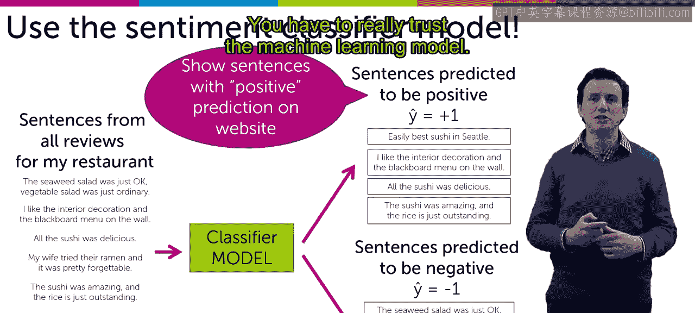

# 机器学习（分类，聚类和检索）：第3-4课：案例研究：准确率不是分类的最佳指标 🎯

在本节课中，我们将探讨一个重要的概念：为什么在评估分类器时，仅仅依赖准确率或错误率可能是不够的。我们将通过一个有趣的餐厅广告案例，引入**精确率**和**召回率**这两个更细致的评估指标。它们能帮助我们更好地理解分类器在真实世界应用中的表现。

---

## 评估分类器的传统方法

在本课程中，我们一直以一种关键方式评估分类器：我们测量分类器的**错误率**或**准确率**。然而，事实证明，对于许多现实世界的应用，错误率或准确率并不是衡量分类器是否为你做出正确决策的好指标。

## 引入精确率与召回率

在本模块中，我们将讨论**精确率**和**召回率**。这是一种非常酷且简单的方法，用于评估分类器，它能捕捉到广泛应用程序所需的一些特性。我们将使用一个有趣的应用作为贯穿本模块的示例。

## 案例背景：餐厅广告活动

设想我拥有一家餐厅，我的目标是**将餐厅的客流量增加30%**。我计划开展一个创新的广告活动来实现这个目标。但没有人希望他们的广告活动只是垃圾邮件式的群发邮件。因此，我希望广告活动是**真实可信**的。

我希望实现真实性的方式是：**利用顾客的声音**来讲述餐厅有多么棒。具体来说，我将查看顾客评论，从中找出精彩的片段——那些描述餐厅优点的关键正面句子，甚至可能找到一些能言善辩的代言人，来清晰地解释他们喜爱餐厅的原因。

我的目标是自动化这个过程：获取餐厅评论，并将人们所说的关键句子或要点发布在我的网站上，这样任何访问网站的人都能看到最新的好评。

## 自动化流程：使用情感分类器

为了处理大量评论并实现自动化，我将采用我们在专项课程第一门课中描述的方法：将餐厅评论**分割成句子**。对于每个句子，有些是正面的，有些是负面的。我需要一个分类器来评估它们。

例如，如果句子是“easily the best sushi in town”，这就是我的输入 **X**。我将把它输入到**句子情感分类器**中，并获得输出 **ŷᵢ**，它要么是**正面情感**，要么是**负面情感**。

我将对收到的每一条评论中的每一个句子都这样做。事实上，我甚至可以实时进行：每当有新评论出现，我就将其输入这个分类器模型，并尝试预测 **ŷᵢ** 是否为正面。

*   **ŷᵢ = +1**：这些是“好句子”，是我想要展示和谈论的。
*   **ŷᵢ = -1**：这些是负面句子，我想忽略它们。

我关心的是正面句子，并尽力将它们展示出来，让人们觉得：“哇，这家餐厅太棒了，我要去那里吃寿司！”

## 关键问题：如何信任分类器？

我如何找到那些正面句子？我将使用一个情感分类器。但**我如何知道这个情感分类器真的很好，我可以信任它**？我能否放心地将这些句子自动发布到我的网站上，而无需每次都检查？

**这正是我们要讨论的关键点：在自动化机器学习时，你必须真正信任一个机器学习模型。** 那么，如果我告诉你一个特定的准确率，这个数字是否足以让我信任到可以自动将评论输入到直接显示在网站上的系统中？

---

### 总结

本节课我们一起学习了为什么在现实应用中，仅凭准确率评估分类器可能存在问题。我们通过一个餐厅广告的案例，引出了对更细致评估指标的需求。下一节，我们将深入探讨**精确率**和**召回率**的具体定义与计算，看看它们如何帮助我们更好地理解和信任分类器在特定任务（如筛选正面评论）上的表现。