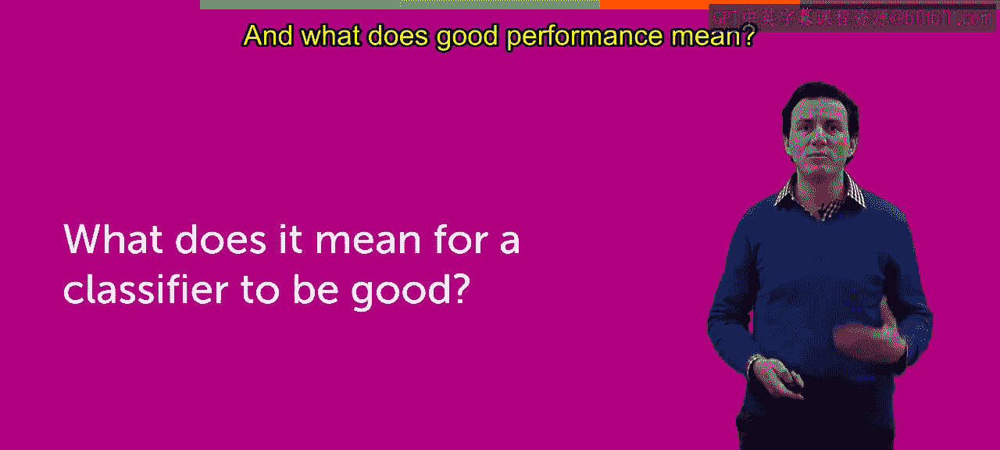
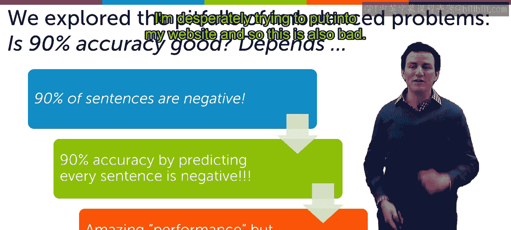
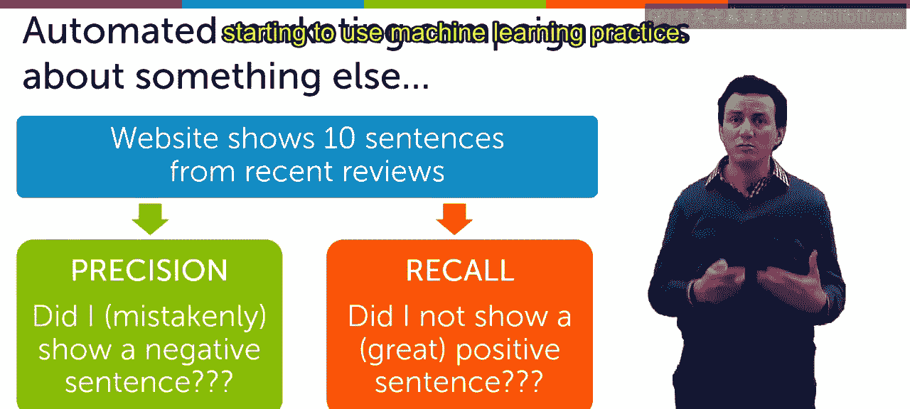

# 华盛顿大学《机器学习（分类，聚类和检索，第3-4课⧸共4课）｜Machine Learning》中英字幕 p99 98_什么是分类器的好性能.zh_en -BV1Sr421F7N7_p99-

。

In order to figure out what sentence I want to put onto my website。

 I want to make sure that my classifier is good at identifying those sentences so I want to make sure its performance is good and what does good performance mean。

😊。

In general， well it depends on the task and the question is。

 what does good performance mean for my task at hand， for deciding what sentences to show？And so。

Previously in the first course we asked the question what is good accuracy。

 what's good accuracy in general and we compared good accuracy with say a random classifier so for example the binary classification task with two classes that we're talking about random gets 50% so 0。

5 classification error and so we should do at least better than 0。

5 if you have multiple classes then you know you get classification error one over k so for three classes to get a 0。

66 and so on so at the very very least we said we should do at least better than random。😊。

But that's not enough to make me decide， doing better and random is not enough to make you decide to deploy this service into the website of my restaurant。

 so I need to think about something else。Then in the first course was to explore the question of imbalance classes。

 what happens for example， when there's a lot more data of one category or one class versus the other。

 so as an example I say my classifier says 90% it has 90% accuracy。But my restaurant sucks。

 90% of the reviews are negative， what does that mean。

 that means the classifier might be saying that everything is negative。

Everything is negative it doesn't find any of those positive reviews。

 so the performance might look pretty good in terms of accuracy。

 but it's never going to find those 10% of positive reviews which I'm desperately now because it's so bad I'm desperately trying to put into my website and so this is also bad。

😊。

And so now let's step back and think about the task that we have。

 this automated marketing campaign task。And ask， what is good performance for me， I it accuracy。

 is it 90%， it's not？It's about two things。First， if I show something on my website。

 it better be good， it better be positive。Man， if I show a negative review on my website。

 it's a double wmy， so first people are going to my website。

 they're reading about me and they're reading bad things there the people saying nobody is going to want to come to my website。

So what I want to make sure is that I'm very precise whenever I show something， it's good。

 so that means high precision。And the other thing that I have to worry about is。

Finding all those positive reviews， maybe my restaurant is not that good and those positive reviews。

And not that common so I want to make sure I find all of the positive reviews so I can have a chance of showing all the positive reviews on my website and that's called recall so precision is how precise I am at showing good stuff in my website recall is how precise I am how good I am at finding all the positive reviews amongst all the reviews all the sentences out there。

So I want to be good into those two metrics。Single accuracy number that we talked about before。

Precision recall is generally an extremely important type of metric for evaluating classifiers。

 people use it in practice all the time when I discuss them in quite a bit of detail today。😊。

And it's something that you should be extremely familiar with if you're starting to use machine learning in practice。

