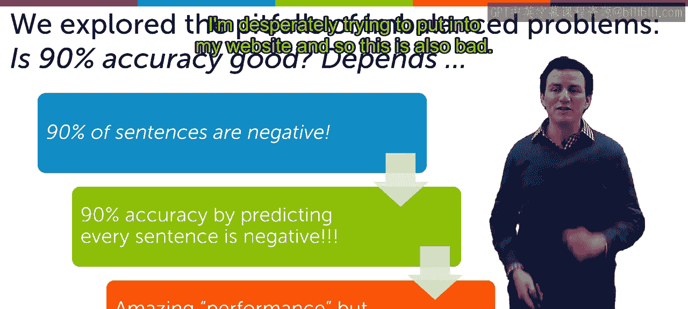
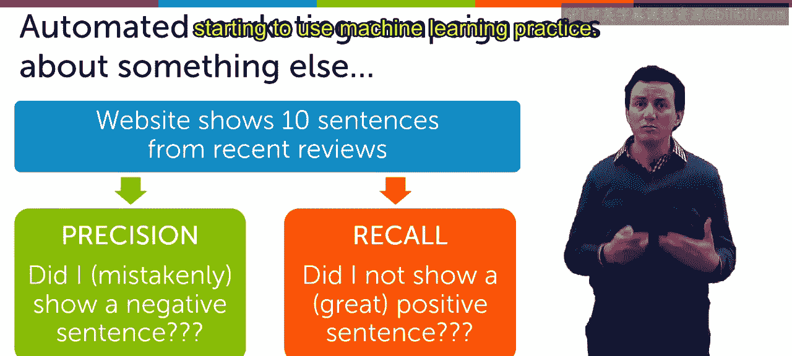

# 机器学习（分类，聚类和检索）：第3-4课：什么是分类器的好性能

在本节课中，我们将探讨如何评估分类器的性能。我们将超越简单的准确率，学习两个在现实任务中至关重要的评估指标：精确率与召回率。

上一节我们介绍了分类任务的基本概念，本节中我们来看看如何具体衡量一个分类器的好坏。

---

为了决定在我的网站上展示哪些句子，我需要确保我的分类器擅长识别这些句子。因此，我需要确保它的性能良好。那么，良好的性能意味着什么？

通常，这取决于具体任务。问题是，对于我决定展示哪些句子这个任务而言，什么才是好的性能？

在第一门课程中，我们曾探讨过什么是好的准确率。我们通常将分类器的准确率与随机分类器进行比较。例如，在我们讨论的二元分类任务中，随机分类器的准确率是50%，即分类错误率为0.5。因此，我们的分类器至少应该比0.5更好。如果有多个类别，随机分类器的错误率是1/k。例如，对于三个类别，错误率约为0.66。所以，我们至少应该比随机分类做得更好。

但这还不足以让我做出决定。仅仅比随机分类好，还不足以让我决定将这个服务部署到我的餐厅网站上。因此，我需要考虑其他因素。

第一门课程中还探讨了类别不平衡的问题。例如，当一个类别的数据远多于另一个类别时会发生什么。举个例子，假设我的分类器声称有90%的准确率。但我的餐厅评价很差，90%的评论都是负面的。这意味着什么？这可能意味着分类器将所有评论都预测为负面。

它从未找到那10%的正面评论。因此，仅从准确率来看，性能可能看起来不错，但它永远找不到我迫切需要的那些正面评论（因为餐厅评价太差，我正拼命想展示它们）。所以，这种情况也很糟糕。

---

现在，让我们退一步，思考我们手头的任务——这个自动化营销活动任务。并问自己：对我来说，什么是好的性能？是准确率吗？是90%吗？不是。它关乎两件事。

首先，如果我在网站上展示某些内容，它最好是正面的。天哪，如果我在网站上展示了一条负面评论，那就是双重打击。一方面，访问我网站的人会读到关于我的负面信息；另一方面，人们会说没人会想来我的网站了。因此，我要确保的是，每当我展示内容时都非常精确，确保它是正面的。这意味着需要高精确率。

其次，我必须担心的另一件事是，找到所有那些正面评论。也许我的餐厅评价并不那么好，那些正面评论并不常见。所以我必须确保我能找到所有的正面评论，这样我才有机会在网站上展示所有正面评论。这被称为召回率。

所以，精确率衡量的是我在网站上展示的内容有多精确（即展示的是正面评论）。召回率衡量的是我有多擅长从所有评论、所有句子中找到所有的正面评论。

因此，我希望在这两个指标上都表现良好。我们之前讨论的单一准确率数字，在实际应用中，精确率和召回率是评估分类器极其重要的一类指标，人们一直在使用它们。今天我将详细讨论它们。

如果你开始在实践中应用机器学习，你应该对这两个概念非常熟悉。