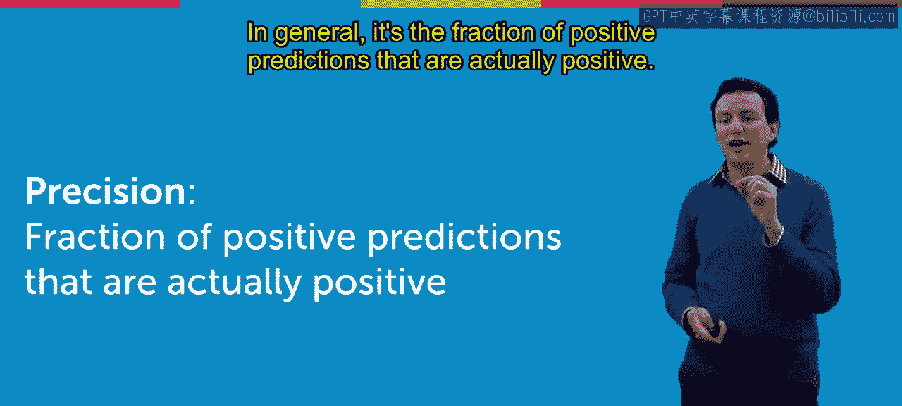
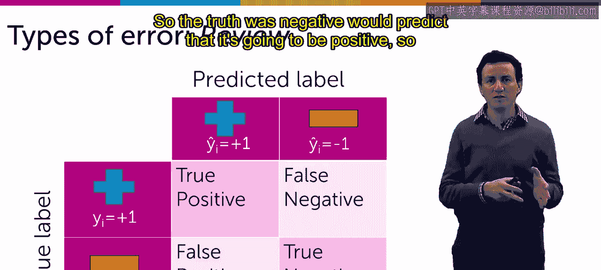
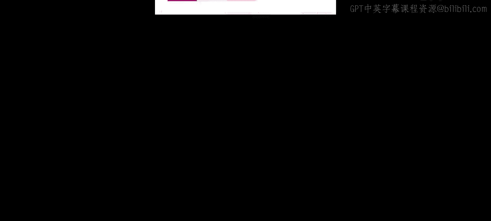
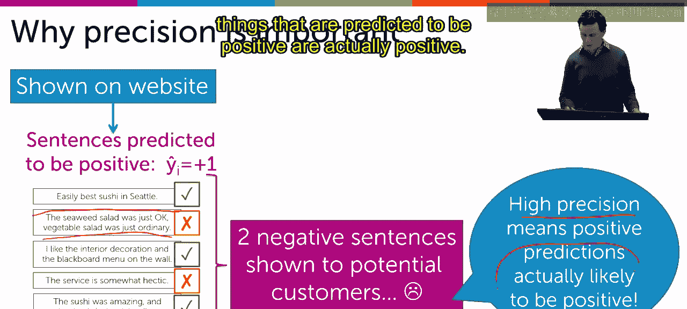

# 华盛顿大学《机器学习（分类，聚类和检索，第3-4课⧸共4课）｜Machine Learning》中英字幕 p100 99_精确率：实际为正的正预测比例.zh_en -BV1Sr421F7N7_p100-

。

We're going to start by defining this idea of precision a little bit more formally。

 so precision is of the sentences that showed in my website which fraction were actually positive in general it's the fraction of positive predictions that are actually positive。

😊。

Precision then is the fraction of positive predictions that were actually positive。

 So let's say that my algorithm predicted that the six sentences were positive。

 so I predicted y hat equals plus one for the six sentences。

 but in reality only four out of those six were truly positive。

 so we got four truly positive ones and two false positives in the mix so its precision was four6。😊。

So in general， we have a set of data points we're calling positive that we're predicting to be positive y hat in this case I equals plus1。

 some of them are truly positive， the Yi is plus1， but some of them were actually not positive so that Yi was actually minus1 and the question is how big a fraction of those are the ones that are actually truly positive。

So here is where we can review that notion of true positives and true negatives。

 and so we can look at the table where on the rows we have the true label YI。

 while in the columns we have the predicted label Y hat。

And so if the truth is positive and the predictor is positive。

 we say that we call that a true positive， it was positive and it was true。If the true label。

Is minus1？And the prediction is minus1， we call that true negative， it was negative。

 and we predicted negative minus1， so both of those are correct。

 but there are two types of mistakes we can make。The first type so called false negatives。

 it was truly a positive review， but we predicted it to be negative。😊，So Yi was plus1。

 Y hat was minus1 and finally a false positive is one where the true label was minus1。

 but the prediction was plus1， so the truth was negative we predicted it to be positive。

 so it's a false。

Positive。

I find it very helpful to ground this idea as a false positive and false negative in the context of an example to really kind of really feel it and really understand what the impact of those mistakes can be。

 So let's look at this matrix here again If we look at the top left we have a truly positive sentence So it was a plus one sentence。

😊，And we got it right， so we had a plus one prediction。So that's a no mistake。 That's great。

 Similarly， for the bottom right， we didn't make a mistake。 we had a minus one sentence。

So a negative sentence。 and we made a negative prediction。Now。

 the problematic ones are the other two， so let's look first at the top one。

 So what happened here was that I had a positive sentence。But a -1 prediction。

So what does this actually mean there was a positive sentence in the world that I thought was negative。

 so I missed a sentence to show my website。Maybe this is not too bad。

 you know there might be some positive things that said， so maybe missing one is not that bad。

 but it's still a problem。But let's look at the other quadrant here。

 The quadrant is when we have a -1 sentence。But I made a plus one prediction。In other words。

 it was a negative sentence in the world in a review， and I thought it was positive。

 so that means I show the bad thing， I showed a bad review on my website。

So this is quite problematic I showed a battery review on the website maybe it said you know the sushi sucked。

 everybody read it， nobody comes to my restaurant anymore， big big， big big trouble。

With these definitions， we can now talk about precision a little bit more precise。

 so precision is the fraction of the true positives to all my positive predictions。

 so the true positives to the false positives and it has best possible value one。

 that means that everything I predicts with positive it is actually positive and worst possible value zero。

 everything I predict with positive turned out to be negative。😊，In our example here， we had。

Four true positives， so four things that I predicted to be positive and were actually positive and then we had four positives and two negatives in there so we had a grand total here。

 four6 or two thirds just like we said in the beginning。So two mistakes， four corrects。

Now in the context of our application， what would happen would be I'm going to show the six sentences on my website。

 unfortunately I ended up showing two negative sentences on my website。

 so for example I'll show that this one here which says the seaweed salad was just okay。

The vegetable salad was just ordinary。And so basically the salad suck in my restaurant。

 and so that might not be good， I don't want to show bad stuff on my website。

 so I want to make sure that I'm high precision， which means things that are predicted to be positive are actually positive。

。