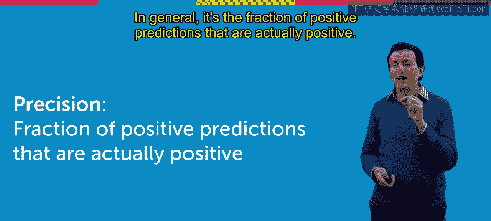
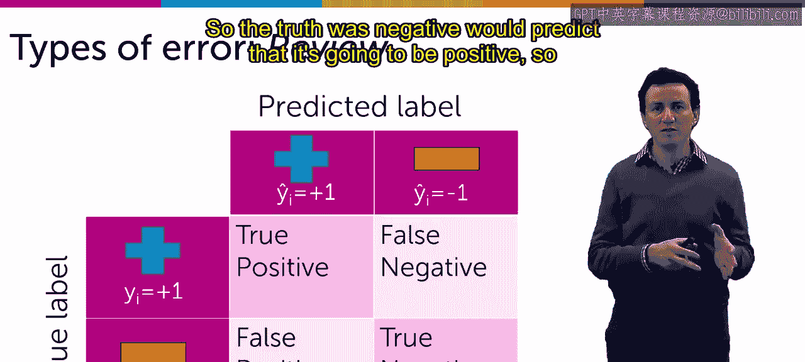
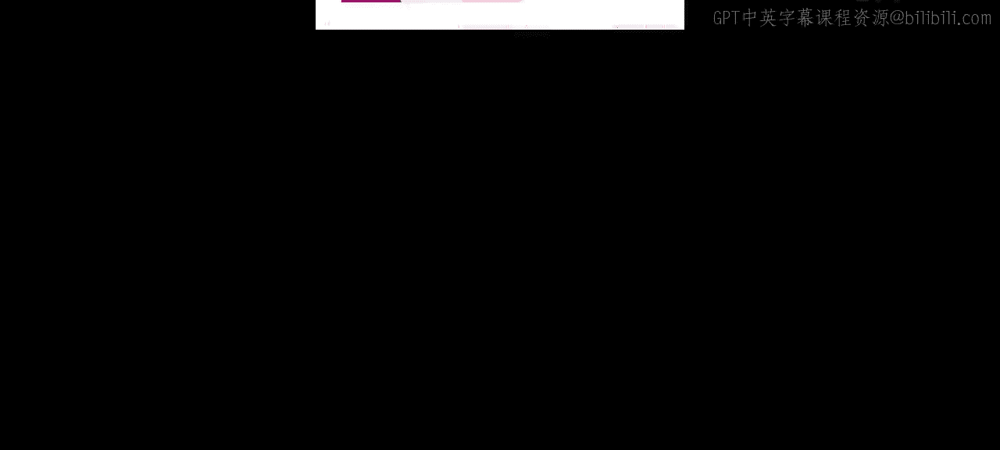
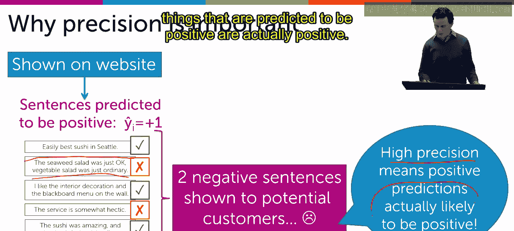

# 机器学习（分类，聚类和检索）：第3-4课：精确率：实际为正的正预测比例

在本节课中，我们将要学习一个重要的分类评估指标——精确率。我们将了解其正式定义，并通过一个具体的例子来理解它在实际应用中的意义。

## 定义精确率

上一节我们介绍了分类任务的基本概念，本节中我们来看看如何衡量分类器在预测“正类”时的准确性。

精确率衡量的是，在所有被模型预测为“正类”的样本中，有多少是真正的“正类”。其核心思想是评估“正类预测”的准确度。

**公式**：`精确率 = 真阳性 / (真阳性 + 假阳性)`

## 理解混淆矩阵

为了更清晰地计算精确率，我们需要引入混淆矩阵的概念。混淆矩阵可以帮助我们区分四种不同的预测结果。

以下是混淆矩阵中四种情况的定义：

*   **真阳性**：真实标签为正，预测标签也为正。
*   **真阴性**：真实标签为负，预测标签也为负。
*   **假阴性**：真实标签为正，但预测标签为负。
*   **假阳性**：真实标签为负，但预测标签为正。

## 通过例子理解错误类型

现在，我们通过一个餐厅评论筛选的例子来具体感受假阳性和假阴性带来的不同影响。

假设我们有一个模型，用于判断餐厅评论是正面还是负面，并决定是否将其展示在网站上。

*   **假阴性**：一条真实的正面评论被模型预测为负面。这意味着我们错过了一条好评，没有把它展示出来。虽然不理想，但后果相对较轻。
*   **假阳性**：一条真实的负面评论被模型预测为正面。这意味着我们把一条差评展示在了网站上。例如，一条说“海藻沙拉很一般”的差评被展示出来，这可能会吓跑潜在顾客，后果非常严重。

## 计算精确率

基于混淆矩阵，我们可以更精确地定义和计算精确率。

精确率是“真阳性”数量占所有“预测为正类”样本（即真阳性与假阳性之和）的比例。其最佳值为1，表示所有预测为正的样本都是真正的正类；最差值为0，表示所有预测为正的样本实际上都是负类。

回顾我们最初的例子：模型预测了6条句子为正类。其中，4条是**真阳性**，2条是**假阳性**。

**计算**：`精确率 = 4 / (4 + 2) = 4/6 ≈ 0.667`

这意味着，在模型决定展示的6条评论中，有4条是真实的好评，但有2条是混入的差评。为了维护网站声誉，我们希望模型具有高精确率，以确保展示出来的内容尽可能都是正面的。

## 总结

本节课中我们一起学习了精确率这一评估指标。我们了解到，精确率关注的是模型预测出的“正类”结果有多纯净。它通过公式 **`精确率 = 真阳性 / (真阳性 + 假阳性)`** 进行计算，特别适用于那些需要严格控制“假阳性”（即误报）代价的应用场景，例如在我们的例子中，避免将差评展示在网站上。