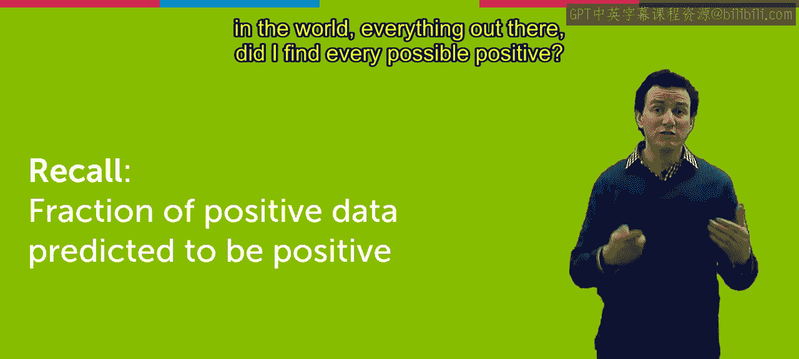
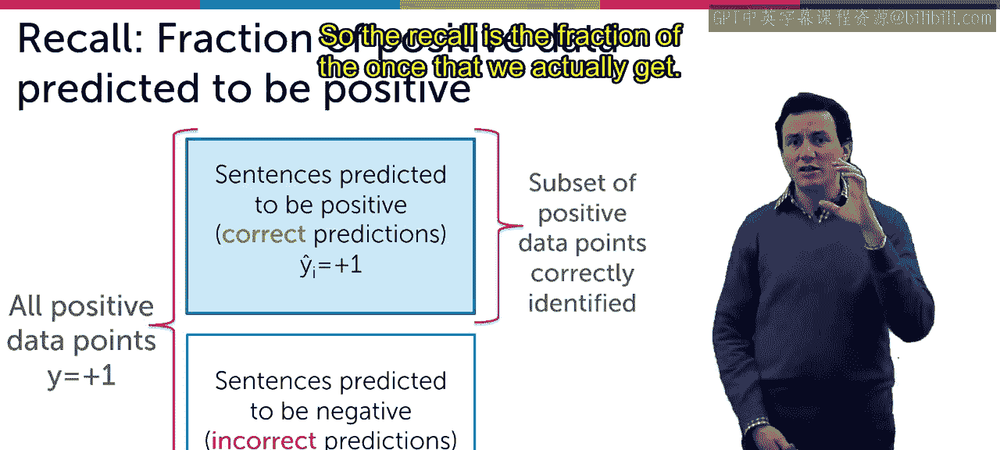
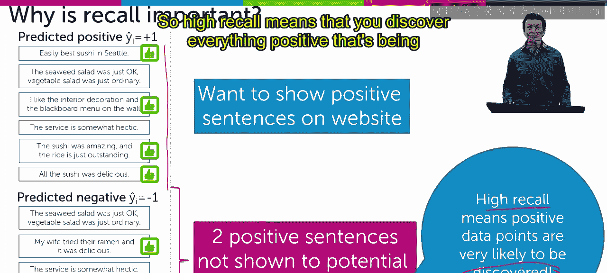
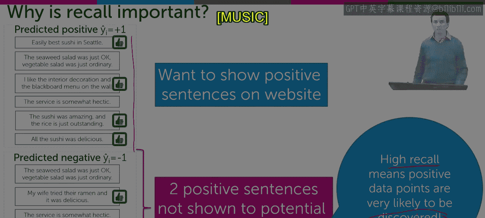

# 华盛顿大学《机器学习（分类，聚类和检索，第3-4课⧸共4课）｜Machine Learning》中英字幕 p101 100_召回率：被预测为正的正样本比例.zh_en -BV1Sr421F7N7_p101-

。

Now that we explore the idea of precision， let's talk about slightly more subtle idea of recall and recall has to do with out of the possible positive things in the world。

 everything out there， did I find every possible positive sentence about my restroom？

So more specifically， I might take all the restaurant reviews and all the sentences and feed it through my classifier and then classify some of those as positive and some of those as negative。

 so some have Y hat equals plus one， some have Y hat equals minus1。😊，Now。

 if I look at the true label， the true class of each one of the sentences。 So why I。

Which ones have plus one， you see that four of those were predicted to be positive just like we talked earlier in the module。

 but there turned out to be two other sentences。They were truly positive that my algorithm did not find that fell into the negative bin。

 so those are missed out。So in other words， we found the four positive sentences。

 but weed out on two positive sentences that could have shown on my website and indeed those two sentences were so amazing。

That would change the history of my restaurant， but I missed it because I did not have perfect recall。

So more formally， out of all the truly positive data points， so the ones where Yi is plus one。

We can have a subset of those that we do capture， so where Y hat is also plus one。

But there's a subset which we don't capture where we think the Y hat is minus1。

 so Y hat does not agree with Y and so that's the part that we miss。

 So the recall is the fraction of the ones that we actually get。

 we want everything to be in the blue box here。

More formally， we can define recall as the fraction of true positives。

 so these are the data points that we were positive and we got them right divided by the true positives。

And the false negative。 So these were the data points that were true， but we labeled as negative。

 So falsely labeled as negative。 And so this is going to have value 1， if the true positives。

So if the false negatives are zero， which means we captured everything。

 we captured all the true positives and zero， if we did not capture any true positives。

 so all the positive data went to the false negative bin。

So if we go back to the example that weve been looking at。

 I want to show positive sentences on my website， I got four of them。In Y hat I equal plus one。

 but I missed out on two sentences。 So， for example。

 I missed out on a sentence and said my wife tried the ramen and it was delicious。

 And so maybe somebody's interesting ramen。 They don't see that sentence。

 They don't go to my website。 And so I missed out on something really good。

 So a high recall means that you discover everything positive that's being said about the restaurant or all the positive data points。

