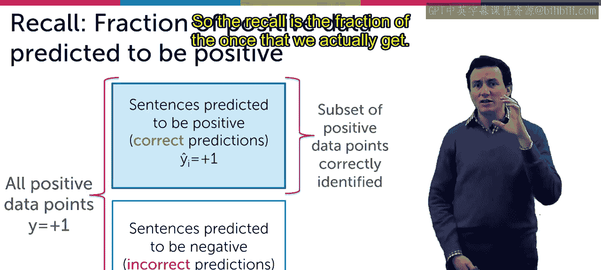
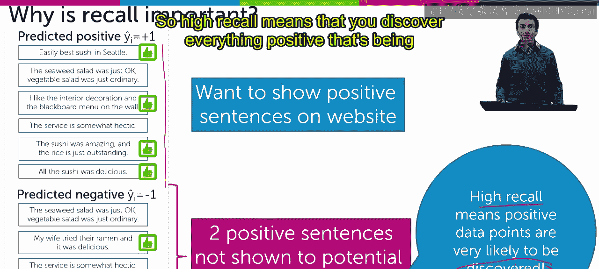
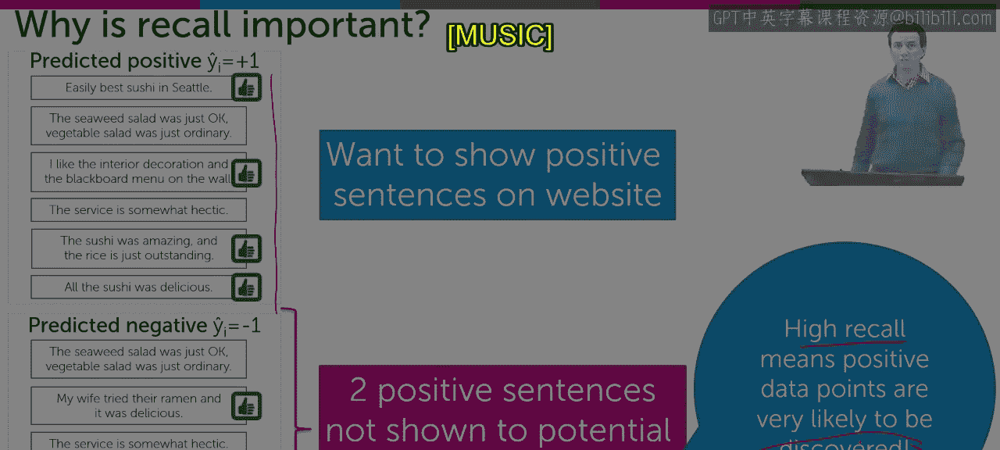

# 机器学习（分类，聚类和检索）：第3-4课：召回率详解 📊

在本节课中，我们将要学习分类模型评估中的一个核心指标——召回率。上一节我们介绍了精确率，它衡量了被模型预测为正的样本中，有多少是真正的正样本。本节中我们来看看召回率，它关注的是所有真正的正样本中，有多少被模型成功“召回”或识别出来。

## 召回率的核心概念

召回率关注的问题是：在所有实际为正的样本中，我的模型成功找出了多少？在餐厅评论的例子中，这意味着在所有真正称赞餐厅的句子中，我的分类器成功识别出了多少句。

我们可以用以下公式来定义召回率：

**召回率 = 真正例 / (真正例 + 假反例)**

其中：
*   **真正例**：实际为正，且被模型预测为正的样本。
*   **假反例**：实际为正，但被模型错误预测为负的样本。

## 通过示例理解召回率

为了更好地理解，让我们看一个具体的例子。假设我们有一个分类器，用于判断餐厅评论中的句子是否为正面评价。

以下是分类器对所有句子进行预测和真实情况的可视化：

在上图中，分类器预测了一些句子为正面（`Y_hat = +1`），一些为负面（`Y_hat = -1`）。然而，当我们查看这些句子的真实标签（`Y`）时，情况如下：

从图中我们可以看到：
*   分类器成功预测了4个真正的正面句子（真正例）。
*   但是，还有2个真正的正面句子被分类器错误地预测为负面（假反例）。

这意味着，虽然我们找到了4句正面评价，但也错过了2句。如果这两句评价非常精彩，错过它们可能会影响餐厅的声誉和吸引力。这就是召回率不完美的代价。

## 召回率的计算与解释

根据定义和示例，我们可以计算召回率：

**召回率 = 4 / (4 + 2) = 4/6 ≈ 0.667**

这个结果意味着，我们的模型成功找出了所有正面评价中的约66.7%。

以下是关于召回率值的关键解读：
*   **召回率 = 1**：这是最理想的情况，意味着**假反例 = 0**。模型成功捕获了所有真正的正样本，没有任何遗漏。
*   **召回率 = 0**：这是最糟糕的情况，意味着**真正例 = 0**。模型没有成功识别出任何一个真正的正样本，所有正样本都被错误地归类为负样本。

回到我们的餐厅例子，高召回率意味着你几乎发现了所有关于餐厅的正面评价，没有让任何好评“漏网”。

## 精确率与召回率的权衡

在实际应用中，精确率和召回率往往是一对需要权衡的指标。提高分类阈值（使模型更“谨慎”地预测为正）通常会提升精确率（因为预测为正的样本更可能是真的），但会降低召回率（因为一些真正的正样本会被排除）。反之，降低阈值会提升召回率，但可能引入更多误报，从而降低精确率。

理解这种权衡对于根据具体业务需求调整模型至关重要。例如，在疾病筛查中，我们可能宁愿接受较低的精确率（一些误报），也要追求极高的召回率（尽可能不漏掉任何病人）。

## 总结

本节课中我们一起学习了召回率这一重要的分类模型评估指标。

*   **召回率**衡量的是模型找出所有正样本的能力。
*   其**公式**为：**召回率 = 真正例 / (真正例 + 假反例)**。
*   高召回率意味着模型遗漏的正样本很少，这对于“宁可错杀，不可放过”的应用场景（如垃圾邮件过滤、安全隐患排查）非常重要。
*   召回率与精确率需要根据实际需求进行权衡。

理解并合理运用召回率，能帮助你更全面地评估分类模型的性能，并做出更符合业务目标的决策。