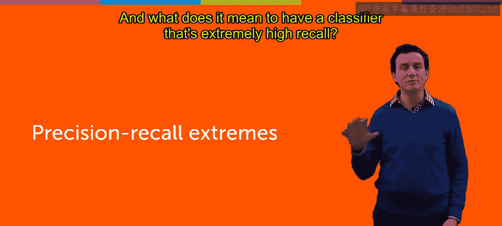
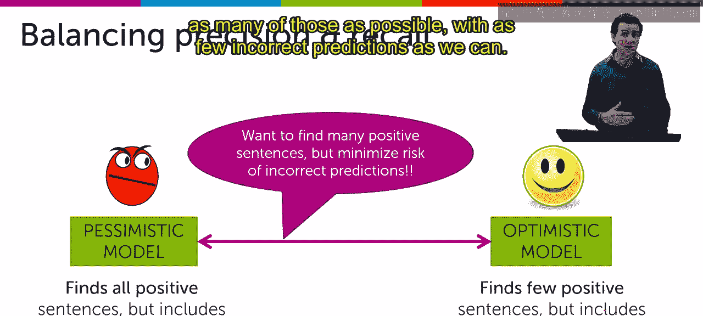
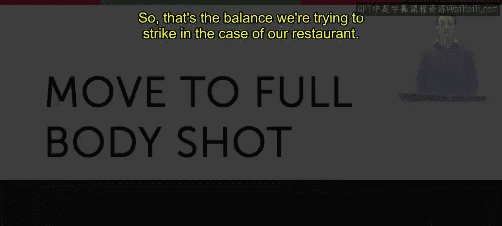

# 华盛顿大学《机器学习（分类，聚类和检索，第3-4课⧸共4课）｜Machine Learning》中英字幕 p102 101_精确率和召回率的极端情况.zh_en -BV1Sr421F7N7_p102-

。

To understand the trade off between precision and recall。

 it's important for us to look at the two extremes。

 what does it mean to have a classifier that's extremely precise and what does it mean to have a classifier that's extremely high recall and how the two can be go against each other sometimes。

So first， let's think about what I call an optimistic classifier。

 You might know some of this optim in your life。 They think everything is good。 as they' going good。

 even bad stuff is happening， they say good。 And so those folks say that all possible experiences are good。

 So they're optim。 That means that pretty much every input， every sentence is labeled as positive。

 very few get labeled as negative。 And so it's extremely likely that all the truly positive data points get labeled as。

😊，Good， and what does that mean， that means that I have perfect。Recall。

Because I recall all those positive data points， but I might not get。

Perfect precision because I put in a bunch of negatives into that bin。

So how can we address that while you can have that？Psimistic classifier。

 you might have some friends like that where you try really hard， you do everything for them。

 you go out of your way and everything sucks。Every single experience that you have is really bad so there's very。

 very， very， very few things that they say they're good and when they are they're you know very likely to be good。

 but everything else you says is bad so everything else that levels y high equal minus1 pessimist means that you're gonna to miss out on many good things in life。

😊，So the pessimists have high precision because the few things the label is good tend to be good。

 but very， very very low recall， they don't identify great things in life。

So it turns out there is a spectrum between a high precision low recall model and a low precision high recall model。

 the pessimist and the optimist， and what would like to do is somehow balance between the two perspectives in the world to find something that is just right for us。

 so balance between that pessimistic model and that optimistic model。And in particular。

 we want to find as many positive reviews or sentences as possible。

 as many of those as possible with as few incorrect predictions as we can。

So that's the balance that we're trying to strike in the case of our restaurant。

