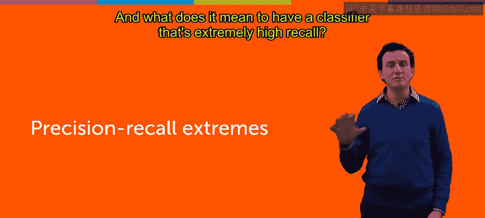
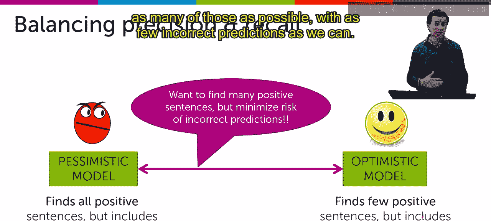

# 机器学习（分类，聚类和检索）：第3-4课：精确率与召回率的极端情况

在本节课中，我们将要学习精确率与召回率这两个评估指标之间的权衡关系。为了深入理解这种权衡，我们将探讨两种极端情况：一个极端追求高精确率的分类器，以及另一个极端追求高召回率的分类器。通过分析这两种极端，我们能更好地理解它们如何相互制约，并找到适合我们需求的平衡点。

## 理解精确率与召回率的权衡

上一节我们介绍了精确率和召回率的基本概念。本节中，我们来看看这两个指标在极端情况下的表现。理解这种权衡关系，关键在于审视两种极端分类器的行为：一种是追求极致精确率的分类器，另一种是追求极致召回率的分类器，以及它们有时如何相互对立。

## 极端情况分析：乐观与悲观的分类器

首先，让我们思考一种我称之为“乐观”的分类器。这种分类器就像生活中的某些乐观主义者，他们认为所有事情都是好的。即使发生了不好的事情，他们也会说“好”。因此，这类分类器会将几乎所有输入都标记为“正面”。

以下是乐观分类器的特点：
*   **行为**：几乎每个输入句子都被标记为正面，极少被标记为负面。
*   **结果**：所有真正正面的数据点极有可能都被标记为正面。
*   **指标影响**：这意味着我们拥有完美的**召回率**，因为我们找回了所有正面数据点。但我们可能无法获得完美的**精确率**，因为我们把一大堆负面数据也放进了“正面”这个桶里。

那么，如何应对这种情况呢？我们可以考虑另一种“悲观”的分类器。这种分类器就像那些悲观的朋友，无论你多么努力，为他们做多少事，他们都觉得一切都很糟糕。他们极少有事情会说是“好”的，而一旦他们说好，那件事很可能确实很好，但其他所有事情都被他们标记为“坏”。

以下是悲观分类器的特点：
*   **行为**：极少将事物标记为正面（例如，标记为+1），其他一切都标记为负面（-1）。
*   **结果**：悲观者会错过生活中的许多美好事物。
*   **指标影响**：悲观者拥有高**精确率**，因为他们标记为“好”的少数事物往往确实是好的。但他们的**召回率**非常非常低，因为他们无法识别出生活中的大量美好事物。

## 在极端之间寻找平衡

由此可见，在高精确率、低召回率的模型（悲观者）与低精确率、高召回率的模型（乐观者）之间，存在一个光谱。我们的目标是在这两种世界观之间找到某种平衡，找到一个对我们来说“恰到好处”的点，即在悲观模型和乐观模型之间取得平衡。

具体而言，我们希望：
*   尽可能多地找出正面评价或句子（高召回率）。
*   同时，尽可能减少错误的预测（高精确率）。

这就是我们在餐厅评论分类案例中试图达成的平衡。

## 总结

本节课中，我们一起学习了精确率与召回率之间的权衡关系。我们通过分析“乐观”和“悲观”这两种极端分类器，理解了高召回率往往以牺牲精确率为代价，而高精确率则可能导致召回率降低。在实际应用中，我们需要根据具体任务的目标，在这两个指标之间找到合适的平衡点。