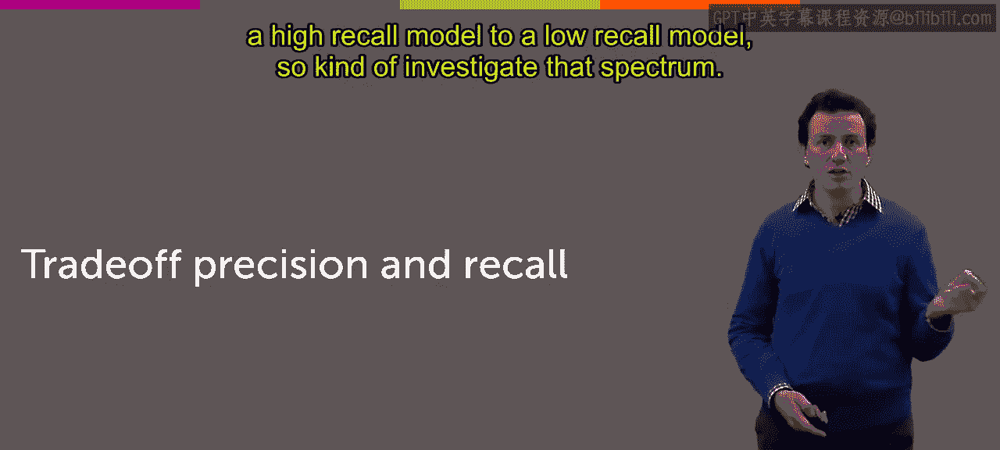
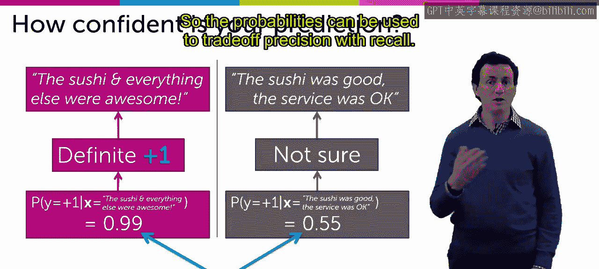
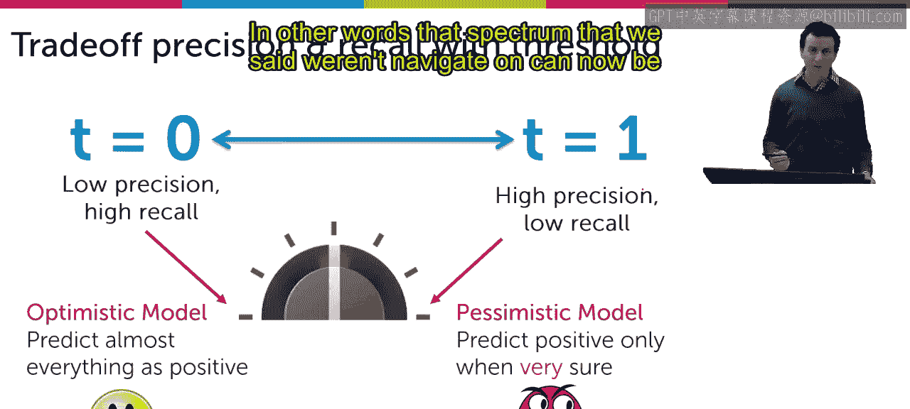
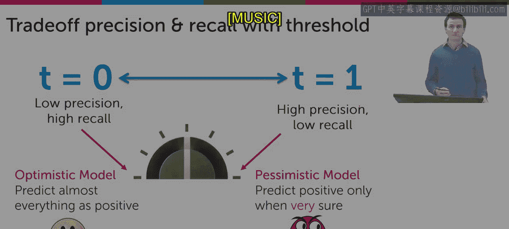

# 华盛顿大学《机器学习（分类，聚类和检索，第3-4课⧸共4课）｜Machine Learning》中英字幕 p103 102_权衡精确率和召回率.zh_en -BV1Sr421F7N7_p103-

。

Thus far weve talked about precision， recall， optimism， pessimism， all sorts of different aspects。

 but one of the most surprising things about this whole story is that it's quite easy to navigate from a low precision model。

To a high precision model from a high recall model to low recall model。

 So kind of investigate that spectrum so we can have a low precision high recall model that's very optimistic。

 You can have a high precision， low recall model that's very pessimistic。

 And then it turns out that it's easy to find a path in between。 And the question is。

 how do we do that。

嗯。If you recall from earlier in this course， we have assigned not just a label plus1 and minus1 of every data point。

 but a probability number， let's say 0。99 of being positive for the su and everything else were awesome to say 0。

55 of being positive for the su was good， the service was okay。😊。

These probabilities I mentioned earlier in the course that they're going to be fundamentally useful。

 Now you're going to see a place where they're amazingly useful。

 so the probabilities can be used to trade off。😊，Precision with recall， and so let's figure that out。

So early in the course， we just had a fixed threshold to decide if an input sentence Xi was going to be positive or negative。

 we said it's going to be positive， if the probability is greater than 0。

5 and it's going to be negative， if the probability is less than 0。5 or less or equal。😊，Now。

 how can we create an optimistic and pessimistic model by just changing that 0。5 threshold。

 Let's explore that idea。Think about what would happen if we set the threshold itself being 0。

5 to be 0。999。So a data point is only plus one if its probability is greater than 0。999。Well。

Here's what happened。 Very few data points would satisfy this。

So if very few data points satisfy this， then very few data points be plus1。

 the vast majority would be labeled as minus1， and we call this classifier the pessimistic classifier。

Now， alternatively， if we change the threshold to be 0。001， then that means that any experience。😊。

Is going to be labeled as positive。 So almost。All of the data points are going to satisfy this condition。

 so we're going to say that everything is plus  one。😊。

And so this is going to be the optimistic classifier， it's going to be say， yeah。

 everything is plus one， everything' is good。😊，So by vary that threshold from 0。

5 to something close to 0 to something close to 1， we're going to change between optimism and pessimism so if we go back to this picture of logistic regression for example it a concrete case。

 we had this input the score。Of x。And the output here was the probability that y is equal to plus 1 given x and w。

It should bring some memories， maybe some sad side memories。

 the threshold here is going to be a cut where we say set y had to be equals plus1。

 if it's greater then the equalco to this threshold T so everything here above the line would be plus1 and everything below the line would be labeled as minus1。

😊，More concretely， let's see what happens if we set the threshold to be some very， very high number。

 so T here is close。to1 so if T is some number close to one。

 then everything below that line will be labeled as minus1 and very。

 very few few things that above the line here can be labeled as plus one。

 so that's why I would end up with a pessimistic classifier。On the flip side。

 if we set the teeth threshold to be something very， very small。So， this is。呃 small。T。

Then everything is going to be above that line， so everything is going to be labeled as plus one and very few data points are going to be labeled as minus1。

 so we end up with the optimistic classifier， so ranging T from0 to1 takes us from optimism to pessimism。

In other words， that spectrum that we said we want to navigate on can now be navigated for a single parameter t that goes between0 and 1。

🎼。