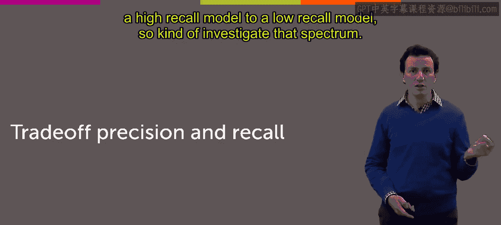
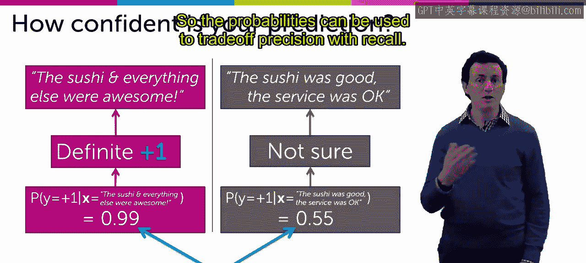
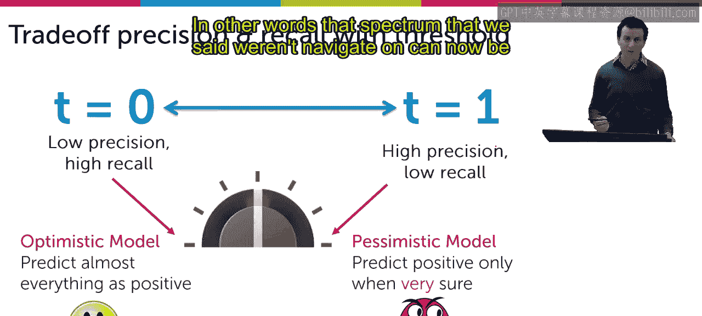
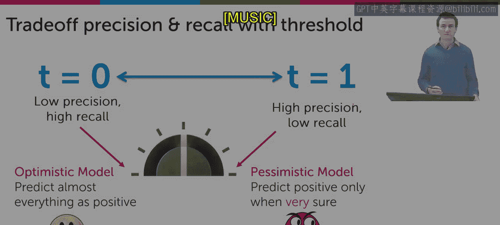

# 机器学习（分类，聚类和检索）：第3-4课：权衡精确率与召回率

在本节课中，我们将学习如何通过调整一个简单的参数，在精确率与召回率之间进行权衡。我们将看到，一个模型可以从“乐观”的高召回率、低精确率状态，平滑地过渡到“悲观”的低召回率、高精确率状态。

---

到目前为止，我们讨论了精确率、召回率、乐观模型、悲观模型等不同方面。但整个故事中最令人惊讶的一点是，从低精确率模型过渡到高精确率模型，或者从高召回率模型过渡到低召回率模型，其实非常容易。

我们可以拥有一个非常乐观的低精确率、高召回率模型，也可以拥有一个非常悲观的高精确率、低召回率模型。事实证明，在这两者之间找到一条路径很容易。问题是，我们如何做到这一点？

---

在本课程早期，我们不仅为每个数据点分配了标签（+1 或 -1），还分配了一个概率值。例如，某个评论有 0.99 的概率是正面的，另一个评论有 0.55 的概率是正面的。

这些概率值在课程早期被提及，它们将具有根本性的作用。现在，你将看到一个它们发挥惊人作用的场景：概率可以用来在精确率和召回率之间进行权衡。让我们来弄清楚这一点。

---

在课程早期，我们使用一个固定的阈值来决定一个输入句子 Xi 是正面还是负面。我们规定，如果概率大于 0.5，则为正面；如果概率小于或等于 0.5，则为负面。

那么，我们如何仅仅通过改变这个 0.5 的阈值来创建一个乐观或悲观的模型呢？让我们探讨这个想法。

考虑一下，如果我们将阈值从 0.5 设置为 0.999 会发生什么。这意味着一个数据点只有在概率大于 0.999 时才会被标记为 +1。结果就是，只有极少数数据点能满足这个条件。

因此，如果只有极少数数据点满足条件，那么只有极少数数据点会被标记为 +1，绝大多数会被标记为 -1。我们称这个分类器为**悲观分类器**。

相反，如果我们将阈值改为 0.001，那么几乎任何体验都会被标记为正面。几乎所有数据点都会满足这个条件，因此我们会说所有东西都是 +1。这就是**乐观分类器**，它会认为一切都好。

因此，通过将阈值从 0.5 调整到接近 0 或接近 1 的值，我们就在乐观和悲观之间切换。

让我们回到逻辑回归的具体例子来理解。我们有一个输入分数 `score(x)`，输出是给定 x 和 w 时 y 等于 +1 的概率 `P(y=+1 | x, w)`。

这里的阈值 `T` 是一个分界点，我们规定：如果概率大于或等于 `T`，则预测 `ŷ` 为 +1；否则为 -1。在概率曲线上方的一切都会被标记为 +1，下方的一切则标记为 -1。

更具体地说：
*   如果我们将阈值 `T` 设置为一个非常高的值（接近 1），那么阈值线以下的几乎所有点都会被标记为 -1，只有极少数高于阈值的点被标记为 +1。这就是我们最终得到悲观分类器的原因。
*   另一方面，如果我们将阈值 `T` 设置为一个非常小的值（接近 0），那么几乎所有点都在阈值线上方，因此几乎所有点都被标记为 +1，只有极少数被标记为 -1。这样我们就得到了乐观分类器。

因此，让阈值 `T` 在 0 到 1 之间变化，就能让我们在从乐观到悲观的整个光谱上导航。换句话说，我们想要探索的那个权衡谱，现在可以通过一个在 0 到 1 之间变化的单一参数 `T` 来实现。

---

**总结**
本节课中，我们一起学习了如何利用分类模型输出的概率值，通过调整一个简单的**决策阈值 `T`**，来系统地权衡精确率与召回率。
*   将阈值 `T` 设置得很高（例如 0.999）会得到一个**悲观分类器**，它具有**高精确率、低召回率**的特点。
*   将阈值 `T` 设置得很低（例如 0.001）会得到一个**乐观分类器**，它具有**低精确率、高召回率**的特点。
通过平滑地调整 `T` 从 0 到 1，我们可以在两者之间找到满足特定业务需求的平衡点。