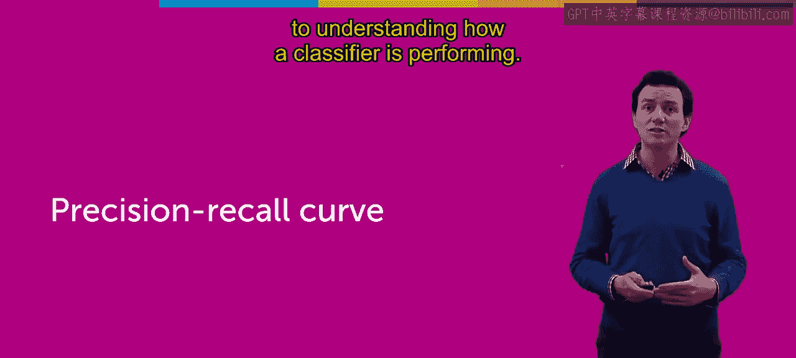
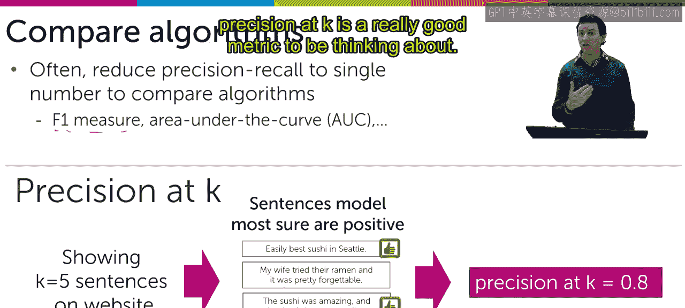

# 华盛顿大学《机器学习（分类，聚类和检索，第3-4课⧸共4课）｜Machine Learning》中英字幕 p104 103_精确率-召回率曲线.zh_en -BV1Sr421F7N7_p104-

。

We saw how we could change the threshold from0 to one for deciding what' supposed positive the value to navigate between the optimistic classifier and the pessimistic classifier。

 This is an actually really intuitive visualization that does this It's called the precision recall curve。

 precision recall curves are extremely useful to understanding how your classifier is performing。

 So in this case， you can imagine setting two points in that curve。

 What happens to the precision once you。😊。

Your threshold is very close to one。 Well， precision is going to be one because you're going to get everything right。

 There's very very few things and you're very sure they're going to correct。

 but the recall is going to be zero because you're going to say。Everythings bad。

 everything else is bad so that's a pessimistic on the other extreme of the precision recall curve。

 the point on the bottom there is a point where the optimistic point where you have very high recall because you're going to find all the positive data points but very low precision because you're going to find all sorts of other stuff and say that's still good and so that happens when t is very small close to zero。

😊，Now if you keep wearingingy you have a spectrum of tradeoffs between precision and recall so if you want a model that has a little bit more recall but still highly precise。

 maybe you set t equals 0。8 but if you really want really really high recall but you know trying to improve the precision a little bit maybe you set t to 0。

2 and you can navigate that spectrum and explore the tradeoff between precision and recall now。

That doesn't always have to be afraid off。 If you had a really perfect classifier。

 you might have a curve that looks like this。 This is kind of the world's ideal where you have perfect precision where no matter what your recall level。

 this line basically never happens。 but that's kind of the ideal。

 That's where you're trying to get to is that kind of flat line at the top。

 So the more your algorithm is closer to the flat line at the top。😊，The better it is。

 And so precision recalls curves can be used to compare algorithms in addition to understanding one。

 So， for example， let's say you have two classifiers， the classifier A and classifier B。

And you see that for every single point， classifier B is higher than classifier A。In that case。

 we can always prefer classifier B no matter what the threshold is。

 classifier B always gives you a better precision for the same recall。

 better precision for the same recall， so B is always better however life is not always this simple。

If there is one thing you should learn about machine learning thus fire is that life in practice tends to be a bit messy and so often what you'll observe is not classifier A and B like we saw it's classifier A and C like we're seeing over here where there might be one or more cutoff points where classifier a。

😊，Does better in some regions of the precision recall curve where classifier B does better than others。

 so for example or C in this case， so for example， if you're interested in very high precision but our K of flow recall then you should pick classifier C because it does better in that region is higher up closer to that flat line。

But if you cared about getting high recall。Then you should choose classifier a because in the high recall regime when you pick T's。

 they're larger， sorry smaller than classifier a tends to do better。

 so you see its curve is higher over here。So that's a。

Kind of complexity of dealing with machine learning in the real world。 Now。

 if you just had to pick one classifier， the question is how do you decide。

 How do you choose between A and C in this case。And you often need a single number to decide as those hinting at depends on where you want to be in the precision tradeoff curve and there's many metrics out there to try to do single numbers like something called FO measures。

 something called area under the curve。I'm less fond of those measures myself for a lot of applications than I am of one it's much simpler。

 which is's called precisionciion at K and let me talk about that because a really simple measure really extremely useful。

So let's say that there's five slots on my website to show sentences。 That's all I care about。

 I want to show five great sentences on my website。 I don't have room for 10 million for5 million。

 just for five。And。I show five sentences there， four grade。And one sucked。

I want all five to be great。So I won my precision for the five top sentences。

For the top five to be as good as possible。 in this case， our precision was 4 hour 5，0。8。

 So I ended up putting a sentence in there and said， my wife tried the ramen。

 and it was pretty forgettable。That's kind of disappointing thing to put in so for many applications like recommender systems for example。

 where you go to a web page and somebody is showing you some products might want to buy precision that K is a really good metric to be thinking about。

