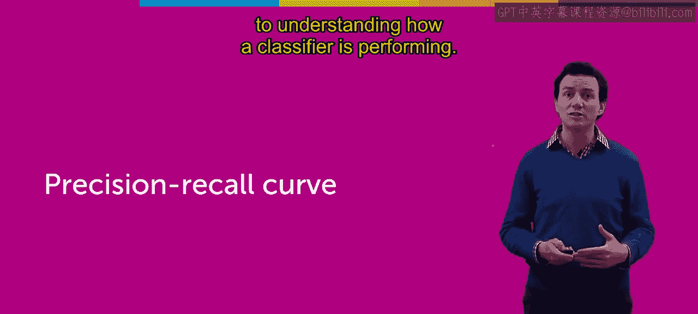
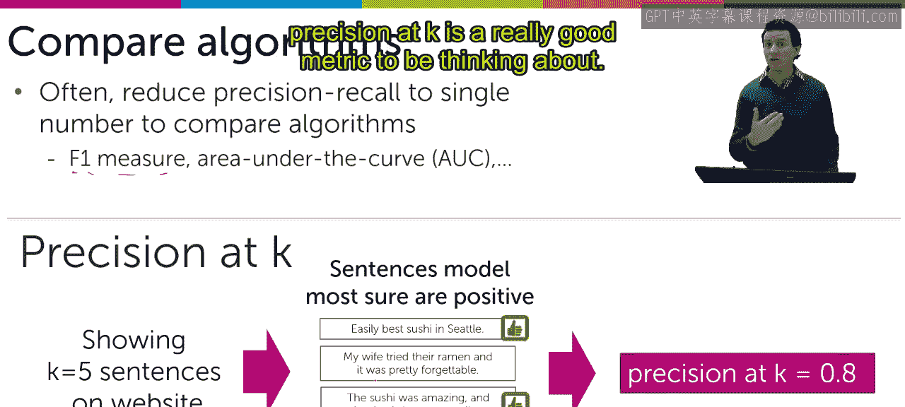

# 机器学习（分类，聚类和检索）：第3-4课：精确率-召回率曲线 📈

在本节课中，我们将学习一个用于评估分类器性能的强大工具——精确率-召回率曲线。我们将了解如何通过调整分类阈值来权衡精确率和召回率，以及如何利用该曲线比较不同分类器的优劣。

---

上一节我们介绍了通过调整阈值可以在乐观分类器和悲观分类器之间切换。本节中，我们来看看一个能直观展示这种权衡关系的可视化工具。

精确率-召回率曲线是理解分类器性能的极其有用的工具。

以下是关于曲线两端点的解释：

*   **当阈值非常接近1时**：分类器变得非常“悲观”。此时，**精确率**会非常高（接近1），因为你只对极少数非常有把握的样本预测为正类，并且它们很可能是正确的。然而，**召回率**会非常低（接近0），因为你会漏掉绝大多数真正的正类样本。
*   **当阈值非常接近0时**：分类器变得非常“乐观”。此时，**召回率**会非常高（接近1），因为你几乎能找到所有真正的正类样本。但是，**精确率**会非常低，因为你也会将许多负类样本错误地预测为正类。

通过不断调整阈值 `t`，你可以在精确率和召回率之间获得一系列的权衡点。例如，如果你想要一个召回率稍高但仍保持高精确率的模型，可以设置 `t = 0.8`。如果你追求极高的召回率，并愿意牺牲一些精确率，可以设置 `t = 0.2`。你可以通过探索这条曲线来理解两者之间的权衡关系。

---

这种权衡关系并非总是无法避免的。一个完美的分类器，其精确率-召回率曲线会呈现一种理想形态。

理想情况下，无论召回率水平如何，精确率都能保持在1。这条位于顶部的水平线是所有分类器追求的目标。你的算法曲线越接近顶部这条水平线，其性能就越好。

因此，精确率-召回率曲线不仅可以用来理解单个分类器，还可以用于比较不同算法。

---

例如，假设你有两个分类器A和B。如果在曲线的每一个点上，分类器B的精确率都高于分类器A，那么无论阈值如何选择，分类器B总是更优的选择，因为它能在相同的召回率下提供更高的精确率。

然而，现实情况往往更为复杂。在实践中，你更可能遇到的是像分类器A和C这样的情况。

它们的曲线存在交叉。在某些精确率-召回率区域，一个分类器表现更好，而在其他区域，另一个分类器更优。

以下是具体的选择策略：

*   如果你关注**高精确率**，即使召回率较低也可以接受，那么应该选择**分类器C**，因为在该区域它的曲线位置更高。
*   如果你追求**高召回率**，那么应该选择**分类器A**，因为在召回率较高的区域（对应较小的阈值 `t`），它的表现更佳。

这体现了现实世界机器学习应用的复杂性。

---

如果你必须只选择一个分类器，问题就变成了：在这种情况下，如何在A和C之间做决定？通常你需要一个单一的数字指标来帮助决策。

这取决于你在精确率-召回率权衡曲线上的目标位置。存在许多试图用一个数字来概括性能的指标，例如 **F1分数** 或 **曲线下面积**。

对于许多应用，我个人更偏爱一个更简单但极其有用的指标，称为 **K值精确率**。

假设我的网站只有5个位置来展示句子。我只关心展示在前5位的句子质量，我希望它们尽可能都是好评。

在这种情况下，我关心的指标就是**前K个结果的精确率**，其中 `K = 5`。如果前5个句子中有4个是好评，1个是差评，那么我的 **`Precision@5`** 就是 `4/5 = 0.8`。

对于像推荐系统这样的应用，当你访问一个网页，系统向你展示一些你可能想购买的产品时，**K值精确率**是一个非常好的考量指标。

---

本节课中我们一起学习了精确率-召回率曲线。我们了解了它如何可视化精确率与召回率之间的权衡，如何用于比较不同分类器在特定需求下的优劣，并介绍了一个在实际应用中非常实用的单一指标——K值精确率。理解这些工具将帮助你更好地评估和选择适合具体场景的机器学习模型。