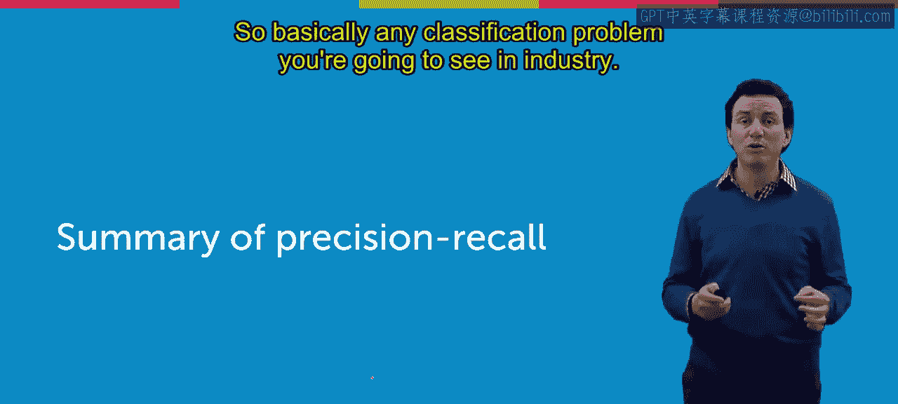

# 华盛顿大学《机器学习（分类，聚类和检索，第3-4课⧸共4课）｜Machine Learning》中英字幕 p105 104_精确率和召回率的回顾.zh_en -BV1Sr421F7N7_p105-

。

In this module we discussed a very important fundamental concept which is evaluating classifiers。

 and in particular we talked about precision recall。

 which is a concept that's widely used way beyond some of the classifiers we talked about here to basically any classification problem we're going to see in industry。

😊。

We saw that just straight accuracy or error metrics might not be the right things for your application and you need to look at something else and precision recall is one of the first things you might want to look at precision captures the fraction of your top of positive predictions that are actually positive and recall talks about of all the positive predictions positive sentence out there which ones that you find which ones that you labels positive so we talked about the tradeoffs between precision and recall and how you can navigate that tradeoff with that tradeoff parameter T in terms of the probability and really get this beautiful precision tradeoff curves。

😊，And finally， we talked about comparing models with this precision at K metric。

 which is one that I particularly like for a lot of applications。

I want to take a moment here to thank my colleague， Krishna Sriar。

 who was instrumental at helping the slides come together and creating the ideas behind this module。

