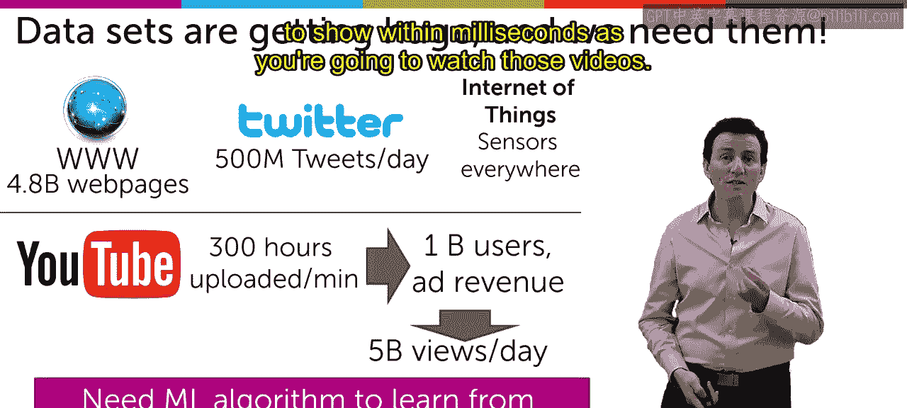

# 华盛顿大学《机器学习（分类，聚类和检索，第3-4课⧸共4课）｜Machine Learning》中英字幕 p106 105_梯度上升法无法扩展到当今的大型数据集.zh_en -BV1Sr421F7N7_p106-

。

In this module we're going to address a really important problem in machine learning today how to scale the algorithms we discussed to really large data sets。

 the ideas we discussed today are going to be broadly applicable。

 they're going to be applicable for all of classification they're also going to be applicable even for the regression course or the second course of the specialization We're going to talk about the technique called stochastic gradient。

😊，And when related to something called online learning， where you're learning from data streams。

 where one piece of data is arriving at a time。Let's take a moment to review how gradient ascent works in the context of classification and how it's impacted by the dataset set size。

😊，So we have a very large data set here and we have a several coefficient WT which we're hoping to update so we're going to use gradient set we're going to compute a gradient on this data set which requires us to make a pass or scan over the data computing the contribution of each one of these data points to the gradient。

 then we compute a gradient and we'll go ahead and update a parameters， then we get WT plus one。😊。

Now we have to go back to the dataset and make another pass where we visit every single data point and we go complete the new gradient and update the parameters。

 the coefficients and get WT plus 2。So in this process。

 every time we're going to do a coefficient update。

 we're going to have to make a full scan or a full passover the entire data。

 which can be really slow if the data is really big。😊，And these days datas are getting huge。

 you can think about the 4。8 billion web pages that are out there on the web。

 you can think about the fact that Twitter for example， is generating 500 million tweets a day。

 that's a lot， by the way， following me on Twitter。😊。

Or you can think about even how the world is getting embedded with sensors。

 which something we today call internet things where you have devices throughout the homes。

 devices we carry with us， like the smartwatch here and everything else connected to each other。

Generating tons and tons of tons of data。And you can think about specific websites like YouTube。

 where 300 hours of video uploaded every minute and nobody watches them。

And this is a really fundamental problem for machine learning how to tackle this huge massive data sets。

 let's use YouTube as an example， we have the tos of videos being uploaded and there's a billion users who are visiting this website。

😊，And YouTube makes money out of ad revenue out of showing the right ad to each one of these users。

Now the number you should be thinking about is not 300 hours of video minute or 1 billion users。

 but you should be thinking about the 4 billion page views or video views they have every day。

 so for each one of these page views they have to serve ads they have to figure out what ads support of those videos and they have to go back and retrain their learning algorithm in other words。

 they need a machine learning algorithm to figure out what a to show they can deal with 5 billion events per day and that's fast enough that can make predictions as to what adsd to show within milliseconds as you're going to watch those videos。

