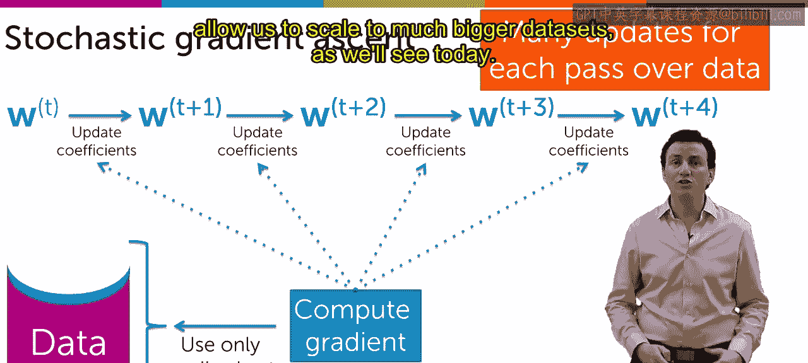

# 华盛顿大学《机器学习（分类，聚类和检索，第3-4课⧸共4课）｜Machine Learning》中英字幕 p107 106_可扩展机器学习的时间线：随机梯度.zh_en -BV1Sr421F7N7_p107-

。

It's no news to anybody the dataset sets have been getting larger over the last two decades。

 but what it's interesting is what impact has had on machine learning research and on machine learning in practice so if you look back 20 years ago datas are pretty small and so we ended up working on a lot of very complex models to be able to get the most squeeze the most out of that data because we needed good accuracy with very little data so we work on things like kernels and Gphco models so things which are pretty complex。

Ten years later， the scale of data started growing tremendously。

We to enter an area that we call big data area and。

It turns out that because it was so hard to scale machine learning algorithms。

 big data sets and because there was so much data， we reverted back to simpler algorithms。

 to simpler days。And using things like logistic rational matrix factorization to address the machine learning problem。

And。There was even a lot of discussion of what ImpactA has on machine learning approaches and there was this presnal paper that talked about the unason and reasonableason effectiveness of big data sets and what it basically says is if you have a massive data set you can use a very simple approach like a linear classfi logistic regression and beat fancy approach like Gco model because a Graphal model could only handle smaller dataset sets。

 so in bigger data sets， simple approaches can do extremely well。Well。

 since then a lot of things have changed， our data has gotten even bigger and are ambitious have gotten bigger。

 we want to be able to deal with even more accurate models on this even larger data。

 and so we're forced to come up with new kinds of algorithms that can scale up complex models to huge data sets to get really amazing accuracy。

 and this is where things like parallelisms， using GPUs。

 using big computer clusters and the type of technique that we're doing to talk about today。😊。

Are going to be helpful for us to deal with complex models， so things like boost decision trees。

 tensor factorization， deep learning， deep learning requires tremendous amount of computation time to get the amazing accuracy guess and going back to not 20 years ago people were building this massive massive graphical models because they have new techniques to scale them in parallel in distributed settings to be able to get even more accuracy with bigger data sets。

So the summary of the story is that machine learning has evolved over the last few years to first go back to its simpler route to be able to do a large data sets。

 but today to come up with new algorithms that can scale complex models to massive data sets。

 that's where we are today。😊，So we went back to the same framework we'll be discussing the whole course。

 where we're taking some training data， we're extracting some features or building some machine learning model。

 but the machine learning algorithm that we're going to use is a small modification gradient same study change。

 but it will allow us to scale to much bigger data sets and often perform really well。

This modification is called stochastic gradient and it does something extremely simple what it does is take your master data set in your current parameter there's WT and when you're computing the gradient it still looking at all the data。

😊，Because you don't need to look at everything。 It just looks at small subset of the data so it just a bit of the data and then updates the parameter to the coefficients to WT plus1 and then it looks a little bit more data and then updates the coefficients to WT plus2 then it looks at a little bit more data and updates to WT plus3 and then looks a little bit more data and updates the coefficients to WT plus4 and so instead of making a massive passive over the data before making a coefficient update here we're just looking a little bits of data and updating coefficients in a kind of interlea fashion。

 This small change is going to really change everything for us and allow us to scale to much bigger data as we'll see today。

