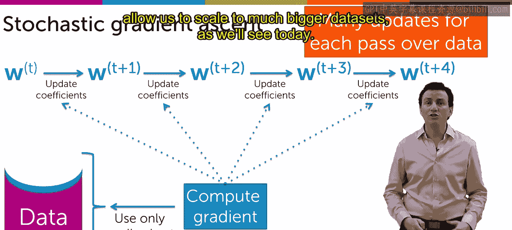

# 机器学习（分类，聚类和检索）：第3-4课：可扩展机器学习的时间线与随机梯度

在本节课中，我们将要学习机器学习如何随着数据规模的演变而发展，并介绍一种名为**随机梯度**的关键技术，它使我们能够在海量数据集上训练复杂模型。

## 概述：机器学习与数据规模的演变

过去二十年间，数据集的规模持续增长。这一变化对机器学习的研究与实践产生了深远影响。了解这段历史，有助于我们理解当前主流算法背后的设计思想。

## 从复杂到简单，再到复杂

二十年前，数据集规模普遍较小。为了从有限的数据中榨取最高的准确率，研究者们致力于开发非常复杂的模型，例如**核方法**和**图模型**。

十年后，数据规模开始急剧增长，我们进入了所谓的“大数据”时代。由于当时的机器学习算法难以扩展到如此庞大的数据集，而数据量本身又非常充足，研究趋势又回归到了更简单的算法，例如**逻辑回归**和**矩阵分解**。甚至有论文讨论了“大数据集的非理性效力”，其核心观点是：面对海量数据，使用简单的线性分类器（如逻辑回归）可能击败复杂的图模型，因为后者在当时无法有效处理大规模数据。

然而，情况继续变化。如今，数据变得更大，我们的目标也更高——我们希望在超大规模数据集上构建更精确的模型。这迫使我们必须设计新型算法，将复杂模型扩展到海量数据上，以追求惊人的准确率。**并行计算**、**GPU加速**、**大型计算机集群**以及本节课将重点讨论的**随机梯度**等技术，正是在此背景下变得至关重要。

因此，机器学习的演进路径可以总结为：首先回归简单以处理大数据，如今则致力于开发能将复杂模型扩展到海量数据的新算法。这正是我们当前所处的阶段。

## 核心框架与随机梯度的引入

我们将回到本课程一直使用的框架：获取训练数据，提取特征并构建机器学习模型。但我们将对算法做一个微小的修改——将**梯度下降**改为**随机梯度下降**。这一修改将使我们能够扩展到更大的数据集，并且通常表现优异。

以下是随机梯度下降的核心思想：

它做了一件极其简单的事：在更新参数时，不再需要遍历全部数据来计算梯度。假设当前参数为 **W_t**，随机梯度下降不会使用所有数据计算梯度，而是**随机查看数据的一小部分（一个子集）**，然后基于这一小部分数据计算出的梯度来更新参数，得到 **W_{t+1}**。接着，它再查看另一小部分数据，更新参数得到 **W_{t+2}**，如此循环往复。

与传统的梯度下降需要完整遍历一遍数据后才进行一次参数更新不同，随机梯度下降以**交错**的方式，每看一小批数据就立即更新参数。这个小小的改变将为我们带来巨大的 scalability（可扩展性）优势。

## 总结

本节课中，我们一起回顾了机器学习随数据规模增长的演变历程：从小数据时代的复杂模型，到大数据初期的简单模型回归，再到如今追求在海量数据上扩展复杂模型的新阶段。我们重点介绍了**随机梯度下降**这一关键技术，它通过每次迭代仅使用数据的一个子集来更新模型参数，从而实现了对超大规模数据集的高效训练。